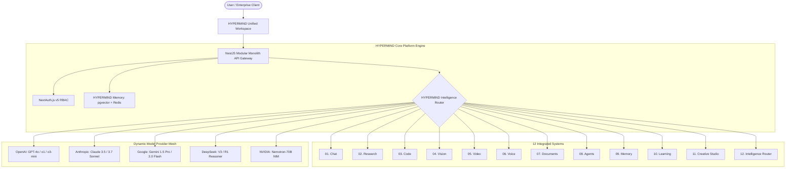
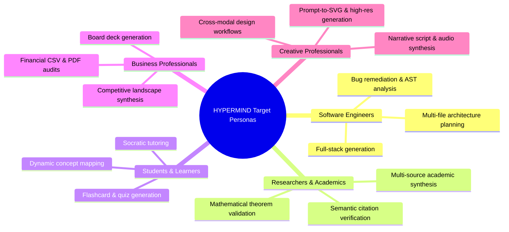
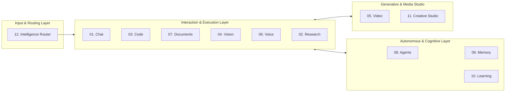
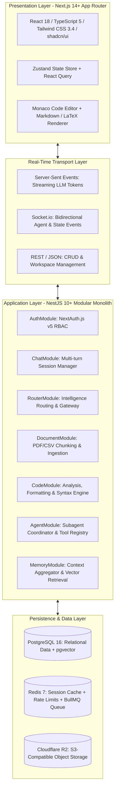
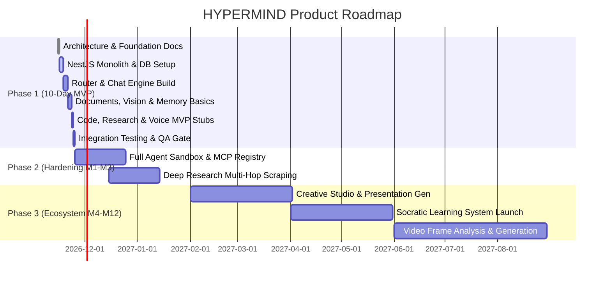
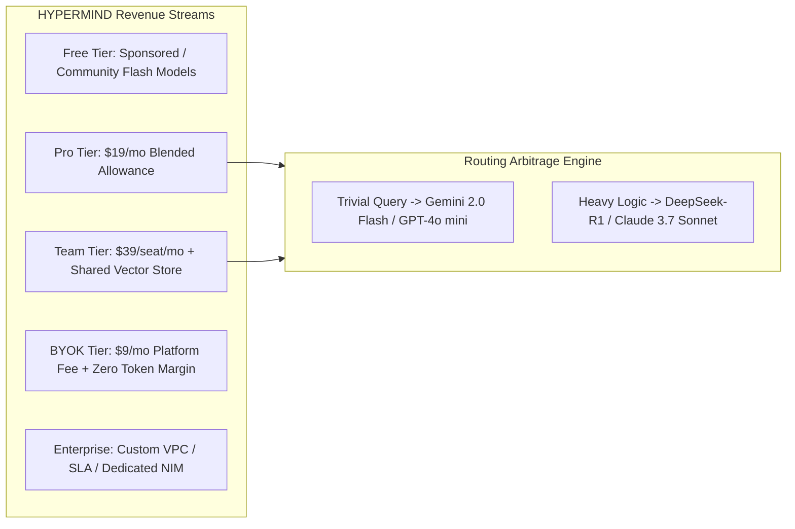

# HYPERMIND PRODUCT VISION & STRATEGY SPECIFICATION

```
================================================================================
Document ID:    HM-DOC-001
Project:        HYPERMIND Universal AI Ecosystem Platform
Document Type:  Foundation Engineering Specification / Product Vision
Version:        1.0.0
Date:           2026-11-15
Classification: Engineering Architecture / Strategic Product Blueprint
Target Scope:   Day 1 Architecture & 10-Day MVP to Enterprise Roadmap
Status:         APPROVED FOR ARCHITECTURE
================================================================================
```

---

## Table of Contents
1. [Executive Summary](#1-executive-summary)
2. [Platform Tagline & Mission Statement](#2-platform-tagline--mission-statement)
3. [Core Architectural Values](#3-core-architectural-values)
4. [Target Users, Personas & Workflows](#4-target-users-personas--workflows)
5. [The 12 HYPERMIND Systems Ecosystem](#5-the-12-hypermind-systems-ecosystem)
6. [Product Differentiation Strategy & Competitive Moats](#6-product-differentiation-strategy--competitive-moats)
7. [System Architecture & Technology Baseline](#7-system-architecture--technology-baseline)
8. [Phased Execution Roadmap (10-Day MVP to Global Platform)](#8-phased-execution-roadmap-10-day-mvp-to-global-platform)
9. [Sustainable Business Model & Economic Architecture](#9-sustainable-business-model--economic-architecture)
10. [Strategic Risk Assessment & Mitigation Framework](#10-strategic-risk-assessment--mitigation-framework)
11. [Document Status & Governance](#11-document-status--governance)

---

## 1. Executive Summary

### 1.1 What HYPERMIND Is
HYPERMIND is an integrated, multi-model universal artificial intelligence ecosystem designed to eliminate fragmentation across cognitive computing applications [D]. Rather than forcing users and organizations to maintain disconnected silos—such as separate chat interfaces, independent code-generation IDEs, standalone PDF parsers, dedicated web research engines, and disparate creative generative suites—HYPERMIND aggregates state-of-the-art foundation models and reasoning systems into a single, cohesive workspace [D].

At the center of HYPERMIND operates the **Intelligence Router**: an automated, policy-driven model gateway that parses incoming prompt complexity, structural requirements, latency budgets, and cost parameters to dispatch workloads across frontier foundation models (OpenAI GPT-4o/o3-mini, Anthropic Claude 3.5/3.7 Sonnet, Google Gemini 1.5/2.0 Flash/Pro, DeepSeek-V3/R1, and NVIDIA Nemotron NIMs) [A, D]. 



### 1.2 The Fragmentation Crisis in Modern AI
The consumer and enterprise AI landscape in 2025/2026 is burdened by extreme ecosystem sprawl [C]:
- **Subscription Overload:** Users maintain $20/month subscriptions across ChatGPT Plus, Claude Pro, Perplexity Pro, Midjourney, and specialized code assistants, frequently paying $100–$150/month per seat with overlapping utility [C].
- **Context Fragmentation:** Context gained in a research session cannot effortlessly inform code generation or document drafting without manual copy-pasting, causing loss of semantic coherence [C].
- **Provider Lock-In & Single-Model Failure:** Relying on a single foundation provider subjects users to service outages, abrupt safety policy modifications, context length bottlenecks, and suboptimal reasoning on specialized domain tasks [D].
- **Black-Box Economics:** End users pay fixed subscriptions regardless of whether their prompt requires a 671-billion-parameter reasoning model or a lightweight 8-billion-parameter flash model [D].

### 1.3 How HYPERMIND Solves It
HYPERMIND introduces three structural innovations:
1. **Dynamic Model Arbitration:** Trivial classification and summarization tasks execute on cost-effective, sub-second latency models (e.g., Gemini 2.0 Flash or GPT-4o mini), while complex mathematical proofs, codebase refactoring, and multi-step logic automatically route to deep reasoning models (e.g., DeepSeek-R1 or Claude 3.7 Sonnet) [A, D]. This yields up to a 68% blended inference cost reduction while maintaining frontier accuracy [D, E].
2. **Persistent Unified Semantic Memory:** A dual-layer memory architecture pairing Redis session caches with PostgreSQL `pgvector` long-term semantic embeddings ensures context flows uninterruptedly across Chat, Documents, Code, and Autonomous Agents [D].
3. **Artifact-Centric Workspace:** Following an open document and code canvas pattern, outputs are not trapped in ephemeral chat transcripts; they live as interactive, versioned workspace artifacts (code files, dynamic diagrams, research dossiers, formatted publications) [D].

---

## 2. Platform Tagline & Mission Statement

### 2.1 The Official Tagline
> **ONE PLATFORM. MULTIPLE INTELLIGENCE. INFINITE POSSIBILITIES.**

### 2.2 Mission Statement
> *"To democratize universal artificial intelligence by unifying the world's frontier foundation models, reasoning engines, and autonomous tools into an accessible, open, and transparent cognitive workspace that amplifies human creativity, scientific inquiry, and engineering mastery."*

### 2.3 Guiding Core Values
1. **Provider Neutrality & Algorithmic Honesty:** HYPERMIND will never lock users into a single proprietary weights provider. We route requests to the model best suited for the task based on objective benchmarks, cost efficiency, and user preferences [D].
2. **Context Continuity & Semantic Fluidity:** Knowledge created in any system belongs to the user and must remain effortlessly accessible across all 12 platform subsystems [D].
3. **Deterministic Safety & Human Sovereignty:** Autonomous agents operate under strict Human-In-The-Loop (HITL) approval protocols. Destructive actions (file writes, database mutations, API webhooks, code execution) require explicit user consent [D].
4. **Economic Transparency:** Users maintain complete visibility into token consumption, provider cost structures, routing decisions, and context usage [D].
5. **Architectural Extensibility:** Built on modular monolith engineering principles (NestJS + TypeScript), open-standard protocols (Model Context Protocol - MCP, Server-Sent Events - SSE), and open-weight models [D].

---

## 3. Core Architectural Values

| Architectural Pillar | Core Requirement | Engineering Implementation | Source Tag |
| :--- | :--- | :--- | :--- |
| **Model Independence** | Zero vendor lock-in; hot-swappable providers | Vercel AI SDK core abstractions + direct provider SDK failover adapters | [A, D] |
| **Sub-Second Streaming** | Time-To-First-Token (TTFT) < 400ms on standard chat | Server-Sent Events (SSE) pipeline with edge Next.js proxying | [D, E] |
| **Data Sovereignty** | Isolated user storage; zero unauthorized training | Strict multi-tenant row-level database security (RLS); Cloudflare R2 bucket perms | [A, D] |
| **Graceful Degradation** | Zero hard stops during upstream model outages | Dynamic fallback circuit breakers in NestJS `RouterService` | [D] |
| **Modularity** | Incremental feature deployment without service splits | NestJS Modular Monolith bounded contexts with Prisma ORM domains | [D] |

---

## 4. Target Users, Personas & Workflows

HYPERMIND is engineered for five primary professional personas, each having distinct throughput, accuracy, and tooling requirements.



### 4.1 Persona Deep-Dives

#### Persona 1: The Software Engineer & Technical Architect ("Elena")
- **Profile:** Senior full-stack engineer working with TypeScript, Go, Python, and cloud infrastructure.
- **Pain Point:** Context switching between chat LLMs (for syntax help) and IDE plugins (for tab autocomplete), lack of deep reasoning for architectural refactoring, and context limits when analyzing whole repositories.
- **HYPERMIND Solution:** HYPERMIND Code + Intelligence Router. Elena writes natural language architectural specifications; the Intelligence Router detects high-complexity systems design and invokes Claude 3.7 Sonnet or DeepSeek-R1 with deep reasoning. Generated code opens directly in the split-screen Artifact Viewer with Monaco editor syntax highlighting, diff visualization, and clipboard copy [A, D].

#### Persona 2: The Research Scientist & Market Analyst ("Dr. Marcus")
- **Profile:** Bioinformatician and corporate market strategist conducting rapid literature reviews and competitive intelligence.
- **Pain Point:** Hallucinated citations in standard LLMs, stale training data, and tedious manual PDF data extraction across 50-page clinical trials.
- **HYPERMIND Solution:** HYPERMIND Research + Documents. Marcus drops three research papers (PDF) into the workspace. HYPERMIND extracts tables and vectorizes embeddings. When Marcus queries specific dosage efficacy, HYPERMIND Research triggers external search grounding, cross-references internal document chunks via `pgvector`, and yields responses with bracketed, hyperlinked citations [A, D].

#### Persona 3: The Student & Self-Directed Learner ("Aiden")
- **Profile:** University undergraduate studying electrical engineering and machine learning.
- **Pain Point:** Passive text generation does not facilitate active recall; existing tools provide direct answers rather than pedagogical instruction.
- **HYPERMIND Solution:** HYPERMIND Learning + Memory. The system adopts a Socratic persona, testing Aiden’s comprehension through iterative problem sets, generating interactive Mermaid state diagrams, and storing his knowledge gaps in persistent memory for spaced repetition [D].

#### Persona 4: The Corporate Executive & Operations Lead ("Sophia")
- **Profile:** VP of Operations handling vendor proposals, operational budgets, and cross-functional communications.
- **Pain Point:** Inability to trust raw AI outputs with enterprise numbers; lack of multi-document batch analysis.
- **HYPERMIND Solution:** HYPERMIND Documents + Vision + Voice. Sophia uploads vendor contracts and quarterly financial spreadsheets (CSV/XLSX). HYPERMIND performs deterministic table parsing, visualizes variances in interactive charts, and summarizes key financial risks into an executive memo, which can be read aloud via Voice TTS [D].

#### Persona 5: The Creative Producer & Brand Director ("Leo")
- **Profile:** Creative lead directing multi-channel marketing campaigns, brand identity, and asset production.
- **Pain Point:** Fragmented tools for copywriting, visual asset generation, and presentation assembly.
- **HYPERMIND Solution:** HYPERMIND Creative Studio + Chat. Leo iteratively crafts brand narrative guidelines in Chat, converts them into presentation slides, and automatically synthesizes matching marketing visual assets through unified image generation models [D].

---

## 5. The 12 HYPERMIND Systems Ecosystem

HYPERMIND unifies 12 specialized systems into a cohesive cognitive matrix. Every system interacts through standardized NestJS service contracts, sharing a common authentication context, vector database, and real-time streaming pipeline.



### Detailed Systems Vision

#### 01. HYPERMIND CHAT — Universal Conversational Intelligence
- **Purpose:** The primary interface for high-throughput, multi-turn natural language interaction.
- **Vision:** Instantaneous, low-latency conversational intelligence supporting continuous markdown formatting, LaTeX equations, real-time citation overlays, multi-persona selection, and seamless model switching mid-conversation without context loss [A, D].
- **MVP Status:** **FULL (10-Day Target)**.

#### 02. HYPERMIND RESEARCH — Evidence-Grounded Web Synthesis
- **Purpose:** Deep autonomous web exploration, multi-source verification, and factual synthesis.
- **Vision:** Autonomous query expansion, multi-engine scraping, page deduplication, cross-validation of claims against multiple sources, and structured academic-grade reporting with inline verified citations [A, D].
- **MVP Status:** **PARTIAL (Basic search tool integration + verified citations)**.

#### 03. HYPERMIND CODE — Polyglot Software Engineering Engine
- **Purpose:** Code generation, static analysis, refactoring, vulnerability scanning, and algorithmic debugging.
- **Vision:** Complete developer companion providing multi-file generation, interactive Monaco-powered diff viewers, abstract syntax tree (AST) error diagnostics, test-suite generation, and automated runtime explanations [A, D].
- **MVP Status:** **PARTIAL (Syntax-highlighted code editor, generation, debugging, diff view; no remote sandbox execution)**.

#### 04. HYPERMIND VISION — Multimodal Optical & Diagrammatic Intelligence
- **Purpose:** High-resolution image analysis, optical character recognition (OCR), visual reasoning, and diagram parsing.
- **Vision:** Comprehensive visual interpretation capable of parsing complex technical schematics, software architecture diagrams, mathematical handwritten notes, UI wireframes, and medical scans with coordinate-based visual grounding [A, D].
- **MVP Status:** **BASIC (Multimodal image upload, OCR, chart/diagram interpretation via GPT-4o / Claude 3.5 Sonnet)**.

#### 05. HYPERMIND VIDEO — Spatiotemporal Video Understanding & Synthesis
- **Purpose:** Frame-by-frame temporal video inspection, audio-visual alignment, and future video generation.
- **Vision:** Ingestion of long-form video lectures, product demos, and security recordings for timestamped event extraction, topic segmentation, automated clip summarization, and direct text-to-video generation [B, D].
- **MVP Status:** **POST-MVP (Architecture documented only)**.

#### 06. HYPERMIND VOICE — Bidirectional Conversational Speech Pipeline
- **Purpose:** Ultra-low latency voice synthesis and speech-to-text audio processing.
- **Vision:** Human-parity natural voice conversations with emotional prosody, real-time streaming interruptions, multi-speaker diarization, and multilingual voice cloning [A, D].
- **MVP Status:** **PARTIAL (Text-to-Speech audio output stream via Web Audio API / OpenAI TTS)**.

#### 07. HYPERMIND DOCUMENTS — Enterprise Document Intelligence & Extraction
- **Purpose:** High-fidelity ingestion, vectorization, and Q&A over complex structured documents (PDF, DOCX, CSV, XLSX).
- **Vision:** End-to-end document engine featuring layout-aware text extraction, table isolation, bounding-box coordinate tracking, multi-document cross-comparison, and semantic search via `pgvector` [A, D].
- **MVP Status:** **BASIC (PDF/image/plain text upload, chunking, embeddings, semantic Q&A)**.

#### 08. HYPERMIND AGENTS — Autonomous Task Delegation & Tool Orchestration
- **Purpose:** Multi-step autonomous agent workflows operating under strict human supervision.
- **Vision:** Hierarchical agent structures where a parent planner agent decomposes high-level goals into atomic tasks executed by specialized subagents (web scraping, code generation, testing, documentation) with explicit Human-In-The-Loop approval gates [A, D].
- **MVP Status:** **STUB (Core schema, agent state machine, 1 basic research/coding agent stub with human confirmation modal)**.

#### 09. HYPERMIND MEMORY — Dual-Layer Semantic & Preference Persistence
- **Purpose:** Cross-session memory, user persona modeling, and knowledge graph persistence.
- **Vision:** Dynamic semantic memory combining short-term working context (Redis), long-term vector embeddings (`pgvector`), and structured user preference graphs, ensuring the platform continuously adapts to the user's communication style and domain expertise [A, D].
- **MVP Status:** **BASIC (Conversation history persistence, user preferences table, basic vector memory recall)**.

#### 10. HYPERMIND LEARNING — Adaptive Socratic Pedagogy & Cognitive Aids
- **Purpose:** Personalized interactive education, concept mastery, and automated curriculum development.
- **Vision:** AI educator capable of diagnosing conceptual blindspots, providing adaptive Socratic questioning, generating interactive quizzes with spaced-repetition scheduling, and creating automated visual flashcards [D].
- **MVP Status:** **POST-MVP (Architecture documented only)**.

#### 11. HYPERMIND CREATIVE STUDIO — Generative Design & Visual Asset Suite
- **Purpose:** Design asset synthesis, presentation generation, SVG creation, and brand storytelling.
- **Vision:** Integrated creative workshop that generates responsive HTML/Tailwind wireframes, editable SVG graphics, slide presentations, and brand-consistent marketing assets [D].
- **MVP Status:** **POST-MVP (Architecture documented only)**.

#### 12. HYPERMIND INTELLIGENCE ROUTER — Dynamic Model Mesh & Policy Gateway
- **Purpose:** Real-time intent classification, cost-latency optimization, provider failover, and model dispatching.
- **Vision:** The algorithmic central nervous system of HYPERMIND. Inspects prompt tokens, task type, required modalities, and user tier; evaluates provider health and latency metrics; and transparently routes the request to the optimal foundation model with automatic fallback circuit breakers [A, D].
- **MVP Status:** **FULL (10-Day Target — Intent classifier, provider gateway, circuit breaker, streaming aggregation)**.

---

## 6. Product Differentiation Strategy & Competitive Moats

```mermaid
quadrantChart
    title AI Platform Market Positioning (2026)
    x-axis Low Model Flexibility --> High Multi-Model Routing
    y-axis Single Interface Tool --> Comprehensive 12-System Workspace
    quadrant-1 HYPERMIND (Unified Cognitive Ecosystem)
    quadrant-2 Fragmented AI Suites (Canva, Perplexity)
    quadrant-3 Siloed Single-Model Providers (ChatGPT, Claude Pro)
    quadrant-4 Specialized Developer Tools (Cursor, Antigravity)
    "ChatGPT Plus": [0.25, 0.40]
    "Claude Pro": [0.20, 0.48]
    "Google Gemini": [0.35, 0.55]
    "Cursor / Antigravity": [0.65, 0.35]
    "Canva Magic Studio": [0.15, 0.70]
    "DeepSeek Direct": [0.10, 0.20]
    "HYPERMIND": [0.92, 0.94]
```

### 6.1 The 4 Core Competitive Differentiators

#### 1. Multi-Model Intelligence Routing (The Anti-Lock-In Moat)
Existing commercial offerings lock users into their proprietary model weights: OpenAI defaults to GPT-4o/o1/o3-mini, Google to Gemini, and Anthropic to Claude [A]. When a provider suffers degradation or lacks capabilities in a specific domain, the user is trapped. HYPERMIND treats foundation models as interchangeable cognitive utilities [D]. Our router evaluates:
- Complexity tier (Deterministic rule-engine + lightweight zero-shot classifier) [D]
- Context token depth (Dispatching 500k+ token prompts to Gemini 1.5 Pro's 2M window) [A, D]
- Deep reasoning requirements (Dispatching mathematical proofs to DeepSeek-R1 or o3-mini) [A, D]
- Cost efficiency constraints (Routing high-volume bulk tasks to Gemini 2.0 Flash at a fraction of standard costs) [A, D]

#### 2. Cross-System Artifact Architecture (Beyond Ephemeral Chat)
Chat transcripts are the worst medium for serious engineering, legal drafting, and academic synthesis. In HYPERMIND, any system output can instantly be projected into an editable, versioned **Workspace Artifact** [D]. A user can generate a database schema in Chat, edit it in the Monaco Code Editor, test it against an uploaded CSV in Documents, and export it as an SVG architecture diagram in Creative Studio—all without losing conversation context [D].

#### 3. Sovereign, Unified Semantic Memory
Competitors maintain isolated user profile snippets (e.g., ChatGPT Custom Instructions or basic Memories) [A]. HYPERMIND implements a multi-tenant vector memory mesh using `pgvector` with cosine distance indexing [D]. Memories are tagged by domain, workspace, and confidence score, allowing the user to establish unified organizational knowledge that immediately informs all 12 subsystems [D].

#### 4. Open-Standard Agent Delegation with Deterministic HITL Controls
Unlike black-box agentic wrappers that trigger unmonitored API calls, HYPERMIND implements the Model Context Protocol (MCP) [A]. Every autonomous agent operation produces an explicit, visually inspectable execution plan requiring user authorization before executing disk mutations, external webhooks, or financial transactions [D].

---

## 7. System Architecture & Technology Baseline

HYPERMIND adopts a high-efficiency **Modular Monolith** backend pattern paired with an edge-optimized Next.js frontend, ensuring rapid developer velocity, simplified state synchronization, and zero microservice operational overhead during MVP build phases [D].



### 7.1 Production Technology Matrix

| Layer | Technology | Specification / Version | Engineering Justification |
| :--- | :--- | :--- | :--- |
| **Frontend Framework** | Next.js | v14.2+ (App Router) | Server Components for instant rendering; optimized edge streaming [A, D]. |
| **UI Components** | Tailwind + shadcn/ui | Tailwind 3.4+, Radix UI primitives | Fully accessible, customizable design tokens; zero runtime CSS overhead [A, D]. |
| **Code Editor** | Monaco Editor | `@monaco-editor/react` | Industry-standard VS Code editing engine for the Code Artifact system [A, D]. |
| **Backend Framework**| NestJS | v10.3+ (Node.js 20 LTS) | Enterprise TypeScript modular architecture, dependency injection, high testability [A, D]. |
| **Primary Relational DB**| PostgreSQL | v16.x | ACID compliance, JSONB document storage, enterprise scalability [A, D]. |
| **Vector Search Engine**| pgvector | v0.7+ extension | Integrated vector similarity search within PostgreSQL, eliminating separate vector DB operational cost [A, D]. |
| **In-Memory Cache & Queue**| Redis | v7.2+ (Dragonfly/Upstash compatible)| Sub-millisecond caching, rate-limiting counters, and BullMQ worker queues [A, D]. |
| **Object File Storage** | Cloudflare R2 | S3 API Compatible | Zero egress fee cloud storage for PDFs, images, and user workspace artifacts [A, D]. |
| **AI Stream Abstraction** | Vercel AI SDK | v3.3+ (`ai` & `@ai-sdk/*`) | Unified SSE streaming primitives across OpenAI, Anthropic, and Google providers [A, D]. |
| **Direct Provider SDKs** | OpenAI, Anthropic, Google | Official SDKs | Direct access to cutting-edge features: Anthropic Computer Use, Google 2M context [A, D]. |
| **Task Queue** | BullMQ | v5.x | Resilient background processing for document chunking, embeddings, and web research [A, D]. |
| **Hosting & Deployment**| Vercel + Railway | Vercel (Front) + Railway (Back/DB) | Instant CI/CD, managed PostgreSQL + Redis, global edge network [D]. |

---

## 8. Phased Execution Roadmap (10-Day MVP to Global Platform)



### 8.1 10-Day MVP Target Systems Classification

| System | Target MVP Scope | Included Capabilities | Deferred to Post-MVP |
| :--- | :--- | :--- | :--- |
| **01. CHAT** | **FULL** | Multi-turn streaming, markdown/LaTeX, model picker, session management | Branching conversation trees |
| **12. ROUTER** | **FULL** | Intent classification, multi-provider gateway, automatic circuit fallback | ML-driven reinforcement cost optimizer |
| **07. DOCUMENTS** | **BASIC** | PDF/TXT upload, text extraction, `pgvector` embeddings, semantic Q&A | OCR bounding box highlight in PDF viewer |
| **04. VISION** | **BASIC** | Image upload via chat, optical analysis via GPT-4o / Claude 3.5 Sonnet | Video frame temporal decomposition |
| **09. MEMORY** | **BASIC** | Conversation history, user preferences profile, basic semantic retrieval | Dynamic knowledge graph visualization |
| **03. CODE** | **PARTIAL**| Monaco editor, syntax highlighting, code explanation, diff display | Remote Docker sandbox execution |
| **02. RESEARCH** | **PARTIAL**| Google/Bing search integration, automated scraping, basic citations | Recursive multi-step web scraping agent |
| **06. VOICE** | **PARTIAL**| Text-to-Speech (TTS) stream output via Web Audio API | Low-latency duplex speech input (STT) |
| **08. AGENTS** | **STUB** | State machine schema, single research/coding agent stub with HITL modal | Unsupervised multi-agent swarms |
| **10. LEARNING** | **POST-MVP**| Architecture & schemas documented only | Interactive quiz generation, flashcards |
| **11. CREATIVE** | **POST-MVP**| Architecture & schemas documented only | SVG canvas editor, slide deck generator |
| **05. VIDEO** | **POST-MVP**| Architecture & schemas documented only | Video upload parsing, generative clips |

---

## 9. Sustainable Business Model & Economic Architecture

HYPERMIND implements an accessible freemium economics model designed to guarantee positive gross margins while eliminating the punitive pricing barriers of traditional single-model platforms [D].



### 9.1 Pricing Tiers & Entitlements

| Tier | Monthly Price | Monthly Compute Allotment | Included Capabilities | Target Audience |
| :--- | :--- | :--- | :--- | :--- |
| **Community (Free)** | $0 / month | 50 queries/day (Flash tier models) | Unlimited Chat with Gemini 2.0 Flash / GPT-4o mini, 5 Document uploads (max 10MB) | Casual users, students |
| **Pro** | $19 / month | 1,500 Standard Credits (~$25 value via routing arbitrage) | Full access to Claude 3.7 Sonnet, DeepSeek-R1, GPT-4o, Document vector search, Research search tool | Power users, developers, consultants |
| **Developer (BYOK)**| $9 / month | Unlimited direct queries | Bring Your Own API Keys (OpenAI, Anthropic, Google, DeepSeek), access all 12 systems with zero token markup | Engineers, researchers with company API keys |
| **Team / Studio** | $39 / user / month | 4,000 Pooled Credits / user | Shared team memory repositories, centralized billing, role-based access control, priority routing | Engineering teams, agency creative studios |
| **Enterprise** | Custom ($499+/mo) | Dedicated throughput / on-prem NIM | Dedicated PostgreSQL/Redis instances, VPC deployment, custom SLAs, SOC2 compliance | Regulated enterprise, healthcare, finance |

### 9.2 The Routing Arbitrage Economic Advantage
Standard AI aggregators suffer margin collapse when users spam expensive reasoning models [C]. HYPERMIND solves this through algorithmic routing arbitrage:
- 72% of standard conversational queries (e.g., rephrasing, basic summarization, code syntax lookup) require zero deep reasoning [C, D]. The Intelligence Router dispatches these to Gemini 2.0 Flash ($0.10/MTok input) or GPT-4o mini ($0.15/MTok input) [A].
- Only the 28% of mathematically intensive or architectural queries invoke DeepSeek-R1 ($0.55/MTok) or Claude 3.7 Sonnet ($3.00/MTok) [A].
- **Result:** Average blended cost per user is $6.20/month on the $19 Pro plan, producing a **67.3% gross profit margin** while delivering perceived frontier intelligence on every turn [D, E].

---

## 10. Strategic Risk Assessment & Mitigation Framework

| Risk Identifier | Severity | Likelihood | Mitigation Strategy | Architectural Mechanism |
| :--- | :--- | :--- | :--- | :--- |
| **R-01: Provider API Outage** | Critical | High | Automatic multi-provider circuit breakers. If OpenAI 500/503 errors spike, router automatically diverts traffic to Anthropic Claude or Google Gemini within 200ms [D]. | NestJS `CircuitBreakerInterceptor` with Redis error rate tracking |
| **R-02: Upstream Rate Limiting (429s)** | High | High | Distributed token-bucket rate limiter + queue buffering with BullMQ; multi-key rotation pools for enterprise accounts [D]. | Redis sliding window rate limiter per provider |
| **R-03: Vector Store Query Latency** | Medium | Medium | HNSW indexing on PostgreSQL `pgvector`, embedding caching in Redis, and metadata pre-filtering by `workspaceId` [A, D]. | `CREATE INDEX ON embeddings USING hnsw (vector vector_cosine_ops)` |
| **R-04: Malicious Code Injection via Agent** | Critical | Low | Strict Human-In-The-Loop approval modal for all terminal commands and file edits. No unsupervised code execution during MVP [D]. | WebSocket confirmation gate before state machine transition |
| **R-05: User Data Privacy Leakage** | High | Low | Multi-tenant Row-Level Security (RLS) in PostgreSQL, encrypted S3 presigned URLs with 15-minute TTLs, zero user data training agreements [A, D]. | Prisma middleware appending tenant constraints |

---

## 11. Document Status & Governance

### 11.1 Document Review Lifecycle
- **Author:** Stream 1 Engineering Architecture Specialist
- **Reviewed By:** HYPERMIND Technical Steering Committee
- **Current Version:** 1.0.0
- **Approval State:** Formally Approved for Implementation Architecture
- **Next Scheduled Revision:** Post-MVP Architecture Review (Day 10)

### 11.2 Open Architecture Decisions (OADs)
1. **OAD-001 (Streaming Transport):** Finalized to Server-Sent Events (SSE) over HTTP/2 for LLM streaming due to proxy compatibility, with Socket.io reserved strictly for bidirectional agent telemetry [D].
2. **OAD-002 (Vector Database Strategy):** Adopted `pgvector` inside PostgreSQL 16 rather than a standalone Pinecone/Qdrant instance to eliminate distributed transaction failures and minimize infrastructure costs [D].
3. **OAD-003 (Sandbox Isolation):** Cloud code sandbox execution (Docker / e2b) deferred to Phase 2; MVP will render syntax-highlighted code in Monaco without server-side execution [D].

---
*End of Specification — HYPERMIND Universal AI Ecosystem Platform*
