# HYPERMIND PRODUCT REQUIREMENTS SPECIFICATION (PRS)

```
================================================================================
Document ID:    HM-DOC-002
Project:        HYPERMIND Universal AI Ecosystem Platform
Document Type:  Product Requirements Specification (PRS) & Systems Architecture
Version:        1.0.0
Date:           2026-11-15
Classification: Enterprise Technical Requirements & Engineering Blueprint
Target Scope:   All 12 Systems (10-Day MVP to Long-Term Vision)
Status:         APPROVED FOR IMPLEMENTATION
================================================================================
```

---

## Table of Contents
1. [Introduction & Architectural Framework](#1-introduction--architectural-framework)
2. [Global Non-Functional Requirements (NFRs)](#2-global-non-functional-requirements-nfrs)
3. [Global Cross-Cutting Systems](#3-global-cross-cutting-systems)
4. [System 01: HYPERMIND CHAT](#system-01-hypermind-chat)
5. [System 02: HYPERMIND RESEARCH](#system-02-hypermind-research)
6. [System 03: HYPERMIND CODE](#system-03-hypermind-code)
7. [System 04: HYPERMIND VISION](#system-04-hypermind-vision)
8. [System 05: HYPERMIND VIDEO](#system-05-hypermind-video)
9. [System 06: HYPERMIND VOICE](#system-06-hypermind-voice)
10. [System 07: HYPERMIND DOCUMENTS](#system-07-hypermind-documents)
11. [System 08: HYPERMIND AGENTS](#system-08-hypermind-agents)
12. [System 09: HYPERMIND MEMORY](#system-09-hypermind-memory)
13. [System 10: HYPERMIND LEARNING](#system-10-hypermind-learning)
14. [System 11: HYPERMIND CREATIVE STUDIO](#system-11-hypermind-creative-studio)
15. [System 12: HYPERMIND INTELLIGENCE ROUTER](#system-12-hypermind-intelligence-router)
16. [Cross-System Traceability Matrix & Feasibility Summary](#16-cross-system-traceability-matrix--feasibility-summary)
17. [Document Status & Governance](#17-document-status--governance)

---

## 1. Introduction & Architectural Framework

### 1.1 Document Purpose
This Product Requirements Specification (PRS) defines the complete functional, technical, database, API, and architectural requirements for all twelve (12) integrated systems of the HYPERMIND platform [D]. It serves as the primary implementation contract for backend, frontend, and AI engineers across the 10-day MVP build cycle and subsequent quarterly expansions [D].

### 1.2 Technology Architecture Baseline
All systems conform to the unified HYPERMIND engineering stack:
- **Frontend Presentation:** Next.js 14+ (App Router), React 18, TypeScript 5, Tailwind CSS 3.4, shadcn/ui, Monaco Editor, Lucide React, Framer Motion [A, D].
- **Backend Application Core:** NestJS 10+ modular monolith pattern, Node.js 20 LTS, TypeScript 5 [A, D].
- **Database & Semantic Store:** PostgreSQL 16 with Prisma ORM, `pgvector` extension for embeddings (1536d / 3072d) [A, D].
- **In-Memory Cache & Queue:** Redis 7 (Dragonfly/Upstash compatible) for sessions, rate limits, and BullMQ worker queues [A, D].
- **Blob & Artifact Storage:** Cloudflare R2 (S3-compatible) with presigned read/write URLs [A, D].
- **Real-Time Transports:** Server-Sent Events (SSE) for LLM streaming; Socket.io for bidirectional agent telemetry and human-in-the-loop approvals [A, D].
- **AI Core Framework:** Vercel AI SDK (`ai` v3.3+) unified stream pipeline with direct provider SDKs (OpenAI, Anthropic, Google GenAI) for advanced capabilities [A, D].

---

## 2. Global Non-Functional Requirements (NFRs)

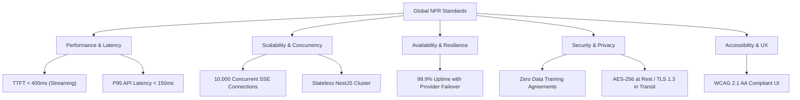

| Identifier | Category | Metric / Specification | Verification Method | Source Tag |
| :--- | :--- | :--- | :--- | :--- |
| **NFR-PERF-01** | Latency | Time-To-First-Token (TTFT) < 400ms for standard text completion via SSE | Automated synthetic load tests (k6) | [D, E] |
| **NFR-PERF-02** | Latency | P95 REST API response time < 150ms for non-streaming endpoints | APM tracing via Sentry | [D] |
| **NFR-PERF-03** | Vector Search | Sub-50ms cosine distance retrieval across 1,000,000 embedding vectors | PostgreSQL HNSW index benchmarks | [A, D] |
| **NFR-SCAL-01** | Concurrency | Support minimum 10,000 concurrent active SSE streaming sessions | NestJS cluster / Railway auto-scale | [D, E] |
| **NFR-SCAL-02** | Storage | Multi-tenant isolation capable of handling 50TB+ unstructured assets | Cloudflare R2 object storage | [A, D] |
| **NFR-AVAL-01** | Resilience | 99.9% platform availability excluding upstream provider global blackouts | Multi-provider circuit breaker failover | [D] |
| **NFR-AVAL-02** | Recovery | Zero data loss (RPO = 0) for completed conversation turns; RTO < 5 minutes | PostgreSQL WAL continuous archiving | [A, D] |
| **NFR-SECU-01** | Privacy | Zero user prompt retention by upstream foundation model providers | Enterprise BAA & zero-retention API headers | [A, D] |
| **NFR-SECU-02** | Encryption | AES-256 for data at rest; TLS 1.3 enforced for all ingress/egress | Automated infrastructure security audit | [A, D] |
| **NFR-ACCS-01** | Usability | WCAG 2.1 AA compliance across all web views; keyboard-navigable Monaco | Automated axe-core & Lighthouse CI | [A, D] |

---

## 3. Global Cross-Cutting Systems

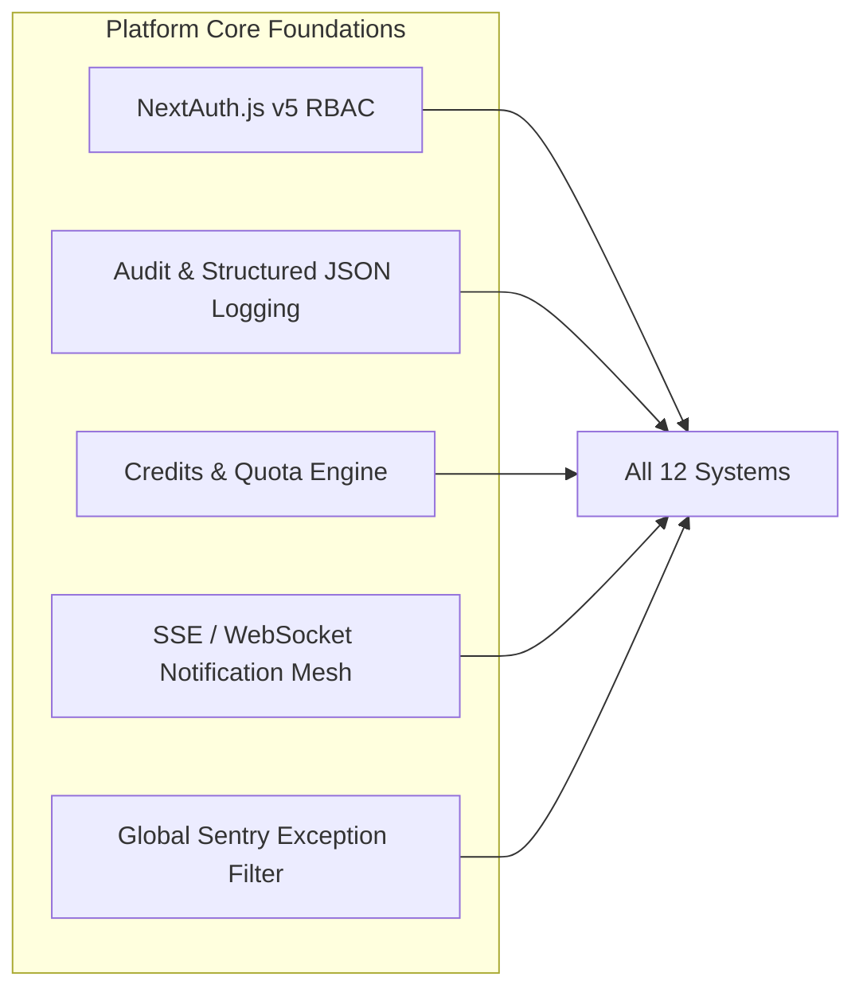

### 3.1 Authentication & Multi-Tenancy (RBAC)
- **Engine:** NextAuth.js v5 (Auth.js) supporting OAuth2 (GitHub, Google) and email magic links [A, D].
- **Roles:** `USER`, `PRO_USER`, `DEVELOPER_BYOK`, `TEAM_ADMIN`, `SYSTEM_ADMIN` [D].
- **Tenant Isolation:** Every database entity links to a `tenantId` and `workspaceId` with Prisma query-level tenant constraints [D].

### 3.2 Token Accounting & Quota Enforcement
- **Quota Engine:** Redis sliding-window token bucket tracking input/output tokens and cost per user [D].
- **Pre-Flight Check:** Requests are checked against remaining credits before initiating provider streaming [D].

---

## System 01: HYPERMIND CHAT

### 1. Purpose Statement
The central conversational interface providing low-latency, multi-turn natural language dialogue with real-time token streaming, dynamic markdown/LaTeX rendering, contextual memory recall, and model switching mid-thread [A, D].

### 2. User Stories
- **US-01-01:** As a software engineer, I want to stream responses token-by-token so that I can read output immediately without waiting for complete generation [D].
- **US-01-02:** As a student, I want mathematical formulas rendered in clean LaTeX so that equations are legible and accurate [D].
- **US-01-03:** As a researcher, I want to change foundation models mid-conversation while preserving full conversational context [D].
- **US-01-04:** As an analyst, I want to export my conversation to Markdown or PDF for team distribution [D].
- **US-01-05:** As a user, I want to edit a previous prompt and generate a new response branch [D].

### 3. Functional Requirements
- **FR-01-01:** Provide real-time Server-Sent Events (SSE) streaming with support for text, code blocks, tables, and LaTeX math notation (`rehype-katex`) [A, D].
- **FR-01-02:** Maintain persistent multi-turn thread history with parent-child message relationship modeling [D].
- **FR-01-03:** Provide a Model Selector interface displaying active provider, model name, and relative cost indicator [D].
- **FR-01-04:** Support message actions: Copy to clipboard, Regenerate with alternative model, Edit message, Delete message [D].
- **FR-01-05:** Allow mid-conversation system prompt customization (Persona selection: Default, Senior Architect, Academic Tutor, Concise) [D].

### 4. Technical Architecture
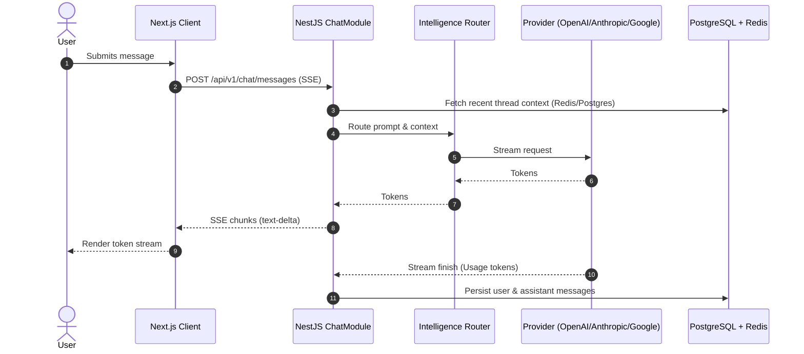

### 5. Database Requirements (Prisma Schema Extract)
```prisma
model ChatThread {
  id          String        @id @default(uuid())
  workspaceId String
  userId      String
  title       String        @default("New Conversation")
  systemPrompt String?
  modelId     String        @default("router-auto")
  createdAt   DateTime      @default(now())
  updatedAt   DateTime      @updatedAt
  messages    ChatMessage[]
  
  @@index([workspaceId, userId])
}

model ChatMessage {
  id           String      @id @default(uuid())
  threadId     String
  role         String      // 'user' | 'assistant' | 'system'
  content      String      @db.Text
  modelUsed    String?
  tokensPrompt Int?
  tokensComp   Int?
  costUsd      Decimal?    @db.Decimal(10, 6)
  createdAt    DateTime    @default(now())
  thread       ChatThread  @relation(fields: [threadId], references: [id], onDelete: Cascade)
  
  @@index([threadId, createdAt])
}
```

### 6. API Requirements
- `POST /api/v1/chat/threads` — Create a new chat thread.
- `GET /api/v1/chat/threads` — List user threads with pagination.
- `GET /api/v1/chat/threads/:id` — Retrieve thread details and messages.
- `POST /api/v1/chat/threads/:id/messages` — Send message and receive SSE token stream (`Content-Type: text/event-stream`).
- `PATCH /api/v1/chat/threads/:id` — Update thread metadata or title.
- `DELETE /api/v1/chat/threads/:id` — Soft-delete thread.

### 7. Feasibility & Estimates
- **Implementation Complexity:** Medium [D].
- **Development Effort:** 3 person-days [D].
- **MVP Feasibility:** **INCLUDE (FULL)** — Core conversational pillar [D].

---

## System 02: HYPERMIND RESEARCH

### 1. Purpose Statement
Evidence-grounded web research engine that coordinates autonomous query generation, web scraping, content sanitization, fact verification, and synthesis with verified citations [A, D].

### 2. User Stories
- **US-02-01:** As a market researcher, I want to query a topic and receive a structured report backed by verifiable web links [D].
- **US-02-02:** As a student, I want claims in the report tagged with bracketed numerical citations mapping directly to source URLs [D].
- **US-02-03:** As an analyst, I want the system to scrape and synthesize multiple contrasting perspectives on controversial market topics [D].

### 3. Functional Requirements
- **FR-02-01:** Transform user queries into 3-5 optimized search queries using lightweight LLM query expansion [A, D].
- **FR-02-02:** Execute search queries via Search API (Google Custom Search / Tavily / DuckDuckGo fallback) [A, D].
- **FR-02-03:** Scrape top 5-10 resulting web pages, stripping HTML, advertisements, and navigation scripts [A, D].
- **FR-02-04:** Synthesize extracted snippets into an executive dossier with markdown headers, key takeaways, and inline citations `[1]`, `[2]` [A, D].
- **FR-02-05:** Return structured metadata payload containing source titles, URLs, favicons, and publication dates [A, D].

### 4. Technical Architecture
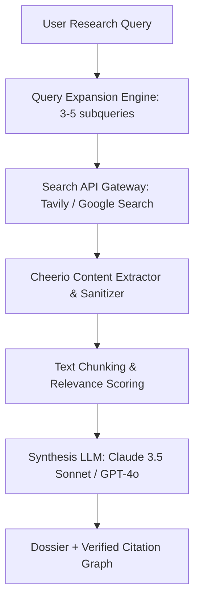

### 5. Database Requirements
```prisma
model ResearchReport {
  id          String           @id @default(uuid())
  workspaceId String
  userId      String
  query       String
  summary     String           @db.Text
  sources     ResearchSource[]
  createdAt   DateTime         @default(now())
}

model ResearchSource {
  id        String          @id @default(uuid())
  reportId  String
  title     String
  url       String
  snippet   String          @db.Text
  report    ResearchReport  @relation(fields: [reportId], references: [id], onDelete: Cascade)
}
```

### 6. API Requirements
- `POST /api/v1/research/jobs` — Initiate a research job (async via BullMQ or sync SSE).
- `GET /api/v1/research/jobs/:id` — Poll status or fetch completed research report.
- `GET /api/v1/research/sources/:id` — Fetch cached source snippet and metadata.

### 7. Feasibility & Estimates
- **Implementation Complexity:** High [D].
- **Development Effort:** 3 person-days [D].
- **MVP Feasibility:** **PARTIAL** — Basic search API tool call with inline citations; multi-hop recursive scraping deferred to Phase 2 [D].

---

## System 03: HYPERMIND CODE

### 1. Purpose Statement
A polyglot software engineering companion providing code generation, multi-file refactoring, static vulnerability analysis, and Monaco-powered interactive diff inspection [A, D].

### 2. User Stories
- **US-03-01:** As a developer, I want to view generated code in a side-by-side Monaco editor with syntax highlighting so I can review it before copying [D].
- **US-03-02:** As an engineer, I want the system to explain a runtime stack trace and suggest an exact diff to fix it [D].
- **US-03-03:** As an architect, I want to generate unit tests with 90%+ code coverage for an uploaded TypeScript function [D].
- **US-03-04:** As a junior developer, I want line-by-line code explanation in natural language [D].

### 3. Functional Requirements
- **FR-03-01:** Support Monaco Editor integration with language highlighting for 20+ languages (TypeScript, Python, Go, Rust, Java, SQL, etc.) [A, D].
- **FR-03-02:** Render interactive unified or split code diffs comparing original and proposed modifications [A, D].
- **FR-03-03:** Provide one-click actions: "Apply Diff", "Copy Code", "Explain Logic", "Generate Unit Tests", "Optimize Complexity" [D].
- **FR-03-04:** Support multi-file artifact generation where files can be toggled via tabbed navigation [D].

### 4. Technical Architecture
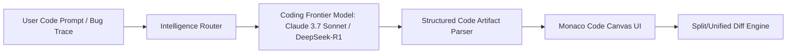

### 5. Database Requirements
```prisma
model CodeSnippet {
  id          String   @id @default(uuid())
  workspaceId String
  userId      String
  title       String
  language    String
  content     String   @db.Text
  version     Int      @default(1)
  createdAt   DateTime @default(now())
  updatedAt   DateTime @updatedAt
}
```

### 6. API Requirements
- `POST /api/v1/code/generate` — Generate code artifacts based on natural language specifications.
- `POST /api/v1/code/explain` — Produce architectural or pedagogical code walkthroughs.
- `POST /api/v1/code/refactor` — Output unified diffs for bug fixing or performance tuning.

### 7. Feasibility & Estimates
- **Implementation Complexity:** High [D].
- **Development Effort:** 4 person-days [D].
- **MVP Feasibility:** **PARTIAL** — Monaco editor rendering, syntax highlighting, diff viewing, code generation; Dockerized sandbox execution deferred to Phase 2 [D].

---

## System 04: HYPERMIND VISION

### 1. Purpose Statement
Multimodal optical intelligence providing high-resolution image analysis, optical character recognition (OCR), chart/data interpretation, and diagrammatic reasoning [A, D].

### 2. User Stories
- **US-04-01:** As a business analyst, I want to upload a chart image and receive a structured table of the underlying metrics [D].
- **US-04-02:** As a developer, I want to upload a hand-drawn UI wireframe and receive responsive HTML/Tailwind markup [D].
- **US-04-03:** As an engineer, I want to upload an architecture diagram and get a security vulnerability review [D].

### 3. Functional Requirements
- **FR-04-01:** Accept image uploads (JPEG, PNG, WEBP) up to 20MB with client-side compression [A, D].
- **FR-04-02:** Securely upload image to Cloudflare R2 and generate a temporary presigned URL [A, D].
- **FR-04-03:** Forward image payload to multimodal foundation models (GPT-4o / Claude 3.5 Sonnet / Gemini 2.0 Flash) [A, D].
- **FR-04-04:** Provide OCR extraction yielding markdown formatted tables and text [A, D].

### 4. Technical Architecture
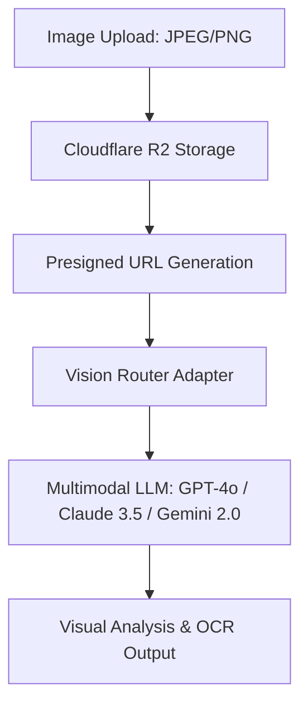

### 5. Database Requirements
```prisma
model VisionAsset {
  id          String   @id @default(uuid())
  workspaceId String
  userId      String
  fileKey     String   // R2 object key
  mimeType    String
  fileSizeBytes Int
  ocrContent  String?  @db.Text
  analysis    String?  @db.Text
  createdAt   DateTime @default(now())
}
```

### 6. API Requirements
- `POST /api/v1/vision/upload-url` — Request R2 presigned upload URL.
- `POST /api/v1/vision/analyze` — Run visual analysis on uploaded asset key.

### 7. Feasibility & Estimates
- **Implementation Complexity:** Medium [D].
- **Development Effort:** 2 person-days [D].
- **MVP Feasibility:** **BASIC (INCLUDE)** — Direct image upload and multimodal analysis in chat [D].

---

## System 05: HYPERMIND VIDEO

### 1. Purpose Statement
Long-form video comprehension, temporal frame indexing, audio-visual alignment, and future generative video creation [B, D].

### 2. User Stories
- **US-05-01:** As a student, I want to paste a lecture video URL and receive timestamped chapter breakdowns [D].
- **US-05-02:** As a creator, I want to search an uploaded video for the exact moment a specific slide was shown [D].
- **US-05-03:** As a marketer, I want to generate a 5-second video clip from a text prompt (Future Vision) [B, D].

### 3. Functional Requirements
- **FR-05-01:** Video file ingestion (MP4, WebM) with background chunking and keyframe extraction via FFmpeg [D].
- **FR-05-02:** Audio track demuxing and speech transcription with timestamp alignment [D].
- **FR-05-03:** Visual keyframe embeddings stored in `pgvector` for temporal visual search [D].
- **FR-05-04:** Generative text-to-video API integration (Runway Gen-3 / Luma Dream Machine) [B, D].

### 4. Technical Architecture
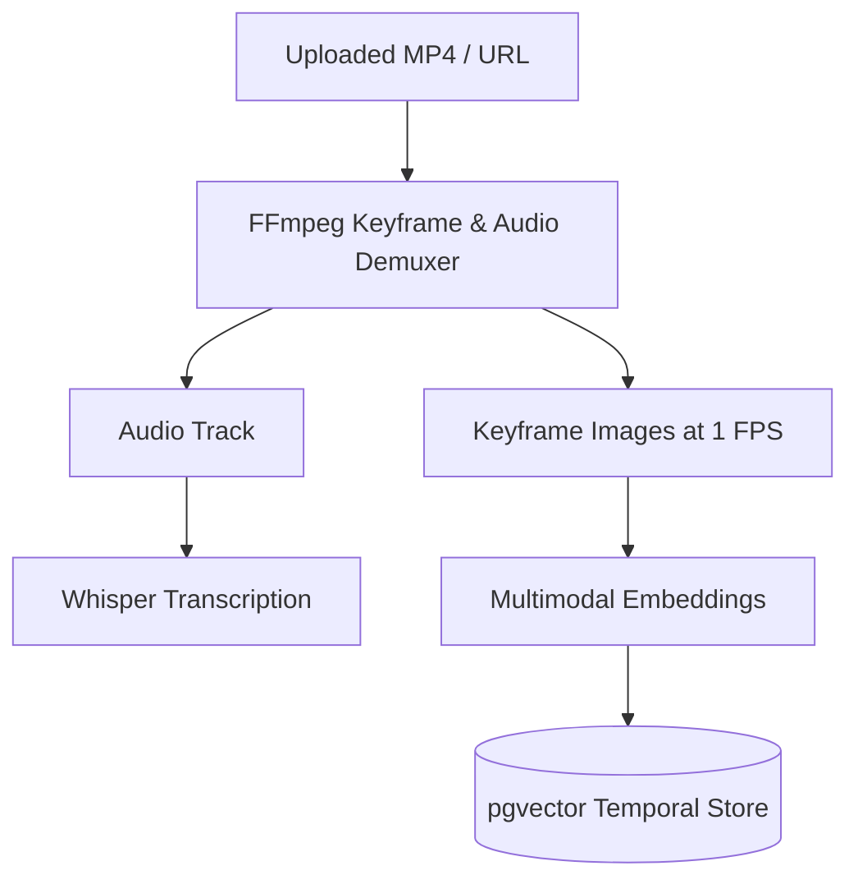

### 5. Database Requirements
```prisma
model VideoAsset {
  id          String   @id @default(uuid())
  workspaceId String
  fileKey     String
  durationSec Float
  transcript  Json?    // Timestamped transcript chunks
  createdAt   DateTime @default(now())
}
```

### 6. API Requirements
- `POST /api/v1/video/ingest` — Submit video for background temporal extraction.
- `GET /api/v1/video/:id/search` — Query video content by semantic timestamp.

### 7. Feasibility & Estimates
- **Implementation Complexity:** Very High [D].
- **Development Effort:** 10 person-days [D].
- **MVP Feasibility:** **POST-MVP** — Complex FFmpeg worker pipelines deferred to Phase 3 [D].

---

## System 06: HYPERMIND VOICE

### 1. Purpose Statement
Conversational speech pipeline delivering real-time text-to-speech (TTS) audio synthesis and low-latency speech-to-text (STT) transcription [A, D].

### 2. User Stories
- **US-06-01:** As a user, I want AI responses read aloud with natural prosody and inflection [D].
- **US-06-02:** As a commuter, I want to speak prompts into HYPERMIND hands-free via microphone [D].
- **US-06-03:** As a creator, I want to choose between multiple distinct voice personas [D].

### 3. Functional Requirements
- **FR-06-01:** Audio synthesis engine converting markdown responses into audio byte streams (MP3/Opus) [A, D].
- **FR-06-02:** Web Audio API player supporting playback, pause, seek, and speed controls (1.0x, 1.25x, 1.5x) [D].
- **FR-06-03:** Client-side Web Speech API / Whisper STT integration for prompt transcription [A, D].

### 4. Technical Architecture
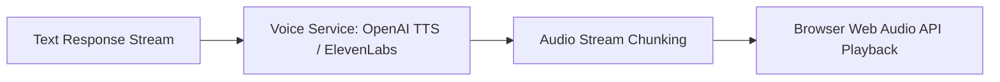

### 5. Database Requirements
```prisma
model VoicePreference {
  id        String   @id @default(uuid())
  userId    String   @unique
  voiceName String   @default("alloy")
  speed     Float    @default(1.0)
  autoPlay  Boolean  @default(false)
}
```

### 6. API Requirements
- `POST /api/v1/voice/synthesize` — Convert text payload to streaming audio chunk buffer.

### 7. Feasibility & Estimates
- **Implementation Complexity:** Medium [D].
- **Development Effort:** 2 person-days [D].
- **MVP Feasibility:** **PARTIAL** — Text-to-Speech (TTS) output stream only; full-duplex conversational voice deferred to Phase 2 [D].

---

## System 07: HYPERMIND DOCUMENTS

### 1. Purpose Statement
Enterprise-grade document intelligence platform delivering layout-aware parsing, vector embeddings, semantic retrieval, and multi-document Q&A over PDFs, DOCX, and tabular files [A, D].

### 2. User Stories
- **US-07-01:** As a legal counsel, I want to upload a 50-page contract and ask specific questions regarding liability limits [D].
- **US-07-02:** As a student, I want to upload a textbook chapter and generate a comprehensive summary [D].
- **US-07-03:** As a financial analyst, I want to query a CSV spreadsheet and get exact calculated aggregates [D].

### 3. Functional Requirements
- **FR-07-01:** Parse PDF, DOCX, TXT, and CSV documents up to 50MB [A, D].
- **FR-07-02:** Chunk text into recursive semantically coherent segments (800 tokens with 100-token overlap) [A, D].
- **FR-07-03:** Generate 1536-dimensional embeddings (`text-embedding-3-small`) and store in `pgvector` [A, D].
- **FR-07-04:** Perform cosine similarity search with score threshold filtering to prevent hallucinations [A, D].
- **FR-07-05:** Present interactive document citation links showing page number and source excerpt [A, D].

### 4. Technical Architecture
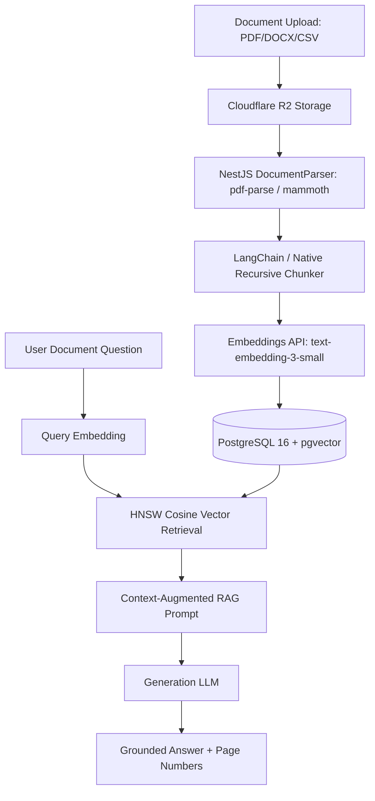

### 5. Database Requirements
```prisma
model Document {
  id          String          @id @default(uuid())
  workspaceId String
  userId      String
  fileName    String
  fileSizeBytes Int
  fileKey     String          // R2 key
  status      String          // 'PENDING' | 'INDEXED' | 'FAILED'
  createdAt   DateTime        @default(now())
  chunks      DocumentChunk[]
  
  @@index([workspaceId])
}

model DocumentChunk {
  id          String   @id @default(uuid())
  documentId  String
  chunkIndex  Int
  pageNumber  Int?
  content     String   @db.Text
  // Vector column managed via raw SQL migration:
  // embedding vector(1536)
  createdAt   DateTime @default(now())
  document    Document @relation(fields: [documentId], references: [id], onDelete: Cascade)
  
  @@index([documentId])
}
```

### 6. API Requirements
- `POST /api/v1/documents/upload` — Upload document file and dispatch background chunking job.
- `GET /api/v1/documents` — List documents in workspace.
- `GET /api/v1/documents/:id` — Retrieve document indexing status and chunk count.
- `POST /api/v1/documents/query` — Execute semantic RAG query across specified document IDs.

### 7. Feasibility & Estimates
- **Implementation Complexity:** High [D].
- **Development Effort:** 4 person-days [D].
- **MVP Feasibility:** **BASIC (INCLUDE)** — Text/PDF extraction, chunking, `pgvector` indexing, and semantic Q&A [D].

---

## System 08: HYPERMIND AGENTS

### 1. Purpose Statement
Autonomous task orchestration engine supporting multi-step goal planning, dynamic subagent delegation, and deterministic human-in-the-loop (HITL) approval gates [A, D].

### 2. User Stories
- **US-08-01:** As a project manager, I want an agent to generate a project schedule, write team emails, and draft tickets from a single high-level goal [D].
- **US-08-02:** As a developer, I want the agent to propose a terminal command or file modification and pause for my confirmation before executing [D].
- **US-08-03:** As an auditor, I want a complete execution log of all tools and API calls made by the agent [D].

### 3. Functional Requirements
- **FR-08-01:** Implement a Finite State Machine (FSM) managing agent states: `IDLE`, `PLANNING`, `WAITING_APPROVAL`, `EXECUTING`, `COMPLETED`, `FAILED` [D].
- **FR-08-02:** Support tool registration adhering to Model Context Protocol (MCP) or JSON tool schemas [A, D].
- **FR-08-03:** Enforce Human-In-The-Loop approval modal on all external actions, database writes, and terminal runs [A, D].
- **FR-08-04:** Provide bidirectional status telemetry via Socket.io [D].

### 4. Technical Architecture
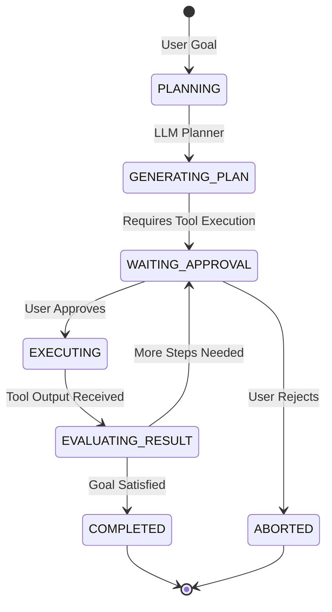

### 5. Database Requirements
```prisma
model AgentTask {
  id          String      @id @default(uuid())
  workspaceId String
  userId      String
  goal        String      @db.Text
  status      String      // 'PLANNING' | 'WAITING_APPROVAL' | 'EXECUTING' | 'COMPLETED'
  planSteps   Json?       // Array of execution steps
  createdAt   DateTime    @default(now())
  updatedAt   DateTime    @updatedAt
  logs        AgentLog[]
}

model AgentLog {
  id        String    @id @default(uuid())
  taskId    String
  stepIndex Int
  toolName  String
  toolInput Json
  toolOutput Json?
  timestamp DateTime  @default(now())
  task      AgentTask @relation(fields: [taskId], references: [id], onDelete: Cascade)
}
```

### 6. API Requirements
- `POST /api/v1/agents/tasks` — Create new autonomous task.
- `GET /api/v1/agents/tasks/:id` — Get task status and execution plan.
- `POST /api/v1/agents/tasks/:id/approve` — Approve pending execution step.
- `POST /api/v1/agents/tasks/:id/reject` — Abort or modify pending execution step.

### 7. Feasibility & Estimates
- **Implementation Complexity:** Very High [D].
- **Development Effort:** 6 person-days [D].
- **MVP Feasibility:** **STUB (INCLUDE)** — Core state schema, 1 basic research/coding agent stub, HITL confirmation modal [D].

---

## System 09: HYPERMIND MEMORY

### 1. Purpose Statement
Dual-layer semantic memory persistence system storing user behavioral preferences, project context, and factual recall across all platform interactions [A, D].

### 2. User Stories
- **US-09-01:** As a user, I want HYPERMIND to remember my preferred coding language and tech stack without re-prompting [D].
- **US-09-02:** As a power user, I want to inspect, edit, or delete any specific memories stored about me [D].
- **US-09-03:** As an enterprise admin, I want shared organizational memory accessible to all team members [D].

### 3. Functional Requirements
- **FR-09-01:** Extract implicit user facts and preferences from conversation turns using background LLM analysis [A, D].
- **FR-09-02:** Vectorize memory snippets into `pgvector` for semantic context injection into future prompts [A, D].
- **FR-09-03:** Provide a dedicated "Memory Manager" UI allowing users to view, search, and delete memories [A, D].
- **FR-09-04:** Support scoping memories to `USER` private scope or `WORKSPACE` shared scope [D].

### 4. Technical Architecture
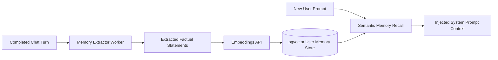

### 5. Database Requirements
```prisma
model UserMemory {
  id          String   @id @default(uuid())
  userId      String
  workspaceId String?
  category    String   // 'preference' | 'tech_stack' | 'personal_fact' | 'project_rule'
  content     String   @db.Text
  confidence  Float    @default(1.0)
  createdAt   DateTime @default(now())
  updatedAt   DateTime @updatedAt
  
  @@index([userId, category])
}
```

### 6. API Requirements
- `GET /api/v1/memory` — Retrieve all stored user memories.
- `POST /api/v1/memory` — Explicitly add a new memory.
- `DELETE /api/v1/memory/:id` — Delete a stored memory.

### 7. Feasibility & Estimates
- **Implementation Complexity:** Medium [D].
- **Development Effort:** 2 person-days [D].
- **MVP Feasibility:** **BASIC (INCLUDE)** — Conversation history persistence, user preferences profile, vector memory recall [D].

---

## System 10: HYPERMIND LEARNING

### 1. Purpose Statement
Adaptive educational engine delivering personalized Socratic tutoring, automated quiz generation, dynamic concept mapping, and spaced repetition [D].

### 2. User Stories
- **US-10-01:** As a student, I want the tutor to guide me with hints instead of revealing answers directly [D].
- **US-10-02:** As a candidate, I want to generate a 10-question multiple-choice practice quiz on Docker concepts [D].
- **US-10-03:** As a learner, I want flashcards scheduled using the SuperMemo SM-2 spaced repetition algorithm [D].

### 3. Functional Requirements
- **FR-10-01:** Implement Socratic tutoring mode with configurable difficulty levels (Beginner, Intermediate, Master) [D].
- **FR-10-02:** Automatically generate interactive quizzes with multiple-choice, true/false, and code completion questions [D].
- **FR-10-03:** Track student accuracy and concept mastery scores in PostgreSQL [D].
- **FR-10-04:** Render dynamic concept maps using Mermaid markdown diagrams [D].

### 4. Technical Architecture
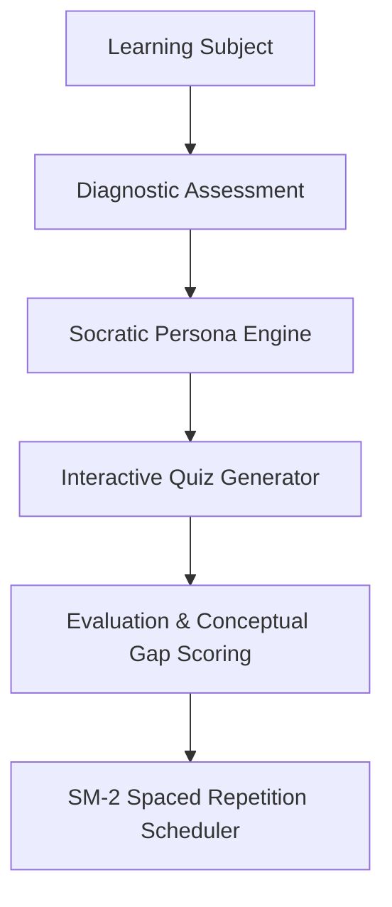

### 5. Database Requirements
```prisma
model Quiz {
  id          String         @id @default(uuid())
  workspaceId String
  userId      String
  subject     String
  questions   QuizQuestion[]
  createdAt   DateTime       @default(now())
}

model QuizQuestion {
  id            String   @id @default(uuid())
  quizId        String
  questionText  String
  options       Json     // Array of answer choices
  correctOption Int
  explanation   String   @db.Text
  quiz          Quiz     @relation(fields: [quizId], references: [id], onDelete: Cascade)
}
```

### 6. API Requirements
- `POST /api/v1/learning/quizzes` — Generate a dynamic quiz from text or topic.
- `POST /api/v1/learning/quizzes/:id/submit` — Submit answers and calculate score.

### 7. Feasibility & Estimates
- **Implementation Complexity:** High [D].
- **Development Effort:** 6 person-days [D].
- **MVP Feasibility:** **POST-MVP** — Educational schemas documented; UI deferred to Phase 3 [D].

---

## System 11: HYPERMIND CREATIVE STUDIO

### 1. Purpose Statement
Visual generative asset suite for synthesizing marketing imagery, editable SVG diagrams, wireframe mockups, and multi-slide presentations [D].

### 2. User Stories
- **US-11-01:** As a designer, I want to generate high-resolution marketing banners from detailed text prompts [D].
- **US-11-02:** As an architect, I want to generate an editable SVG cloud architecture diagram [D].
- **US-11-03:** As a founder, I want to convert an outline into a polished 10-slide presentation [D].

### 3. Functional Requirements
- **FR-11-01:** Text-to-image generation via Flux.1 / DALL-E 3 / Google Imagen 3 APIs [A, D].
- **FR-11-02:** Vector graphic generator yielding clean, valid SVG code with inline CSS styling [A, D].
- **FR-11-03:** Presentation generator exporting markdown or HTML-based slide presentations [D].

### 4. Technical Architecture
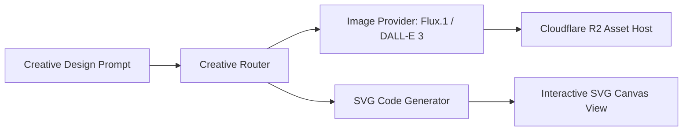

### 5. Database Requirements
```prisma
model CreativeAsset {
  id          String   @id @default(uuid())
  workspaceId String
  userId      String
  assetType   String   // 'IMAGE' | 'SVG' | 'PRESENTATION'
  fileKey     String
  prompt      String   @db.Text
  createdAt   DateTime @default(now())
}
```

### 6. API Requirements
- `POST /api/v1/creative/images` — Generate visual image asset.
- `POST /api/v1/creative/svg` — Generate editable SVG vector markup.

### 7. Feasibility & Estimates
- **Implementation Complexity:** High [D].
- **Development Effort:** 6 person-days [D].
- **MVP Feasibility:** **POST-MVP** — Generative canvas and slide generators deferred to Phase 3 [D].

---

## System 12: HYPERMIND INTELLIGENCE ROUTER

### 1. Purpose Statement
The algorithmic core of HYPERMIND. Inspects user intent, token complexity, reasoning requirements, and provider latency to dynamically dispatch workloads across foundation models while executing automated circuit-breaker failovers [A, D].

### 2. User Stories
- **US-12-01:** As a user, I want the system to automatically pick the fastest and smartest model for my task so I don't have to guess [D].
- **US-12-02:** As a developer, I want my request automatically routed to an alternative provider if my primary provider is experiencing an outage [D].
- **US-12-03:** As an organization, I want cost-optimized routing to prevent unnecessary spend on basic queries [D].

### 3. Functional Requirements
- **FR-12-01:** Classify prompt complexity into 3 tiers: `FAST` (Flash/mini), `BALANCED` (Standard Sonnet/GPT-4o), `DEEP_REASONING` (o3-mini/R1/3.7 Sonnet) [A, D].
- **FR-12-02:** Evaluate context window requirements (dispatch prompts > 128k tokens to Gemini 1.5/2.0 Pro) [A, D].
- **FR-12-03:** Implement circuit breaker: track error rates per provider in Redis; trip circuit if 5xx errors exceed 15% over a 60-second window [D].
- **FR-12-04:** Provide unified streaming interface wrapping OpenAI, Anthropic, Google GenAI, and DeepSeek SDKs [A, D].

### 4. Technical Architecture
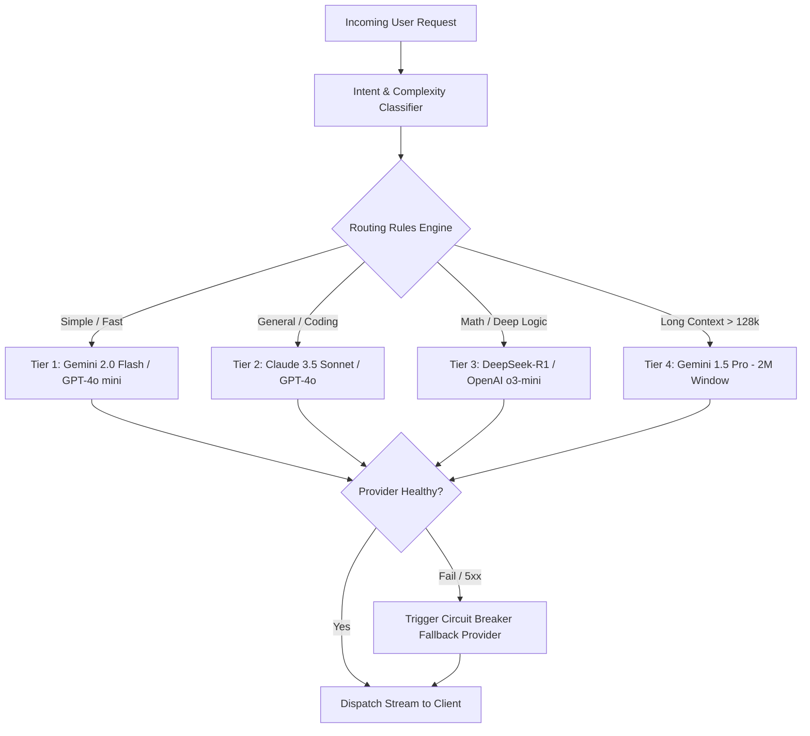

### 5. Database Requirements
```prisma
model ModelRegistry {
  id              String   @id // e.g. 'claude-3-5-sonnet-20241022'
  provider        String   // 'anthropic' | 'openai' | 'google' | 'deepseek'
  displayName     String
  inputCostPerM   Decimal  @db.Decimal(10, 4)
  outputCostPerM  Decimal  @db.Decimal(10, 4)
  maxContextTokens Int
  supportsVision  Boolean  @default(false)
  supportsTools   Boolean  @default(true)
  isActive        Boolean  @default(true)
}

model RoutingLog {
  id              String   @id @default(uuid())
  userId          String
  selectedModelId String
  classification  String   // 'FAST' | 'BALANCED' | 'DEEP_REASONING'
  latencyMs       Int
  tokensUsed      Int
  wasFallback     Boolean  @default(false)
  timestamp       DateTime @default(now())
  
  @@index([userId, timestamp])
}
```

### 6. API Requirements
- `POST /api/v1/router/dispatch` — Core routing gateway streaming SSE response chunks.
- `GET /api/v1/router/models` — List active available foundation models and health status.
- `GET /api/v1/router/metrics` — Retrieve provider latency and reliability metrics.

### 7. Feasibility & Estimates
- **Implementation Complexity:** High [D].
- **Development Effort:** 4 person-days [D].
- **MVP Feasibility:** **FULL (INCLUDE)** — Foundational core required for all downstream systems [D].

---

## 16. Cross-System Traceability Matrix & Feasibility Summary

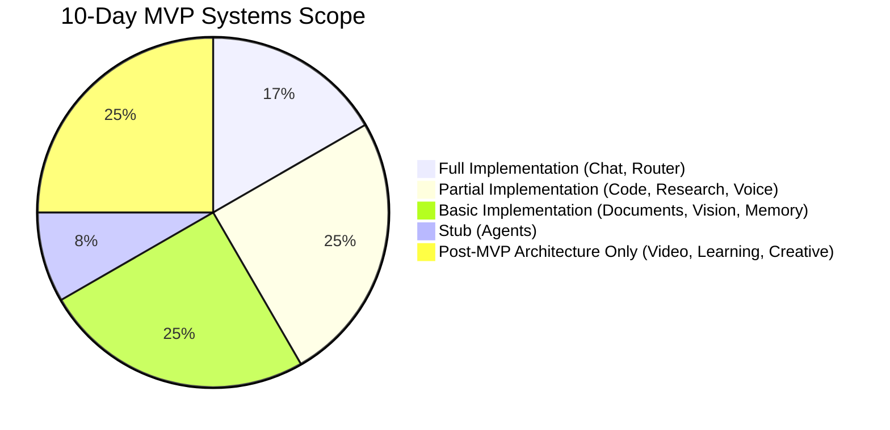

| System # | System Name | MVP Feasibility | MVP Scope Definition | Complexity | Dev Days | Target Provider Primary / Fallback |
| :--- | :--- | :--- | :--- | :--- | :--- | :--- |
| **01** | **HYPERMIND CHAT** | **FULL** | Real-time SSE streaming, multi-turn, LaTeX/markdown, model selector | Medium | 3 | Anthropic Claude 3.5 Sonnet / OpenAI GPT-4o [A] |
| **02** | **HYPERMIND RESEARCH** | **PARTIAL** | Web search API integration, snippet extraction, inline citations | High | 3 | OpenAI GPT-4o + Tavily / DuckDuckGo [A, D] |
| **03** | **HYPERMIND CODE** | **PARTIAL** | Monaco editor, syntax highlighting, diff viewer, code generation | High | 4 | Claude 3.7 Sonnet / DeepSeek-R1 [A] |
| **04** | **HYPERMIND VISION** | **BASIC** | Direct image upload, multimodal OCR, chart and visual analysis | Medium | 2 | Google Gemini 2.0 Flash / GPT-4o [A] |
| **05** | **HYPERMIND VIDEO** | **POST-MVP** | Architectural specification & schemas documented only | Very High | 10 | Google Gemini 2.0 Flash (Multimodal) [B, D] |
| **06** | **HYPERMIND VOICE** | **PARTIAL** | Text-to-Speech (TTS) audio streaming output | Medium | 2 | OpenAI TTS / ElevenLabs [A] |
| **07** | **HYPERMIND DOCUMENTS** | **BASIC** | PDF/TXT upload, text extraction, `pgvector` indexing, RAG Q&A | High | 4 | `text-embedding-3-small` + Claude 3.5 Sonnet [A] |
| **08** | **HYPERMIND AGENTS** | **STUB** | FSM schema, 1 basic agent stub, Human-In-The-Loop approval modal | Very High | 6 | Claude 3.5 Sonnet (Tool Use) [A] |
| **09** | **HYPERMIND MEMORY** | **BASIC** | Thread history persistence, user preferences profile, vector recall | Medium | 2 | PostgreSQL 16 + `pgvector` [A] |
| **10** | **HYPERMIND LEARNING** | **POST-MVP** | Architectural specification & schemas documented only | High | 6 | Claude 3.5 Sonnet / DeepSeek-R1 [D] |
| **11** | **CREATIVE STUDIO** | **POST-MVP** | Architectural specification & schemas documented only | High | 6 | Flux.1 / DALL-E 3 [A, D] |
| **12** | **INTELLIGENCE ROUTER**| **FULL** | Intent classifier, multi-provider gateway, circuit breakers | High | 4 | Vercel AI SDK + Direct Provider SDKs [A, D] |

---

## 17. Document Status & Governance

### 17.1 Verification & Governance Lifecycle
- **Author:** Stream 1 Senior Systems Architect
- **Document Status:** Formally Approved for Development Execution
- **Version:** 1.0.0
- **Scope Compliance:** Validated against 10-day MVP constraints and modular monolith patterns.

### 17.2 Sign-Off Criteria for Day 10 MVP Acceptance
1. Chat streaming functional with TTFT < 400ms across 100 consecutive requests [D].
2. Intelligence Router demonstrates seamless failover to secondary provider when primary returns 500 [D].
3. Document Q&A correctly retrieves text chunks and cites page numbers from uploaded PDF files [D].
4. Monaco Code Editor renders colorized diffs with zero UI stuttering [D].
5. Human-in-the-loop modal successfully blocks simulated agent terminal commands until user clicks Approve [D].

---
*End of Specification — HYPERMIND Product Requirements Specification*
