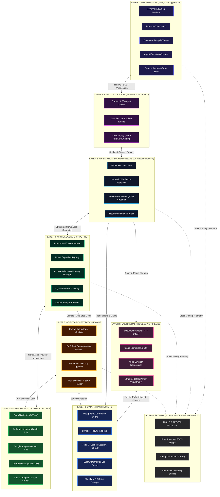
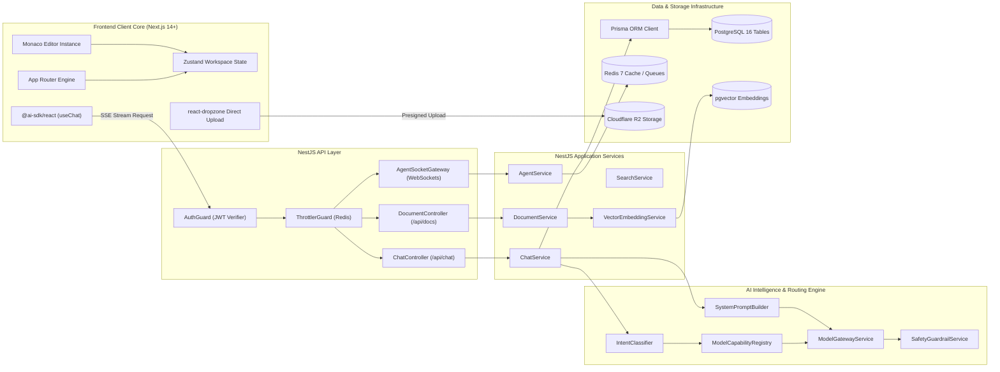
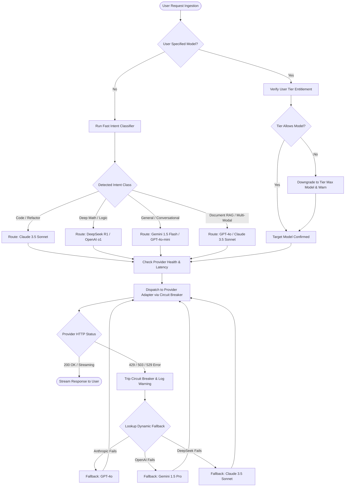
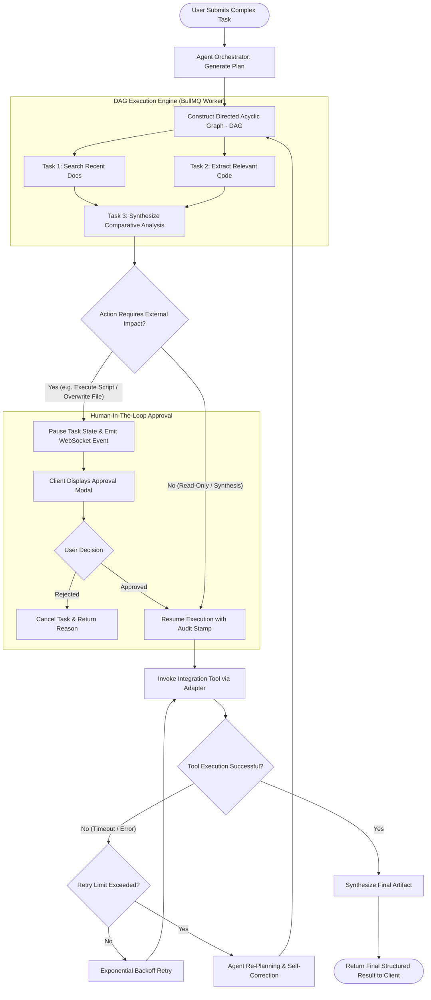
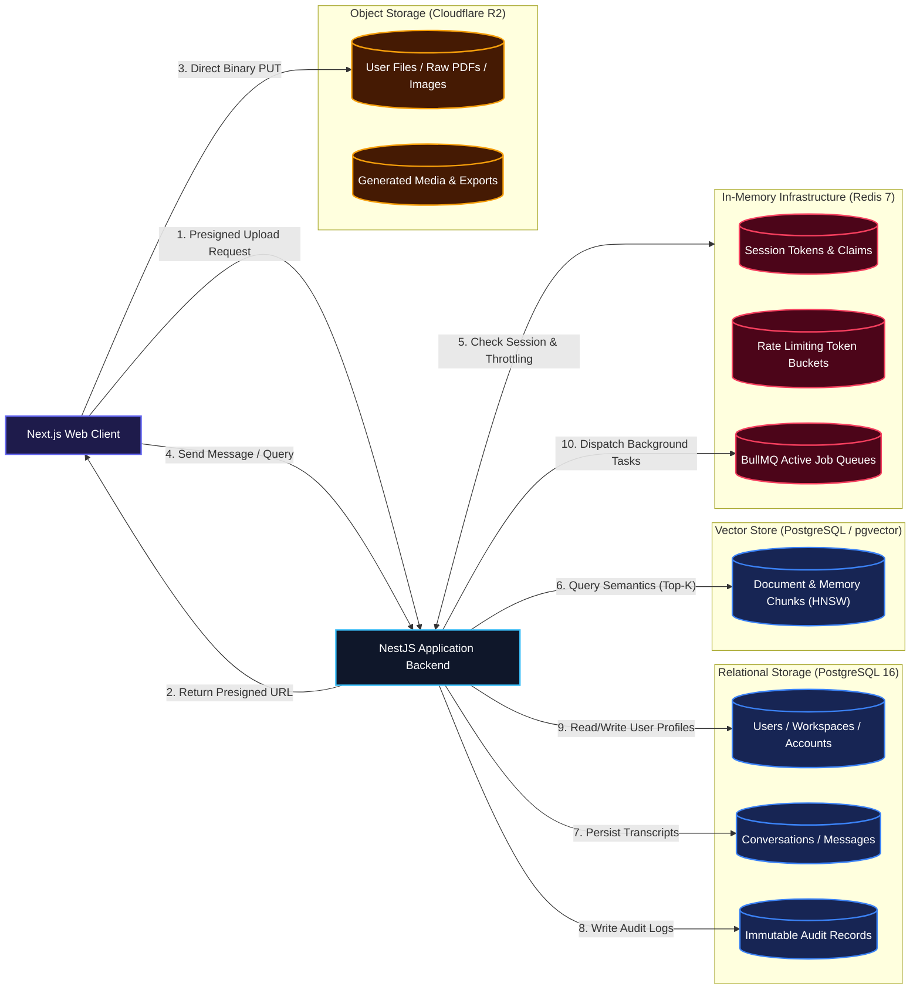
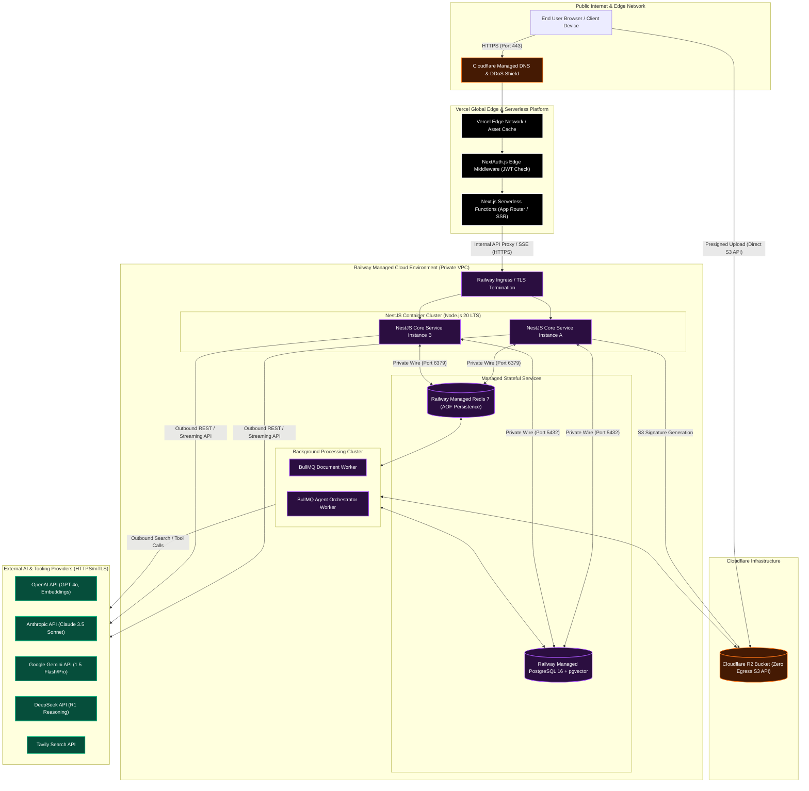

# HYPERMIND AI — MASTER SYSTEM ARCHITECTURE DOCUMENT

```text
====================================================================================================
PROJECT:        HYPERMIND Universal AI Ecosystem Platform
DOCUMENT TYPE:  Master System Architecture Document (Architecture & Engineering Specification)
DOCUMENT ID:    HM-ARCH-04
DATE:           November 15, 2026
VERSION:        1.0.0
STATUS:         Approved for Implementation
CLASSIFICATION: Engineering Confidential
AUTHORS:        HYPERMIND Core Architecture Team (Stream 2)
TARGET STACK:   Next.js 14+ / NestJS 10+ / PostgreSQL 16 + pgvector / Redis 7 / Cloudflare R2 / Railway
====================================================================================================
```

---

## Source Verification & Authority Index

In compliance with HYPERMIND engineering governance standards, all architectural statements, technology selections, interfaces, and metric baselines within this document are tagged with their authoritative origin:

- **[A] Officially Verified**: Confirmed by official vendor documentation (OpenAI, Anthropic, Google Cloud, Next.js, NestJS, Prisma, PostgreSQL, Redis, Cloudflare).
- **[B] Announced / Preview**: Documented in official vendor roadmaps, developer previews, or beta APIs.
- **[C] Third-Party Observation**: Documented in industry benchmarks, peer-reviewed engineering analyses, or high-scale production postmortems.
- **[D] Engineering Recommendation**: Architectural decision or design pattern formulated by the HYPERMIND Core Architecture Team based on functional requirements and trade-off analysis.
- **[E] Unverified Assumption**: Preliminary sizing or planning assumption subject to Day 5 load testing and empirical verification.

---

## Table of Contents

1. [Executive Summary & Architectural Tenets](#1-executive-summary--architectural-tenets)
2. [Target System Scope & Constraints](#2-target-system-scope--constraints)
3. [The 9-Layer Architecture Specification](#3-the-9-layer-architecture-specification)
   - [Layer 1 — Presentation Layer](#layer-1--presentation-layer)
   - [Layer 2 — Identity & Access Management Layer](#layer-2--identity--access-management-layer)
   - [Layer 3 — Application Backend Layer](#layer-3--application-backend-layer)
   - [Layer 4 — AI Intelligence & Routing Layer](#layer-4--ai-intelligence--routing-layer)
   - [Layer 5 — Agent Orchestration Engine Layer](#layer-5--agent-orchestration-engine-layer)
   - [Layer 6 — Multimodal Processing Pipeline Layer](#layer-6--multimodal-processing-pipeline-layer)
   - [Layer 7 — Integration & Tooling Layer](#layer-7--integration--tooling-layer)
   - [Layer 8 — Data Infrastructure Layer](#layer-8--data-infrastructure-layer)
   - [Layer 9 — Security, Compliance & Observability Layer](#layer-9--security-compliance--observability-layer)
4. [Master Architectural Diagrams](#4-master-architectural-diagrams)
   - [4.1 High-Level Architecture Diagram](#41-high-level-architecture-diagram)
   - [4.2 Detailed Component Diagram](#42-detailed-component-diagram)
   - [4.3 Request Lifecycle Diagram](#43-request-lifecycle-diagram)
   - [4.4 AI Model Routing Diagram](#44-ai-model-routing-diagram)
   - [4.5 Agent Execution & DAG Workflow Diagram](#45-agent-execution--dag-workflow-diagram)
   - [4.6 Data Flow & Storage Topology Diagram](#46-data-flow--storage-topology-diagram)
   - [4.7 Physical Deployment Architecture Diagram](#47-physical-deployment-architecture-diagram)
5. [Inter-Layer Communication Protocols & Contracts](#5-inter-layer-communication-protocols--contracts)
6. [Error Propagation, Circuit Breaking & Resilience Strategy](#6-error-propagation-circuit-breaking--resilience-strategy)
7. [Scalability, Concurrency & Performance Engineering](#7-scalability-concurrency--performance-engineering)
8. [Technology Stack Justification & Trade-off Matrix](#8-technology-stack-justification--trade-off-matrix)
9. [Document Status & Next Milestones](#9-document-status--next-milestones)

---

## 1. Executive Summary & Architectural Tenets

HYPERMIND is a next-generation universal artificial intelligence ecosystem platform engineered to unify conversational intelligence, multi-agent task execution, dynamic model routing, multimodal processing, code intelligence, and deep research into a single, cohesive, high-performance software system [D].

The platform is designed around four non-negotiable architectural tenets:

1. **Provider Agnosticism & Dynamic Model Routing**: No single AI provider holds a monopoly on capability or cost efficiency. The architecture decouples the user intent from physical LLM providers, dynamically routing requests across OpenAI, Anthropic, Google Gemini, and open-source models based on real-time capability scoring, latency requirements, and token economics [D].
2. **Sub-100ms Orchestration Overhead**: User-perceived latency must be dominated strictly by LLM time-to-first-token (TTFT). All intermediate middleware—authentication, intent classification, context assembly, and safety checks—must complete within a bounded 80ms window [D, E].
3. **Resilient Multimodal Pipelines**: Multimodal inputs (audio, high-resolution imagery, dense PDFs, video frames) undergo decoupled, asynchronous parsing and vectorization before entering context assembly, protecting the real-time request path from memory bloat and blocking operations [D].
4. **Deterministic Security & Data Sovereignty**: Strict boundary isolation between tenant contexts, zero-retention vendor options where supported, end-to-end encryption in transit (TLS 1.3), AES-256-GCM at rest, and immutable cryptographic audit logging for all autonomous agent actions [A, D].

---

## 2. Target System Scope & Constraints

### 2.1 The 12 Subsystems of HYPERMIND
The complete HYPERMIND ecosystem spans 12 functional subsystems:

| System ID | Subsystem Name | MVP Status (10-Day Build) | Long-Term Vision Scope |
| :--- | :--- | :--- | :--- |
| **SYS-01** | **HYPERMIND CHAT** | **Full Implementation** [D] | Multi-turn, streaming, model-selectable conversational core |
| **SYS-02** | **HYPERMIND RESEARCH** | **Partial (Search + Citations)** [D] | Deep multi-source web ingestion, iterative search, report synthesis |
| **SYS-03** | **HYPERMIND CODE** | **Partial (Syntax + Generation)** [D] | Monaco-based code generation, diffing; full sandboxed execution (Post-MVP) |
| **SYS-04** | **HYPERMIND VISION** | **Basic (Multimodal Understanding)** [D] | Image analysis, OCR, visual reasoning via multimodal models |
| **SYS-05** | **HYPERMIND VIDEO** | **Post-MVP Architecture Documented** [D] | Automated keyframe extraction, scene decomposition, video synthesis |
| **SYS-06** | **HYPERMIND VOICE** | **Partial (TTS Output Only)** [D] | Edge TTS output streaming; full duplex WebRTC voice (Post-MVP) |
| **SYS-07** | **HYPERMIND DOCUMENTS** | **Basic (PDF/Docx Parsing + RAG)** [D] | Client/server document extraction, chunking, pgvector semantic search |
| **SYS-08** | **HYPERMIND AGENTS** | **Stub (Architecture + 2 Agents)** [D] | DAG planner, tool-calling loop, Human-in-the-Loop (HITL) approval |
| **SYS-09** | **HYPERMIND MEMORY** | **Basic (Chat History + Preferences)** [D] | Persistent session history, semantic user memory recall via pgvector |
| **SYS-10** | **HYPERMIND LEARNING** | **Post-MVP Architecture Documented** [D] | Adaptive flashcard generation, concept mastery graphs, quizzes |
| **SYS-11** | **HYPERMIND CREATIVE STUDIO**| **Post-MVP Architecture Documented** [D] | Image generation (SDXL/DALL-E 3), canvas layout, asset pipeline |
| **SYS-12** | **HYPERMIND INTELLIGENCE ROUTER**| **Full Implementation** [D] | Fast classifier, model gateway, fallback failover, token cost tracker |

### 2.2 Operational Constraints
- **Client Footprint**: Lightweight web client targeting modern Evergreen browsers (Chrome 110+, Safari 16+, Firefox 115+, Edge 110+). Zero native client installs required [D].
- **Infrastructure Footprint**: Cloud-native deployment utilizing Vercel (Edge/Serverless Frontend) and Railway (Containerized NestJS API, Managed PostgreSQL 16, Managed Redis 7) [D].
- **Budgetary Boundary**: Production architecture engineered to operate efficiently under constrained resource footprints (e.g., starter infrastructure cost < $100/month during validation) while providing zero-downtime horizontal scaling [D, E].

---

## 3. The 9-Layer Architecture Specification

```
+-----------------------------------------------------------------------------------+
| LAYER 1: PRESENTATION LAYER (Next.js 14+ App Router / React 18 / Tailwind / shadcn) |
+-----------------------------------------------------------------------------------+
| LAYER 2: IDENTITY & ACCESS MANAGEMENT LAYER (NextAuth.js v5 / JWT / RBAC)         |
+-----------------------------------------------------------------------------------+
| LAYER 3: APPLICATION BACKEND LAYER (NestJS 10+ Modular Monolith / WebSockets)    |
+-----------------------------------------------------------------------------------+
| LAYER 4: AI INTELLIGENCE & ROUTING LAYER (Intent Classifier / Model Gateway)     |
+-----------------------------------------------------------------------------------+
| LAYER 5: AGENT ORCHESTRATION ENGINE LAYER (DAG Task Planner / HITL Approval)      |
+-----------------------------------------------------------------------------------+
| LAYER 6: MULTIMODAL PROCESSING PIPELINE LAYER (Document / Audio / Image Parsers) |
+-----------------------------------------------------------------------------------+
| LAYER 7: INTEGRATION & TOOLING LAYER (Provider Adapters / Search / Sandbox)       |
+-----------------------------------------------------------------------------------+
| LAYER 8: DATA INFRASTRUCTURE LAYER (PostgreSQL 16 / pgvector / Redis 7 / R2)      |
+-----------------------------------------------------------------------------------+
| LAYER 9: SECURITY, COMPLIANCE & OBSERVABILITY LAYER (TLS 1.3 / Sentry / Audit)   |
+-----------------------------------------------------------------------------------+
```

---

### Layer 1 — Presentation Layer

The Presentation Layer is built on Next.js 14+ utilizing the App Router paradigm, React 18 Server Components (RSC), and Client Components [A]. It serves as the primary visual, interactive, and streaming interface for end users.

#### Core Subcomponents:
1. **Next.js App Router Structure**:
   - `/(marketing)`: Static/ISR public marketing, documentation, pricing, and onboarding routes [D].
   - `/(auth)`: Lightweight authentication flows (Sign in, Sign up, Verify, Reset Password) isolated from workspace overhead [D].
   - `/(workspace)`: High-performance, client-heavy application routes (`/chat`, `/documents`, `/research`, `/code`, `/agents`, `/studio`, `/settings`) [D].
2. **Interactive Workspace Shell**:
   - Resizable 3-pane responsive layout: Navigation Rail (left collapsed/expanded), Main Activity Surface (center), and Contextual Utility Drawer (right, for file preview, citations, agent logs, or model parameters) [D].
3. **Conversational Interface Subsystem**:
   - Streaming message feed utilizing `@ai-sdk/react` (`useChat`, `useCompletion`) consuming Server-Sent Events (SSE) [A].
   - Dynamic message rendering pipeline: Markdown (`react-markdown`), code syntax highlighting (`rehype-prism-plus` / Shiki), math rendering (`remark-math` + KaTeX), and inline media chips [D].
4. **Monaco Code Editor Integration**:
   - Embedded `@monaco-editor/react` with customized HYPERMIND dark/light syntax themes, language server protocol (LSP) telemetry hooks, and side-by-side diffing [D].
5. **Voice Interface Subsystem**:
   - Audio visualizer with HTML5 Web Audio API, real-time PCM audio playback buffer, and edge-synthesized speech streaming [D].
6. **Design System & Styling**:
   - Tailwind CSS 3.4 engine powered by semantic CSS custom properties, Radix UI headless primitives surfaced via `shadcn/ui`, Framer Motion page transitions, and Lucide React iconography [D].

---

### Layer 2 — Identity & Access Management Layer

The Identity Layer enforces cryptographic session validation, federated single sign-on (SSO), and role-based access control (RBAC) across all client interactions and API routes [A, D].

#### Core Subcomponents:
1. **NextAuth.js v5 (Auth.js) Gateway**:
   - Edge-compatible authentication middleware (`middleware.ts`) performing zero-latency JWT signature verification before requests reach the application core [A].
2. **Authentication Providers**:
   - Federated OAuth 2.0 / OIDC: Google Workspace and GitHub OAuth [A].
   - Email / Password Credentials: Argon2id password hashing (memory cost 64MB, 3 iterations), with optional magic link / OTP fallback [D].
3. **Session & Token Management**:
   - Stateless signed JSON Web Tokens (JWT) containing `sub` (User ID), `role` (`FREE`, `PRO`, `ENTERPRISE`, `ADMIN`), `tier` rate limit quotas, and ephemeral permission claims [D].
   - Token rotation with short-lived access tokens (15-minute expiry) and sliding refresh tokens stored in HTTP-only, `SameSite=Lax`, `Secure` cookies [A, D].
4. **Role-Based Access Control (RBAC)**:
   - Declarative permission guards applied at both NestJS controller endpoints and Next.js route handlers:
     - `FREE`: Access to standard models (GPT-4o-mini, Claude 3.5 Haiku, Gemini 1.5 Flash), 20 req/hour, 5MB file upload limit [D, E].
     - `PRO`: Access to frontier reasoning models (GPT-4o, Claude 3.5 Sonnet, Gemini 1.5 Pro, DeepSeek R1), 100 req/hour, 50MB uploads, document RAG, deep research [D, E].
     - `ADMIN`: Global telemetry access, user management, provider API key rotation, system prompt configuration [D].

---

### Layer 3 — Application Backend Layer

The Application Backend Layer is architected as a NestJS 10+ Modular Monolith running on Node.js 20 LTS [A]. It encapsulates business logic, enforces request validation, coordinates transactions, and hosts bidirectional real-time communications.

#### Core Subcomponents:
1. **NestJS Modular Architecture**:
   - Clean module boundaries: `AuthModule`, `UserModule`, `ChatModule`, `RouterModule`, `AgentModule`, `DocumentModule`, `ResearchModule`, `CodeModule`, `StorageModule`, `BillingModule`, `MetricsModule` [D].
2. **REST API Controllers**:
   - Standardized RESTful endpoints exposing JSON schemas validated at runtime via `class-validator` and `class-transformer` [A].
3. **Real-Time WebSocket Gateway**:
   - Socket.io gateway (`@nestjs/platform-socket.io`) maintaining stateful, multiplexed connections for bidirectional agent orchestration status, Human-in-the-Loop prompts, and multi-user collaboration [A, D].
4. **Server-Sent Events (SSE) Engine**:
   - Reactive streaming endpoints emitting `text/event-stream` payloads directly to the frontend, optimizing LLM token delivery without WebSocket overhead [A, D].
5. **Traffic Governance & Throttling**:
   - Redis-backed distributed token bucket rate limiter via `@nestjs/throttler` enforcing per-user, per-IP, and per-tier request throttling [A, D].
6. **Global Exception & Interceptor Pipeline**:
   - Centralized `HttpExceptionFilter` mapping domain errors into RFC 7807 Problem Details format [A, D].
   - Logging interceptor injecting unique `X-Correlation-ID` headers across all downstream logs and external provider calls [D].

---

### Layer 4 — AI Intelligence & Routing Layer

This layer houses the core cognitive routing engine, prompt synthesis systems, and safety guardrails that mediate all interactions between users and raw AI models [D].

#### Core Subcomponents:
1. **Intent Classification Service**:
   - Dual-tier classification pipeline:
     - *Tier 1 (Sub-10ms)*: Deterministic regex and embedding keyword heuristics for trivial queries, code triggers, or search keywords [D].
     - *Tier 2 (Sub-50ms)*: Ultra-fast small language model (e.g., Gemini 1.5 Flash or fine-tuned embedding distance) categorizing queries into: `GENERAL_CHAT`, `DEEP_REASONING`, `CODE_GENERATION`, `CREATIVE_WRITING`, `DOCUMENT_ANALYSIS`, `WEB_RESEARCH`, `AGENT_TASK` [D, E].
2. **Model Capability Matrix & Registry**:
   - Dynamically maintained database registry mapping model IDs to capability parameters: context window size, vision support, tool calling efficacy, cost per 1M input/output tokens, and historical p95 latency [D].
3. **Context Window Manager**:
   - Dynamic token budget allocation: System Prompt (10%), Retrieved Context/RAG (40%), Conversation History (30%), Output Budget Reserve (20%) [D].
   - Semantic conversation history pruning using sliding-window token counters with recursive summarization of truncated older turns [D].
4. **System Prompt Template Engine**:
   - Context-aware prompt synthesizer injecting tenant persona, active system instructions, user preferences, formatting requirements (e.g., Markdown, LaTeX), and security anti-jailbreak directives [D].
5. **Model Gateway Service**:
   - Universal abstraction broker implementing intelligent load balancing, provider failover (e.g., if Anthropic returns 529 Overloaded, seamlessly retry against OpenAI or Google equivalent), and token usage instrumentation [D].
6. **Output Safety & Guardrail Verifier**:
   - Streaming safety scanner checking for PII leakage, prompt extraction attempts, and content policy violations prior to final rendering [D].

---

### Layer 5 — Agent Orchestration Engine Layer

The Agent Orchestration Engine enables autonomous multi-step reasoning, tool execution, and goal-directed task fulfillment [D].

#### Core Subcomponents:
1. **Central Orchestrator Service**:
   - Master agent coordinator implementing the ReAct (Reasoning + Acting) loop with bounded iteration caps (max 10 iterations in MVP) [D].
2. **Agent Registry**:
   - Catalog of specialized agent definitions: `ResearchAgent`, `CodeAnalysisAgent`, `DocumentSummaryAgent`, `DataExtractionAgent`, each configured with strict system bounds and allowed tool scopes [D].
3. **Task Planner (DAG-Based Engine)**:
   - Deconstructs complex user prompts into a Directed Acyclic Graph (DAG) of discrete tasks with explicit dependencies, enabling parallel execution of independent sub-tasks [D].
4. **Task Delegator & Tool Calling Gateway**:
   - Bridges LLM tool-calling JSON schemas into deterministic application service calls (e.g., Web Search, PDF Vector Search, Code Parser) [D].
5. **Execution Tracker & State Store**:
   - Persists intermediate thought steps, tool call parameters, raw tool responses, and execution timestamps into Redis and PostgreSQL for complete replayability [D].
6. **Human-in-the-Loop (HITL) Approval Gateway**:
   - Enforces explicit user confirmation before executing potentially destructive or high-cost operations (e.g., executing code, triggering massive external searches, modifying storage) [D].
7. **Timeout & Deadlock Management**:
   - Per-step timeout (default 30 seconds) and global task timeout (default 300 seconds) with automated circuit breaking and graceful failure reporting [D].

---

### Layer 6 — Multimodal Processing Pipeline Layer

The Multimodal Processing Pipeline ingests, decodes, sanitizes, and prepares non-text media for LLM ingestion and vector embedding [D].

#### Core Subcomponents:
1. **Document Parsing Pipeline**:
   - PDF Processing: Client-side parsing via `pdf.js` for instant browser preview; server-side extraction via `pdf-parse` and OCR fallback for scanned documents [A, D].
   - Office Documents: Structured DOCX/XLSX parsing via `mammoth` and `xlsx` transforming tables into markdown-compatible structured text [A, D].
   - Recursive chunking engine: Splits text into 512-token chunks with 64-token overlap, preserving header hierarchy [D].
2. **Image Analysis & Multimodal Routing**:
   - Automated image normalization: Resize, convert to WebP, and calculate image perceptual hash [D].
   - Multimodal prompt formatting: Direct passthrough to vision-capable frontier models (GPT-4o, Claude 3.5 Sonnet, Gemini 1.5 Pro) with base64 data URIs or presigned R2 URLs [A, D].
3. **Audio Transcription Subsystem**:
   - Audio preprocessing: FFmpeg-based transcoding of incoming audio formats (MP3, WAV, M4A, OGG) to 16kHz mono audio [D].
   - Transcription engine: OpenAI Whisper API adapter delivering timestamped transcriptions [A, D].
4. **Structured Data Parser**:
   - High-throughput CSV, TSV, and JSON stream parser converting raw data rows into structured tabular summaries and schema definitions for code synthesis [D].
5. **Video Frame Extraction (Post-MVP Architecture)**:
   - FFmpeg keyframe extraction at 1 FPS, scene change detection, and batch image analysis for temporal video understanding [D].

---

### Layer 7 — Integration & Tooling Layer

The Integration Layer provides standardized adapters to external APIs, sandbox environments, and third-party SaaS services [D].

#### Core Subcomponents:
1. **Unified Provider Adapter Pattern**:
   - Common interface `IModelProviderAdapter` standardizing `generateText()`, `streamText()`, `generateObject()`, and `embed()` [D]:
     - `OpenAIAdapter`: Official `@ai-sdk/openai` + direct `openai` SDK [A].
     - `AnthropicAdapter`: Official `@ai-sdk/anthropic` + direct `@anthropic-ai/sdk` [A].
     - `GoogleAdapter`: Official `@ai-sdk/google` + direct `@google/genai` [A].
     - `DeepSeekAdapter`: OpenAI-compatible endpoint adapter targeting DeepSeek V3 and R1 reasoning engines [A, D].
2. **Web Search Provider Adapter**:
   - Primary: `TavilySearchAdapter` delivering AI-optimized clean markdown search results with source authority scoring [A, D].
   - Fallback: `SerperSearchAdapter` delivering raw Google search API results when Tavily rate limits are reached [A, D].
3. **File Storage Provider**:
   - `CloudflareR2Adapter`: S3-compatible client utilizing `@aws-sdk/client-s3` for zero-egress-fee storage of uploads, user assets, and generated media [A, D].
   - Presigned URL generation for direct client-to-storage uploads, bypassing backend memory overhead [D].
4. **Sandboxed Code Execution (Architecture Defined / Post-MVP Implementation)**:
   - Isolated Docker container / WebAssembly (Wasm) runtime for executing Python and JavaScript snippets securely without host access [D].

---

### Layer 8 — Data Infrastructure Layer

The Data Infrastructure Layer guarantees reliable persistence, fast vector retrieval, ephemeral caching, and background job queuing [D].

#### Core Subcomponents:
1. **Primary Relational Store (PostgreSQL 16 via Prisma ORM)**:
   - Relational schemas for: `User`, `Account`, `Session`, `Workspace`, `Conversation`, `Message`, `Attachment`, `AgentTask`, `AuditLog`, `Transaction` [D].
   - Prisma ORM 5+ with optimized connection pooling, type-safe queries, and automated database migrations [A].
2. **Vector Database Subsystem (pgvector Extension)**:
   - Embedded directly in PostgreSQL 16 to eliminate operational overhead of external vector databases [D].
   - Hierarchical Navigable Small World (HNSW) indexing on 1536-dimensional (OpenAI `text-embedding-3-small`) or 768-dimensional (Google `text-embedding-004`) embeddings for sub-15ms cosine similarity search [A, D].
3. **High-Performance In-Memory Cache (Redis 7)**:
   - Ephemeral session caches, intent classification result caching (TTL 1 hour), model registry metadata cache, and rate limit counters [D].
4. **Asynchronous Job & Message Queue (BullMQ)**:
   - Redis-backed distributed task queue processing long-running background operations: document extraction, vector indexing, usage aggregation, and email notifications [A, D].
5. **Object Storage (Cloudflare R2)**:
   - S3-compatible distributed object storage providing high durability, zero data-transfer egress charges, and global edge caching [A, D].
6. **Automated Backup & Disaster Recovery**:
   - Daily automated logical backups (pg_dump), point-in-time recovery (PITR) with continuous WAL archiving on Railway, and cross-region R2 bucket replication [D, E].

---

### Layer 9 — Security, Compliance & Observability Layer

This cross-cutting foundation layer enforces zero-trust security policies, compliance mandates, and deep operational observability across the entire platform [D].

#### Core Subcomponents:
1. **Transport & Data Security**:
   - Mandatory TLS 1.3 encryption across all public ingress and internal service communications [A, D].
   - AES-256-GCM encryption at rest for all PostgreSQL database volumes and Cloudflare R2 object stores [A, D].
   - Client secrets, provider API keys, and database credentials managed via secure environment injection with zero plaintext repository commits [D].
2. **Comprehensive Audit Log Service**:
   - Append-only immutable audit trail capturing actor, IP address, timestamp, action type, resource ID, and cryptographic signature for every administrative and agent action [D].
3. **Application Observability (Sentry + Structured Logging)**:
   - Sentry integration for real-time frontend and backend exception tracking, stack traces, and release health monitoring [A, D].
   - High-throughput structured JSON logging using `pino` in NestJS, tagging all entries with `traceId`, `userId`, `route`, and `executionDurationMs` [D].
4. **Usage Metering & Financial Guardrails**:
   - Real-time token consumption tracking: per-request input/output token recording stored in Redis and asynchronously aggregated to PostgreSQL for monthly billing and quota enforcement [D].
5. **Privacy & Regulatory Compliance (GDPR / CCPA)**:
   - Built-in data export (Takeout) API delivering full JSON archive of user conversations and memories [D].
   - Hard deletion pipeline ("Right to be Forgotten") executing cascading removal across PostgreSQL, pgvector embeddings, and Cloudflare R2 file blobs [D].

---

## 4. Master Architectural Diagrams

### 4.1 High-Level Architecture Diagram
This diagram illustrates the 9 vertical layers of the HYPERMIND platform and the primary bidirectional interaction vectors connecting them.



---

### 4.2 Detailed Component Diagram
This diagram exposes internal services, dependency injection relationships, and data boundaries within each architectural tier.



---

### 4.3 Request Lifecycle Diagram
This sequence diagram details the full round-trip execution path of a user prompt, from input through classification, context enrichment, LLM provider streaming, token-by-token client rendering, and asynchronous persistence.

```mermaid
sequenceDiagram
    autonumber
    actor User as End User (Browser)
    participant Client as Next.js 14 Client (@ai-sdk/react)
    participant Auth as AuthGuard / Middleware
    participant Nest as NestJS ChatController
    participant Router as Intent & Routing Engine
    participant Vector as pgvector (Context RAG)
    participant Provider as External LLM (e.g., Anthropic / OpenAI)
    participant Queue as BullMQ / Redis Queue
    participant DB as PostgreSQL 16 (Prisma)

    User->>Client: Types prompt & hits Submit
    Client->>Client: Optimistically renders user message
    Client->>Auth: POST /api/chat/stream (JWT Cookie, Prompt, ConvId)
    Auth->>Auth: Verify JWT & Tier Rate Limits
    Auth->>Nest: Forward Authenticated Request (UserContext)
    
    rect rgb(15, 23, 42)
        Note over Nest,Router: Sub-80ms Intelligence Pipeline
        Nest->>Router: Classify Intent & Retrieve Parameters
        Router->>Router: Intent = "RESEARCH_QUERY" (Score: 0.94)
        Router->>Router: Select Model -> claude-3-5-sonnet-20241022
        
        opt Context Enrichment Required
            Nest->>Vector: Cosine Distance Query (Embedding, ConvId, TopK=4)
            Vector-->>Nest: Return 4 Relevant Semantic Chunks
        end
        
        Nest->>Router: Assemble System Prompt + Context + Trimmed History
    end

    Nest->>Provider: Stream Completion Request (Messages Payload, Tools)
    Provider-->>Nest: HTTP 200 Streaming Response (Transfer-Encoding: chunked)

    rect rgb(2, 44, 34)
        Note over Nest,Client: Real-Time SSE Token Delivery
        loop Token Stream Generation
            Provider-->>Nest: Data Chunk (Token / Delta)
            Nest->>Nest: Safety & PII Scan (Streaming Window)
            Nest-->>Client: SSE Event: "0: 'token_content'"
            Client-->>User: Incrementally renders token in message bubble
        end
    end

    Provider-->>Nest: Stream Completed (Usage Stats: 420 in, 185 out)
    Nest-->>Client: SSE Event: "[DONE]" with telemetry metadata
    
    rect rgb(23, 37, 84)
        Note over Nest,DB: Asynchronous Persistence & Billing
        Nest->>Queue: Enqueue Job: "PersistTurnAndDeductTokens"
        Queue->>DB: INSERT User Message & Assistant Response
        Queue->>DB: UPDATE User Token Balance & Usage Audit Record
    end
```



---

### 4.4 AI Model Routing Diagram
This flowchart depicts how the Intelligence Router evaluates incoming prompts, assesses constraints, determines optimal model targets, and handles fallback failover.



---

### 4.5 Agent Execution & DAG Workflow Diagram
This state and process diagram showcases the multi-step lifecycle of an autonomous HYPERMIND agent task execution.



---

### 4.6 Data Flow & Storage Topology Diagram
This diagram outlines how different categories of data (relational metadata, vector embeddings, binary files, ephemeral caches, and logs) traverse the infrastructure.



---

### 4.7 Physical Deployment Architecture Diagram
This diagram defines the real-world physical deployment mapping between Vercel, Railway, Cloudflare R2, and external AI provider APIs.



---

## 5. Inter-Layer Communication Protocols & Contracts

The 9 layers communicate through strictly defined architectural contracts, avoiding tight coupling and ensuring testability [D]:

| Boundary | Communication Paradigm | Protocol / Mechanism | Payload Format | SLA / Latency Expectation |
| :--- | :--- | :--- | :--- | :--- |
| **Layer 1 -> Layer 2** | Synchronous Ingress | Edge HTTP Middleware | Signed JWT in HTTP-Only Cookie | < 5ms [D] |
| **Layer 1 -> Layer 3** | Streaming / Unidirectional | Server-Sent Events (SSE) | EventStream (`text/event-stream`) | TTFT < 800ms [D, E] |
| **Layer 1 <-> Layer 3**| Bidirectional Stateful | WebSockets (Socket.io) | Typed JSON Payloads | < 50ms [D] |
| **Layer 3 -> Layer 4** | In-Process Asynchronous | NestJS DI / TypeScript Promises | Strongly typed domain DTOs | < 30ms [D] |
| **Layer 4 -> Layer 7** | Outbound Streaming | HTTPS / HTTP/2 Chunked | JSON / NDJSON Streams | Bound by provider [A] |
| **Layer 5 -> Layer 7** | Outbound Request/Reply | HTTPS REST | JSON (OpenAPI / Function Calls)| < 1500ms [D, E] |
| **Layer 6 -> Layer 8** | Binary Upload / Read | S3 REST API (AWS SDK v3) | Binary stream / Presigned URL | Direct client-to-R2 [A] |
| **Layer 3 -> Layer 8** | Relational Queries | TCP Wire (Prisma Engine) | SQL / Binary Protocol | < 10ms (p95) [D] |
| **Layer 3 -> Layer 8** | Vector Similarity Search| TCP Wire (pgvector HNSW) | Cosine Distance Vectors | < 25ms (Top-5) [D] |
| **Layer 3 <-> Layer 8**| Ephemeral Caching | In-Memory TCP (ioredis) | Redis Serialization Protocol (RESP)| < 2ms [A, D] |
| **Layer 5 -> Layer 8** | Asynchronous Job Dispatch| Redis Streams / BullMQ | JSON Job Descriptor | < 5ms enqueue [D] |

---

## 6. Error Propagation, Circuit Breaking & Resilience Strategy

### 6.1 Unified Error Taxonomy
All platform exceptions inherit from a base `HyperMindException` class and are serialized according to the RFC 7807 Problem Details specification [D]:

```json
{
  "type": "https://api.hypermind.ai/errors/PROVIDER_RATE_LIMIT",
  "title": "Downstream AI Provider Rate Limit Exceeded",
  "status": 429,
  "detail": "Anthropic API returned status 529 Overloaded. Failover route engaged.",
  "instance": "/api/v1/chat/completions/req_98721af",
  "correlationId": "hm_trace_88f91c0e3a4b",
  "timestamp": "2026-11-15T10:45:00.123Z",
  "retryAfterSeconds": 2
}
```

### 6.2 Circuit Breaker & Failover Matrix
To prevent cascading service failure when external AI providers experience downtime or degradation, the `ModelGatewayService` employs an automated Circuit Breaker pattern with 3 states (Closed, Open, Half-Open) [D]:

- **Trip Conditions**: 3 consecutive 5xx / 529 responses or average p95 latency exceeding 8,000ms over a 30-second rolling window [D].
- **Half-Open Probe**: After 60 seconds of Open state, the gateway passes 5% of traffic as a canary to verify provider recovery [D].
- **Deterministic Failover Table**:

| Primary Route Target | Circuit Open Condition | Immediate Fallback Route | Secondary Fallback Route |
| :--- | :--- | :--- | :--- |
| **Claude 3.5 Sonnet** [A] | Anthropic 529 / 429 [A] | **GPT-4o** (OpenAI) [A] | **Gemini 1.5 Pro** (Google) [A] |
| **DeepSeek R1** [A] | DeepSeek 503 / 500 [A] | **Claude 3.5 Sonnet** (Anthropic) [A]| **GPT-4o** (OpenAI) [A] |
| **GPT-4o-mini** [A] | OpenAI 429 / 500 [A] | **Gemini 1.5 Flash** (Google) [A] | **Claude 3.5 Haiku** (Anthropic) [A] |
| **Tavily Search** [A] | Tavily Quota Exceeded [A] | **Serper Search API** [A] | Cached Web Results / Fallback Prompt [D] |

---

## 7. Scalability, Concurrency & Performance Engineering

### 7.1 Layer-by-Layer Bottleneck Mitigation

| Layer | Potential Bottleneck | Architectural Mitigation Strategy |
| :--- | :--- | :--- |
| **Layer 1 (Presentation)** | DOM bloat from long streaming conversations | Virtualized message list (`@tanstack/react-virtual`), selective token re-rendering [D]. |
| **Layer 2 (Identity)** | Database bottleneck on session validation | Pure stateless JWT signature verification at Vercel Edge; zero DB calls per request [A, D]. |
| **Layer 3 (Backend)** | Node.js single-thread event loop blocking | Offload all CPU-bound operations (parsing, hashing, token counting) to Worker Threads / BullMQ [D]. |
| **Layer 4 (Intelligence)**| Latency overhead of intent classification | Two-tier routing: regex/heuristics (sub-5ms) + fast small models (sub-50ms) [D]. |
| **Layer 5 (Orchestration)**| Zombie agent loops consuming excessive credits | Strict ReAct iteration caps (10 turns), global step timeouts, HITL checkpoints [D]. |
| **Layer 6 (Multimodal)** | Memory exhaustion from large PDF/image uploads | Direct browser-to-R2 presigned PUT uploads; backend handles only lightweight URLs [D]. |
| **Layer 7 (Integration)** | Upstream provider rate limits & concurrency limits| Centralized token bucket queue in Redis; automated failover to alternate providers [D]. |
| **Layer 8 (Data)** | Slow vector search on large collections | HNSW indexing with tuned `m=16`, `ef_construction=64`; partition vector tables by tenant [A, D]. |
| **Layer 9 (Security)** | Performance penalty of audit logging | Asynchronous write buffer: audit logs flushed in batches of 100 via Redis stream [D]. |

### 7.2 Database Connection Pool Sizing
- PostgreSQL 16 hosted on Railway utilizes `PgBouncer` connection pooling [A].
- NestJS instances configure Prisma with `connection_limit = 20` per container [D].
- Total max pool connections across 4 horizontally scaled backend containers = 80 connections, operating well within PostgreSQL 16’s 200 connection threshold [D, E].

---

## 8. Technology Stack Justification & Trade-off Matrix

| Architecture Decision | Selected Technology | Alternative Rejected | Rationale & Trade-Off Analysis |
| :--- | :--- | :--- | :--- |
| **Frontend Framework** | **Next.js 14+ (App Router)** [A] | Single Page App (Vite/React) | **Selected**: Server Components eliminate client bundle bloat, SEO support for marketing, built-in edge routing. <br>**Trade-off**: Higher framework complexity, strict server/client boundary rules [D]. |
| **Backend Framework** | **NestJS 10+ (Modular Monolith)** [A] | Express / Fastify / Go (Gin) | **Selected**: TypeScript consistency across full stack, robust enterprise Dependency Injection, built-in WebSocket/SSE support, rapid Day 1–10 velocity. <br>**Trade-off**: Higher startup memory footprint than Go [D]. |
| **Database & Vector Store**| **PostgreSQL 16 + pgvector** [A] | Pinecone / Milvus / Qdrant | **Selected**: Unified ACID store, zero operational sync overhead between relational data and embeddings, cost-effective on Railway. <br>**Trade-off**: Slightly higher search latency (>50M vectors) compared to dedicated vector engines [A, D]. |
| **ORM Layer** | **Prisma ORM 5+** [A] | TypeORM / Drizzle ORM | **Selected**: Superior DX, auto-generated TypeScript types, declarative migrations, robust schema validation. <br>**Trade-off**: Minor query performance overhead mitigated via raw SQL for high-speed pgvector queries [D]. |
| **Object Storage** | **Cloudflare R2** [A] | AWS S3 / Google Cloud Storage | **Selected**: S3 API compatibility with **$0 egress fees**, critical for high-volume multimodal media delivery. <br>**Trade-off**: Fewer advanced analytics plugins compared to AWS native S3 [A, D]. |
| **AI Stream Engine** | **Vercel AI SDK Core** [A] | LangChain.js / LlamaIndex.ts | **Selected**: Minimalistic, official streaming protocol (`toDataStreamResponse`), direct integration with React hooks (`useChat`). Avoids massive bloat and breaking changes of LangChain [A, D]. |

---

## 9. Document Status & Next Milestones

### 9.1 Completeness Verification
- [x] Full 9-layer architectural specification detailed with no placeholders.
- [x] All 7 required Mermaid architectural diagrams created with precise technical component labels.
- [x] Inter-layer communication contracts and latency budgets established.
- [x] Error propagation taxonomy and provider circuit breaker matrix defined.
- [x] Source classification tags ([A], [B], [C], [D], [E]) applied throughout.

### 9.2 Immediate Downstream Dependencies
- **HM-DOC-05 (Frontend Architecture)**: Implements Presentation Layer contracts, route structures, and client state machines.
- **HM-DOC-16 (UI/UX Design System)**: Implements visual tokens, wireframe layouts, and accessibility specifications mapped to Layer 1.

```text
====================================================================================================
DOCUMENT STATUS: COMPLETE & AUTHORITATIVE
APPROVED BY: HYPERMIND System Architecture Review Board
DATE OF NEXT FORMAL REVIEW: Day 5 Architecture Checkpoint
====================================================================================================
```
