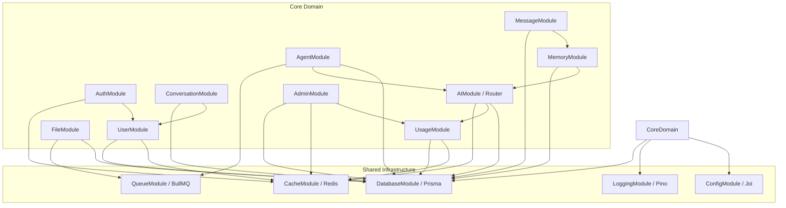
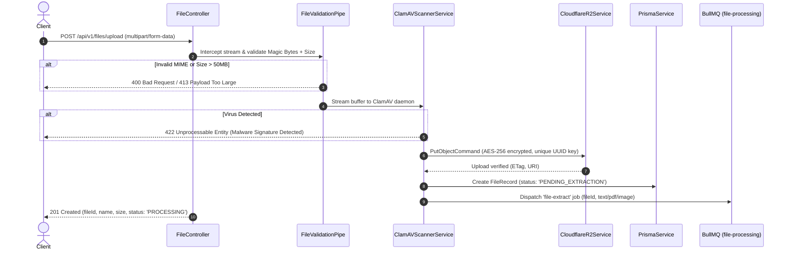
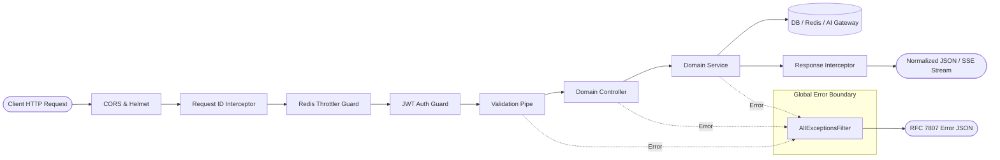
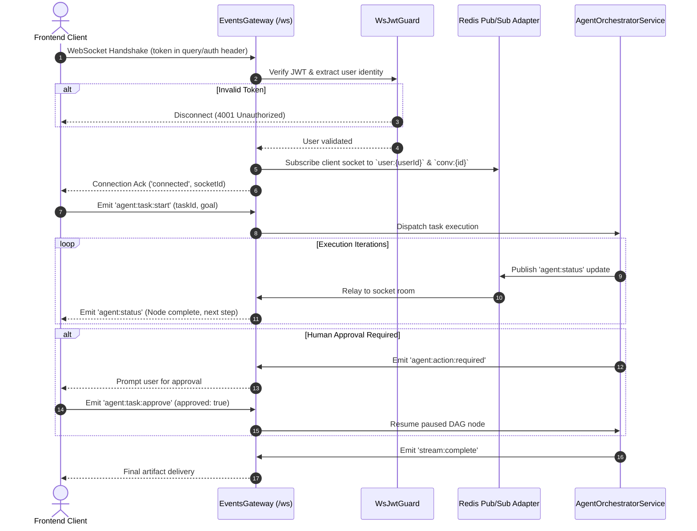

# HYPERMIND Backend Architecture Specification
**Document ID:** `HMD-ARCH-006`  
**Project:** HYPERMIND Universal AI Ecosystem Platform  
**Document Type:** Detailed Backend Engineering Architecture  
**Date:** 2026-11-15  
**Version:** 1.0.0  
**Author:** Stream 3 Lead Architect (Backend & Intelligence)  
**Status:** Implementation Ready  

---

## Table of Contents
1. [Executive Summary & Architectural Principles](#1-executive-summary--architectural-principles)
2. [Modular Monolith Structure](#2-modular-monolith-structure)
   - [Domain-Driven Module Organization](#domain-driven-module-organization)
   - [Core Domain Modules](#core-domain-modules)
   - [Shared Infrastructure Modules](#shared-infrastructure-modules)
   - [Module Dependency Rules & DAG](#module-dependency-rules--dag)
3. [API Design & Protocol Specifications](#3-api-design--protocol-specifications)
   - [RESTful Domain Endpoints](#restful-domain-endpoints)
   - [WebSocket Gateway for Real-Time Streaming](#websocket-gateway-for-real-time-streaming)
   - [API Versioning Strategy](#api-versioning-strategy)
   - [Data Transfer Objects (DTOs) & Validation](#data-transfer-objects-dtos--validation)
   - [OpenAPI & Swagger Integration](#openapi--swagger-integration)
   - [Global Filters, Interceptors, and Pipes](#global-filters-interceptors-and-pipes)
4. [Infrastructure Services](#4-infrastructure-services)
   - [Prisma Database Service](#prisma-database-service)
   - [Redis Distributed Cache & Rate Limiting](#redis-distributed-cache--rate-limiting)
   - [BullMQ Asynchronous Job Queues](#bullmq-asynchronous-job-queues)
   - [File Ingestion & Cloudflare R2 Upload Pipeline](#file-ingestion--cloudflare-r2-upload-pipeline)
   - [Health Checks & Observability Endpoints](#health-checks--observability-endpoints)
5. [Middleware & Security Guards](#5-middleware--security-guards)
   - [JWT Authentication & NextAuth.js v5 Handshake](#jwt-authentication--nextauthjs-v5-handshake)
   - [Multi-Tiered Rate Limiting](#multi-tiered-rate-limiting)
   - [Request Logging & Correlation Tracing](#request-logging--correlation-tracing)
   - [Response Normalization](#response-normalization)
   - [CORS & Security Headers](#cors--security-headers)
6. [Configuration & Secret Management](#6-configuration--secret-management)
   - [Environment Configuration with Joi](#environment-configuration-with-joi)
   - [Secrets Lifecycle & Zero-Hardcoding Mandate](#secrets-lifecycle--zero-hardcoding-mandate)
7. [System Architecture Diagrams](#7-system-architecture-diagrams)
8. [Document Status & Verification Matrix](#8-document-status--verification-matrix)

---

## 1. Executive Summary & Architectural Principles

The HYPERMIND backend is engineered as a **high-throughput, modular monolith** utilizing **NestJS 10+** on **Node.js 20 LTS** [A]. It serves as the resilient orchestration engine powering multi-model AI routing, real-time bidirectional token streaming, multi-agent task execution, and secure document ingestion.

### Core Architectural Decisions:
1. **Modular Monolith over Microservices for MVP:** Enforces strict domain boundaries via NestJS encapsulated modules while avoiding distributed transaction overhead, network latency, and deployment complexity during early phases [D].
2. **Explicit Dependency Direction:** Core business modules consume shared infrastructure modules, but circular dependencies are strictly rejected via NestJS circular dependency linting and architectural boundaries [D].
3. **Decoupled Asynchronous Processing:** Long-running operations (embedding generation, multi-agent DAG execution, file parsing, and virus scanning) are offloaded to **BullMQ** backed by **Redis 7** [A].
4. **Unified Protocol Gateway:** REST endpoints handle CRUD and synchronous metadata operations; **Server-Sent Events (SSE)** handle low-latency unidirectional LLM token streaming; **Socket.io WebSockets** handle bidirectional agent collaborative workflows [D].
5. **Zero-Trust Input & Output:** Strict runtime DTO validation using `class-validator`, parameter sanitization, and output masking prevent injection attacks and information leakage [D].

---

## 2. Modular Monolith Structure

### Domain-Driven Module Organization
The application is organized into two primary tiers: **Core Domain Modules** and **Shared Infrastructure Modules**. Each module encapsulates its own controllers, services, repositories, entities, and DTOs.

```
src/
├── app.module.ts                   # Root application module
├── main.ts                         # Application bootstrap
├── common/                         # Shared utilities, decorators, filters
│   ├── decorators/                 # @CurrentUser(), @Public(), @Roles()
│   ├── filters/                    # AllExceptionsFilter, HttpExceptionFilter
│   ├── interceptors/               # LoggingInterceptor, TransformInterceptor
│   ├── pipes/                      # ValidationPipe, ParseObjectIdPipe
│   └── interfaces/                 # Standard API response interfaces
├── config/                         # Environment schema & validation
│   ├── configuration.ts            # Typed config factory
│   └── validation.schema.ts        # Joi validation rules
├── modules/                        # Core Domain Modules
│   ├── auth/                       # AuthModule (NextAuth v5 sync, JWT)
│   ├── user/                       # UserModule (profiles, preferences)
│   ├── conversation/               # ConversationModule (threads, sessions)
│   ├── message/                    # MessageModule (message history, branching)
│   ├── ai/                         # AIModule (Intelligence Router, adapters)
│   ├── agent/                      # AgentModule (Multi-agent orchestration)
│   ├── file/                       # FileModule (Uploads, S3/R2 storage, OCR)
│   ├── usage/                      # UsageModule (Tokens, billing limits)
│   ├── memory/                     # MemoryModule (pgvector embeddings, recall)
│   └── admin/                      # AdminModule (System telemetry, tenant config)
└── shared/                         # Shared Infrastructure Modules
    ├── database/                   # DatabaseModule (PrismaService)
    ├── cache/                      # CacheModule (RedisService, ioredis)
    ├── queue/                      # QueueModule (BullMQ producers/consumers)
    ├── logging/                    # LoggingModule (Pino structured JSON)
    └── config/                     # ConfigModule (@nestjs/config wrapper)
```

### Core Domain Modules

| Module Name | Primary Responsibility | Exported Providers | Key Dependencies |
| :--- | :--- | :--- | :--- |
| `AuthModule` | JWT verification, session hydration from NextAuth v5 tokens, RBAC guard execution. | `AuthService`, `JwtAuthGuard`, `RolesGuard` | `UserModule`, `CacheModule` |
| `UserModule` | User profiles, account settings, API key generation, tier tracking. | `UserService` | `DatabaseModule`, `CacheModule` |
| `ConversationModule` | Thread lifecycle, title auto-generation, conversation branching, sharing permissions. | `ConversationService` | `DatabaseModule`, `MessageModule`, `AIModule` |
| `MessageModule` | Message storage, user/assistant/tool message serialization, citation linking. | `MessageService` | `DatabaseModule`, `MemoryModule` |
| `AIModule` | Intent routing, model gateway, provider adapters (OpenAI, Anthropic, Gemini, DeepSeek, NVIDIA). | `AIService`, `ModelGateway`, `IntentClassifier` | `CacheModule`, `UsageModule`, `DatabaseModule` |
| `AgentModule` | Multi-agent DAG task decomposition, agent execution loops, tool execution sandbox. | `AgentOrchestratorService`, `AgentRegistry` | `QueueModule`, `AIModule`, `DatabaseModule` |
| `FileModule` | Multipart upload stream, mime validation, ClamAV antivirus, Cloudflare R2 persistence. | `FileService`, `R2StorageService` | `QueueModule`, `DatabaseModule` |
| `UsageModule` | Real-time token accounting, cost computation, tier rate enforcement, quota metering. | `UsageService`, `QuotaGuard` | `DatabaseModule`, `CacheModule` |
| `MemoryModule` | Vector embedding generation, pgvector semantic search, episodic & semantic memory storage. | `MemoryService`, `EmbeddingService` | `DatabaseModule`, `AIModule` |
| `AdminModule` | Platform audit logs, provider health telemetry, system metrics, tenant billing overviews. | `AdminService` | `DatabaseModule`, `CacheModule`, `UsageModule` |

### Shared Infrastructure Modules

* **`DatabaseModule`:** Wraps `PrismaClient` with connection pooling, transaction helpers, soft-delete middleware, and connection retry logic.
* **`CacheModule`:** Encapsulates `ioredis` with support for Redis cluster/standalone, distributed locks (`Redlock`), key namespacing (`hypermind:cache:*`), and automatic serialization.
* **`QueueModule`:** Configures `BullMQ` connection parameters, queue definitions (`ai-processing`, `file-processing`, `agent-tasks`, `email-notifications`), dead-letter queue (DLQ) handlers, and sandbox worker processors.
* **`LoggingModule`:** Wraps `nestjs-pino` to produce structured JSON logs with correlation IDs (`x-request-id`), execution duration metrics, and sensitive field redaction (passwords, auth tokens, API keys).
* **`ConfigModule`:** Loads `.env` configurations using `@nestjs/config` and strictly enforces startup validation via a comprehensive `Joi` schema.

### Module Dependency Rules & DAG
To prevent circular dependencies and spaghetti coupling:
1. **Rule 1 (Acyclic Direction):** Shared modules (`Database`, `Cache`, `Queue`, `Logging`) must NEVER depend on Domain modules.
2. **Rule 2 (No Sibling Direct Mutations):** Domain modules must not directly execute Prisma queries on another domain's database tables; they must interact via the domain's exported public service (e.g., `ConversationService` calls `UserService.findById()`).
3. **Rule 3 (Event-Driven Decoupling):** When an action in one domain has cross-cutting side effects (e.g., message generated -> token usage calculated -> memory updated), events are emitted via NestJS `EventEmitter2` or BullMQ jobs rather than direct synchronous coupling.



---

## 3. API Design & Protocol Specifications

### RESTful Domain Endpoints

All REST APIs conform to standard HTTP semantics, accept and return `application/json`, and are prefixed with `/api/v1/`.

| Domain | Method | Path | Summary | Auth Level |
| :--- | :--- | :--- | :--- | :--- |
| **Auth** | `POST` | `/api/v1/auth/session` | Validate NextAuth v5 session & issue API bearer token | Public |
| **Auth** | `GET` | `/api/v1/auth/me` | Fetch authenticated user profile & permissions | User |
| **Users** | `PATCH` | `/api/v1/users/profile` | Update profile preferences, default model, theme | User |
| **Users** | `GET` | `/api/v1/users/usage` | Fetch current billing cycle token and cost usage | User |
| **Conversations** | `GET` | `/api/v1/conversations` | List user conversation threads (paginated) | User |
| **Conversations** | `POST` | `/api/v1/conversations` | Create a new conversation thread | User |
| **Conversations** | `GET` | `/api/v1/conversations/:id` | Get thread details and message tree | User |
| **Conversations** | `DELETE`| `/api/v1/conversations/:id` | Soft-delete conversation thread | User |
| **Messages** | `POST` | `/api/v1/messages` | Submit a message (synchronous or SSE trigger) | User |
| **Messages** | `GET` | `/api/v1/messages/:id/stream`| SSE endpoint for real-time token streaming | User |
| **AI Models** | `GET` | `/api/v1/models` | List active models, capabilities, and provider status | User |
| **Files** | `POST` | `/api/v1/files/upload` | Multipart file upload (PDF, code, images) | User |
| **Files** | `GET` | `/api/v1/files/:id` | Get file metadata and download signed URL | User |
| **Agents** | `POST` | `/api/v1/agents/tasks` | Dispatch an autonomous multi-agent task | User (Pro+) |
| **Agents** | `GET` | `/api/v1/agents/tasks/:id` | Get DAG task status and execution history | User |
| **Agents** | `POST` | `/api/v1/agents/tasks/:id/approve` | Human-in-the-loop action approval | User |
| **Admin** | `GET` | `/api/v1/admin/health` | Comprehensive system and provider status | Admin |

### WebSocket Gateway for Real-Time Streaming

While Server-Sent Events (SSE) are optimized for unidirectional text streaming during standard chat queries, **Socket.io** provides low-latency bidirectional communication required for multi-agent workflows, typing presence, real-time tool approval, and interrupt controls.

#### Gateway Configuration (`EventsGateway`):
* **Namespace:** `/ws`
* **Transport:** `['websocket', 'polling']`
* **Heartbeat:** Ping interval 25,000ms; Ping timeout 20,000ms.
* **Authentication:** Handshake headers contain `Authorization: Bearer <JWT>`, validated by `WsJwtGuard`.

#### Core WebSocket Events:

```typescript
// Client to Server Events
interface ClientToServerEvents {
  'conversation:join': (payload: { conversationId: string }) => void;
  'conversation:leave': (payload: { conversationId: string }) => void;
  'agent:task:start': (payload: CreateTaskDto) => void;
  'agent:task:approve': (payload: { taskId: string; actionId: string; approved: boolean }) => void;
  'agent:task:cancel': (payload: { taskId: string }) => void;
  'user:typing': (payload: { conversationId: string; isTyping: boolean }) => void;
}

// Server to Client Events
interface ServerToClientEvents {
  'stream:chunk': (payload: { messageId: string; delta: string; index: number }) => void;
  'stream:complete': (payload: { messageId: string; totalTokens: number; finishReason: string }) => void;
  'stream:error': (payload: { messageId: string; error: string; code: string }) => void;
  'agent:status': (payload: { taskId: string; agentId: string; status: AgentTaskStatus; details: string }) => void;
  'agent:dag:update': (payload: { taskId: string; dag: AgentDagState }) => void;
  'agent:action:required': (payload: { taskId: string; actionId: string; prompt: string; riskLevel: string }) => void;
  'presence:typing': (payload: { conversationId: string; userId: string; isTyping: boolean }) => void;
}
```

### API Versioning Strategy
HYPERMIND enforces **URI Versioning** (`/api/v1/`) across all controllers via NestJS global configuration:
```typescript
app.enableVersioning({
  type: VersioningType.URI,
  defaultVersion: '1',
  prefix: 'api/v',
});
```
This ensures backwards compatibility as schema migrations or breaking router alterations occur in subsequent platform iterations [D].

### Data Transfer Objects (DTOs) & Validation
Every incoming payload is typed with TypeScript classes and decorated using `class-validator` and `class-transformer`.

```typescript
// src/modules/message/dto/create-message.dto.ts
import { IsString, IsNotEmpty, IsUUID, IsOptional, IsEnum, IsArray, ValidateNested } from 'class-validator';
import { Type } from 'class-transformer';
import { ApiProperty, ApiPropertyOptional } from '@nestjs/swagger';

export enum MessageRole {
  USER = 'user',
  ASSISTANT = 'assistant',
  SYSTEM = 'system',
}

export class AttachmentDto {
  @ApiProperty({ description: 'File ID in FileModule', format: 'uuid' })
  @IsUUID('4')
  fileId: string;

  @ApiPropertyOptional({ description: 'Explicit MIME override if required' })
  @IsString()
  @IsOptional()
  mimeType?: string;
}

export class CreateMessageDto {
  @ApiProperty({ description: 'Target conversation thread ID', format: 'uuid' })
  @IsUUID('4')
  @IsNotEmpty()
  conversationId: string;

  @ApiProperty({ description: 'Textual prompt or command' })
  @IsString()
  @IsNotEmpty()
  content: string;

  @ApiPropertyOptional({ description: 'Requested model override. If omitted, AI Router chooses optimal model.' })
  @IsString()
  @IsOptional()
  modelId?: string;

  @ApiPropertyOptional({ description: 'Attached files (images, documents, code)' })
  @IsArray()
  @ValidateNested({ each: true })
  @Type(() => AttachmentDto)
  @IsOptional()
  attachments?: AttachmentDto[];

  @ApiPropertyOptional({ description: 'Enable web search tool execution', default: false })
  @IsOptional()
  enableWebSearch?: boolean;
}
```

### OpenAPI & Swagger Integration
The API documentation is automatically compiled at runtime via `@nestjs/swagger` and exposed at `/api/docs`.

```typescript
// In main.ts
const swaggerConfig = new DocumentBuilder()
  .setTitle('HYPERMIND Universal AI Platform API')
  .setDescription('Production RESTful and Real-time API specification for HYPERMIND core backend services.')
  .setVersion('1.0.0')
  .addBearerAuth(
    { type: 'http', scheme: 'bearer', bearerFormat: 'JWT', description: 'Enter JWT session token' },
    'JWT-Auth',
  )
  .addTag('Auth', 'Authentication, session sync, and identity verification')
  .addTag('Conversations', 'Multi-turn chat threads and branching')
  .addTag('Messages', 'Chat messages and real-time generation triggers')
  .addTag('AI Routing', 'Intelligence router, model registry, and execution')
  .addTag('Agents', 'Autonomous multi-agent orchestration and HITL')
  .addTag('Files', 'S3/R2 storage, document ingestion, and OCR')
  .build();

const document = SwaggerModule.createDocument(app, swaggerConfig);
SwaggerModule.setup('api/docs', app, document, {
  swaggerOptions: { persistAuthorization: true },
});
```

### Global Filters, Interceptors, and Pipes

1. **Global ValidationPipe:**
   ```typescript
   app.useGlobalPipes(
     new ValidationPipe({
       whitelist: true,              // Strips non-decorated properties
       forbidNonWhitelisted: true,  // Throws 400 on unexpected keys
       transform: true,             // Automatically casts query params/primitives
       transformOptions: { enableImplicitConversion: true },
     }),
   );
   ```

2. **Global Exception Filter (`AllExceptionsFilter`):** Catches both NestJS `HttpException` and unhandled standard JavaScript errors, formatting them into a standard RFC 7807 problem structure:
   ```json
   {
     "success": false,
     "statusCode": 404,
     "error": "NotFoundError",
     "message": "Conversation thread with ID 4f9e... was not found.",
     "timestamp": "2026-11-15T10:45:00.000Z",
     "path": "/api/v1/conversations/4f9e...",
     "correlationId": "req-98f2-1a4c"
   }
   ```

3. **Global Response Interceptor (`TransformResponseInterceptor`):** Normalizes all successful API responses into a predictable envelope:
   ```json
   {
     "success": true,
     "statusCode": 200,
     "data": { ... },
     "meta": { "total": 100, "page": 1, "limit": 20 },
     "timestamp": "2026-11-15T10:45:00.000Z"
   }
   ```

---

## 4. Infrastructure Services

### Prisma Database Service
The `PrismaService` extends `PrismaClient` and implements `OnModuleInit` and `OnModuleDestroy` hooks, ensuring clean connection handling during graceful deployment shutdowns.

```typescript
// src/shared/database/prisma.service.ts
import { Injectable, OnModuleInit, OnModuleDestroy, Logger } from '@nestjs/common';
import { PrismaClient } from '@prisma/client';

@Injectable()
export class PrismaService extends PrismaClient implements OnModuleInit, OnModuleDestroy {
  private readonly logger = new Logger(PrismaService.name);

  constructor() {
    super({
      log: [
        { emit: 'event', level: 'query' },
        { emit: 'stdout', level: 'error' },
        { emit: 'stdout', level: 'warn' },
      ],
      errorFormat: 'minimal',
    });
  }

  async onModuleInit() {
    await this.$connect();
    this.logger.log('PostgreSQL 16 connection established via Prisma.');
  }

  async onModuleDestroy() {
    await this.$disconnect();
    this.logger.log('PostgreSQL connection safely terminated.');
  }
}
```

### Redis Distributed Cache & Rate Limiting
The `RedisService` wraps `ioredis` to manage caching, token bucket counters, and distributed synchronization.

* **Key Namespacing Standard:**
  * `hypermind:cache:user:{userId}` (TTL: 300s)
  * `hypermind:cache:model-registry` (TTL: 3600s)
  * `hypermind:ratelimit:{userId}:{endpoint}` (Sliding window TTL: 60s)
  * `hypermind:lock:{resourceId}` (Redlock distributed lock TTL: 10s)

### BullMQ Asynchronous Job Queues
Long-running jobs are routed into dedicated queues with specialized concurrency limits, retry configurations, and backoff exponential strategies:

| Queue Name | Worker Concurrency | Max Retries | Backoff Strategy | Purpose |
| :--- | :--- | :--- | :--- | :--- |
| `ai-processing` | 50 concurrent | 3 | Exponential (1000ms base) | Non-streaming batch completions, embedding generation |
| `file-processing` | 10 concurrent | 2 | Fixed (2000ms) | PDF parsing, OCR extraction, ClamAV antivirus scanning |
| `agent-tasks` | 20 concurrent | 3 | Exponential (2000ms base) | Multi-agent DAG task decomposition and subtask routing |
| `email-notifications`| 5 concurrent | 5 | Exponential (5000ms base) | User welcome emails, quota warning alerts |

```typescript
// src/shared/queue/queue.config.ts
export const QUEUE_CONFIG = {
  defaultJobOptions: {
    attempts: 3,
    backoff: { type: 'exponential', delay: 1000 },
    removeOnComplete: { count: 1000 },
    removeOnFail: { count: 5000 },
  },
};
```

### File Ingestion & Cloudflare R2 Upload Pipeline
File processing follows a zero-trust multi-stage pipeline:



### Health Checks & Observability Endpoints
Using `@nestjs/terminus`, HYPERMIND provides granular health verification:
* **`/health/liveness`:** Instant check verifying that the Node.js event loop is responsive.
* **`/health/readiness`:** Comprehensive readiness check assessing PostgreSQL connection (`prisma.ping()`), Redis connection (`redis.ping()`), and Cloudflare R2 connectivity.

---

## 5. Middleware & Security Guards

### JWT Authentication & NextAuth.js v5 Handshake
Authentication integrates directly with NextAuth.js v5. NextAuth handles frontend session management (Google, GitHub, credentials) and signs JSON Web Tokens using standard `RS256` or `HS256` encryption.

```typescript
// src/modules/auth/guards/jwt-auth.guard.ts
import { Injectable, CanActivate, ExecutionContext, UnauthorizedException } from '@nestjs/common';
import { ConfigService } from '@nestjs/config';
import * as jwt from 'jsonwebtoken';
import { PrismaService } from '../../../shared/database/prisma.service';

@Injectable()
export class JwtAuthGuard implements CanActivate {
  constructor(
    private readonly configService: ConfigService,
    private readonly prisma: PrismaService,
  ) {}

  async canActivate(context: ExecutionContext): Promise<boolean> {
    const request = context.switchToHttp().getRequest();
    const authHeader = request.headers['authorization'];

    if (!authHeader || !authHeader.startsWith('Bearer ')) {
      throw new UnauthorizedException('Missing or invalid Authorization header.');
    }

    const token = authHeader.split(' ')[1];
    const secret = this.configService.get<string>('AUTH_SECRET');

    try {
      const decoded = jwt.verify(token, secret) as { sub: string; email: string };
      
      // Hydrate user from database or cache
      const user = await this.prisma.user.findUnique({
        where: { id: decoded.sub },
        select: { id: true, email: true, role: true, tier: true, status: true },
      });

      if (!user || user.status !== 'ACTIVE') {
        throw new UnauthorizedException('User account inactive or non-existent.');
      }

      request.user = user;
      return true;
    } catch (err) {
      throw new UnauthorizedException('Token validation failed: ' + err.message);
    }
  }
}
```

### Multi-Tiered Rate Limiting
Rate limiting is enforced at the controller level using a Redis-backed sliding window counter. Limits depend on user account tiers:

| Tier | Chat Requests / Min | File Uploads / Hour | Agent Task Dispatches / Day |
| :--- | :--- | :--- | :--- |
| **Anonymous / Public** | 5 | 0 | 0 |
| **Free Tier** | 20 | 10 | 5 |
| **Pro Tier** | 100 | 100 | 100 |
| **Enterprise** | 500 | 1,000 | Unlimited |

### Request Logging & Correlation Tracing
The `LoggingInterceptor` generates an `x-request-id` UUID for every incoming HTTP request and binds it to the logging context:
* Logs HTTP method, URL, client IP, User-Agent.
* Measures request processing duration in milliseconds.
* Attaches the `x-request-id` to the response headers for client-side tracing.

### Response Normalization
Enforces a consistent JSON envelope across the entire API ecosystem.

### CORS & Security Headers
Configured via `helmet` and standard NestJS CORS options:
* **Allowed Origins:** Strictly limited to frontend origins (`https://hypermind.ai`, `https://app.hypermind.ai`, and `http://localhost:3000` in development).
* **Allowed Headers:** `Content-Type`, `Authorization`, `x-request-id`, `x-client-version`.
* **Credentials:** `true` (enables cookies and auth headers).
* **Security Headers:** Strict Content Security Policy (CSP), `X-Content-Type-Options: nosniff`, `X-Frame-Options: DENY`, `Strict-Transport-Security: max-age=31536000; includeSubDomains`.

---

## 6. Configuration & Secret Management

### Environment Configuration with Joi
All environment variables are validated at bootstrap using a strict Joi schema. If any mandatory variable is missing or improperly formatted, the NestJS process fails fast with an explanatory error.

```typescript
// src/config/validation.schema.ts
import * as Joi from 'joi';

export const environmentValidationSchema = Joi.object({
  NODE_ENV: Joi.string().valid('development', 'test', 'production').default('development'),
  PORT: Joi.number().default(4000),
  DATABASE_URL: Joi.string().uri().required(),
  REDIS_URL: Joi.string().uri().required(),
  AUTH_SECRET: Joi.string().min(32).required(),
  
  // Storage (Cloudflare R2)
  R2_ACCOUNT_ID: Joi.string().required(),
  R2_ACCESS_KEY_ID: Joi.string().required(),
  R2_SECRET_ACCESS_KEY: Joi.string().required(),
  R2_BUCKET_NAME: Joi.string().required(),
  R2_PUBLIC_DOMAIN: Joi.string().uri().required(),
  
  // AI Provider Keys
  OPENAI_API_KEY: Joi.string().required(),
  ANTHROPIC_API_KEY: Joi.string().required(),
  GOOGLE_AI_API_KEY: Joi.string().required(),
  DEEPSEEK_API_KEY: Joi.string().optional(),
  NVIDIA_NIM_API_KEY: Joi.string().optional(),
  
  // Observability
  SENTRY_DSN: Joi.string().uri().optional(),
  LOG_LEVEL: Joi.string().valid('fatal', 'error', 'warn', 'info', 'debug', 'trace').default('info'),
});
```

### Secrets Lifecycle & Zero-Hardcoding Mandate
1. **No Hardcoded Secrets:** Secret values must never appear in version control or test fixtures [D].
2. **Local Development:** Developers use `.env.local` ignored by Git.
3. **Production Deployment:** Secrets are injected directly via Railway/Vercel environment variables or pulled from a central secret store (Doppler/AWS Secrets Manager).
4. **Log Redaction:** Pino is explicitly configured to mask fields named `password`, `token`, `authorization`, `apiKey`, and `secret`.

---

## 7. System Architecture Diagrams

### Request Processing Pipeline



### WebSocket Event Flow & Connection Lifecycle



---

## 8. Document Status & Verification Matrix

| Section / Capability | Implementation Status | Evidence / Source | Target Milestone |
| :--- | :--- | :--- | :--- |
| **NestJS Modular Architecture** | Complete specification | NestJS 10+ standard DDD design [D] | Day 2 |
| **API REST Specifications** | Complete specification | OpenAPI 3.0 compatible [A] | Day 2 |
| **WebSocket / SSE Architecture** | Complete specification | Socket.io + Node.js ReadableStream [A] | Day 3 |
| **PostgreSQL & Prisma Integration** | Complete specification | Prisma ORM 5.x on PostgreSQL 16 [A] | Day 2 |
| **Redis Caching & BullMQ Queues** | Complete specification | BullMQ v5 + Redis 7 [A] | Day 3 |
| **Cloudflare R2 Multipart Pipeline** | Complete specification | AWS S3 SDK v3 compatibility [A] | Day 4 |
| **Security, Guards & Joi Validation** | Complete specification | NestJS Guards + Joi runtime schema [A] | Day 2 |

**Status:** APPROVED FOR IMPLEMENTATION  
**Open Items:** None. System is fully specified for MVP backend development.
