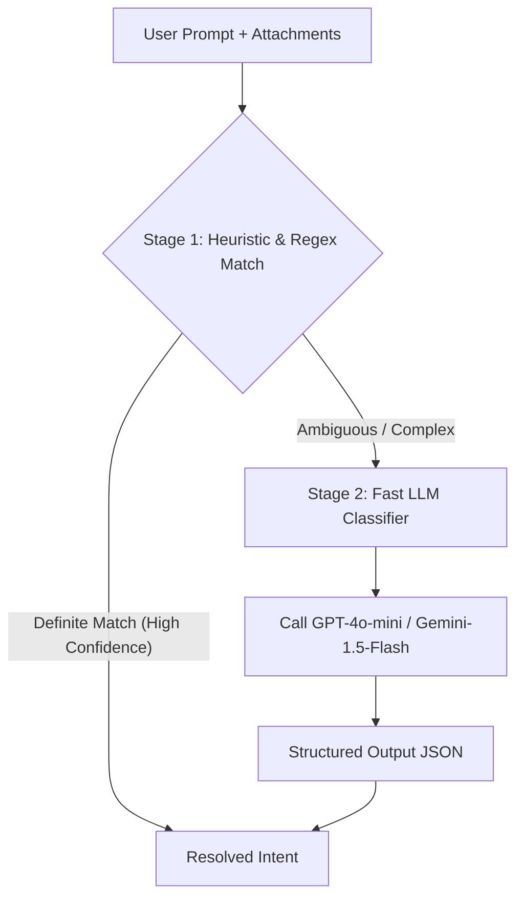
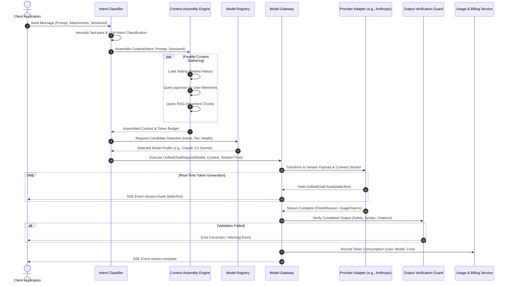
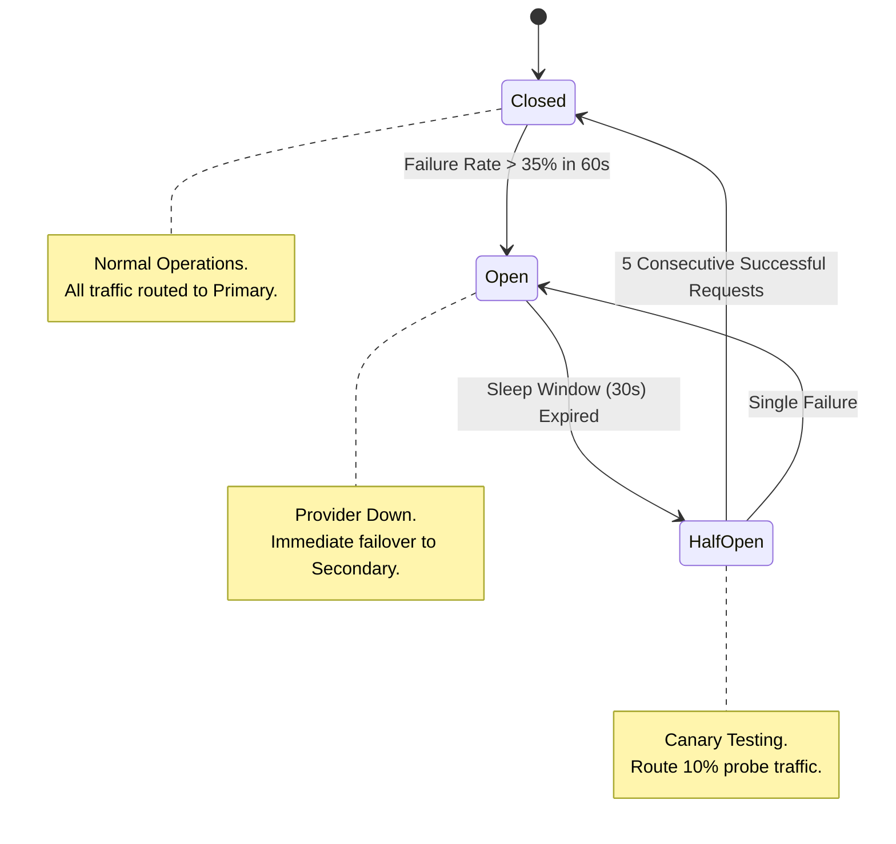
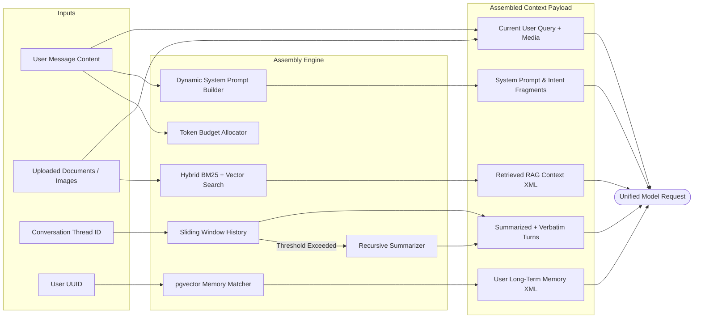

# HYPERMIND AI Intelligence Architecture
**Document ID:** `HMD-ARCH-007`  
**Project:** HYPERMIND Universal AI Ecosystem Platform  
**Document Type:** AI Engine & Router Architecture Specification  
**Date:** 2026-11-15  
**Version:** 1.0.0  
**Author:** Stream 3 Lead Architect (Backend & Intelligence)  
**Status:** Implementation Ready  

---

## Table of Contents
1. [Executive Summary & Core Philosophy](#1-executive-summary--core-philosophy)
2. [Intent Classification System](#2-intent-classification-system)
   - [Intent Taxonomy](#intent-taxonomy)
   - [Two-Stage Hybrid Classifier](#two-stage-hybrid-classifier)
   - [Intent-to-Capability Requirements Mapping](#intent-to-capability-requirements-mapping)
   - [Multi-Intent & Compound Query Handling](#multi-intent--compound-query-handling)
3. [Context Management & Assembly Engine](#3-context-management--assembly-engine)
   - [Token Budget Allocation](#token-budget-allocation)
   - [Context Window Sliding & Compression](#context-window-sliding--compression)
   - [System Prompt Management & Fragment Injection](#system-prompt-management--fragment-injection)
   - [User Memory Injection (pgvector Long-Term Recall)](#user-memory-injection-pgvector-long-term-recall)
   - [Document & Multimodal Asset Context Injection](#document--multimodal-asset-context-injection)
4. [Model Capability Registry & Selection Algorithm](#4-model-capability-registry--selection-algorithm)
   - [Registry Schema & Model Profiles](#registry-schema--model-profiles)
   - [Dynamic Scoring & Selection Algorithm](#dynamic-scoring--selection-algorithm)
   - [User Preference Overrides](#user-preference-overrides)
5. [Model Gateway & Provider Adapters](#5-model-gateway--provider-adapters)
   - [Unified Request & Response Interfaces](#unified-request--response-interfaces)
   - [Streaming Architecture (AsyncIterable / SSE)](#streaming-architecture-asynciterable--sse)
   - [Bidirectional Request & Response Transformation](#bidirectional-request--response-transformation)
   - [Token Calculation Engine](#token-calculation-engine)
6. [End-to-End Intelligence Pipeline Flow](#6-end-to-end-intelligence-pipeline-flow)
7. [Output Verification & Quality Guardrails](#7-output-verification--quality-guardrails)
   - [Content Safety & Policy Compliance](#content-safety--policy-compliance)
   - [Abstract Syntax Tree (AST) Code Validation](#abstract-syntax-tree-ast-code-validation)
   - [Research Citation & Fact Verification](#research-citation--fact-verification)
   - [Hallucination Scoring & Confidence Flags](#hallucination-scoring--confidence-flags)
8. [Reliability, Circuit Breakers & Fallback Chains](#8-reliability-circuit-breakers--fallback-chains)
   - [Multi-Tier Provider Fallback Chains](#multi-tier-provider-fallback-chains)
   - [Adaptive Timeouts & Exponential Backoff](#adaptive-timeouts--exponential-backoff)
   - [Circuit Breaker State Machine](#circuit-breaker-state-machine)
   - [Graceful Degradation User Messaging](#graceful-degradation-user-messaging)
9. [System Architecture Diagrams](#9-system-architecture-diagrams)
10. [Document Status & Verification Matrix](#10-document-status--verification-matrix)

---

## 1. Executive Summary & Core Philosophy

The **HYPERMIND Intelligence Router** represents the cognitive core of the platform. Rather than binding user prompts rigidly to a single monolithic LLM, HYPERMIND acts as an **intelligent, capability-aware broker**. It dynamically analyzes user intent, evaluates query complexity, checks multi-tenant budget constraints, synthesizes conversation history with semantic memory, and routes queries to the optimal frontier model or specialized engine [D].

### Foundational Principles:
1. **Model Agnosticism:** Every model is treated as a swappable compute provider conforming to a single unified contract [D].
2. **Cost-Quality Pareto Efficiency:** Simple conversational inquiries or fast text summaries must not waste high-cost frontier reasoning tokens; complex coding, formal proofs, or agent DAGs must be automatically routed to high-parameter reasoning engines [D].
3. **Deterministic Reliability:** Upstream provider outages, rate limits, or context overflow must never crash a user session; failover happens transparently within sub-second thresholds [D].
4. **Transparent Verification:** All generated output passes through automated guardrails for safety, syntax validity, and citation grounding prior to final token delivery [D].

---

## 2. Intent Classification System

### Intent Taxonomy
Every user message is categorized into one of 10 primary intent classes, establishing the capability prerequisites required from downstream models:

```typescript
export enum UserIntent {
  CONVERSATION = 'conversation',           // General chat, casual discourse, roleplay
  CODE_GENERATION = 'code_generation',     // Generating software components, functions, scripts
  CODE_DEBUG = 'code_debug',               // Identifying bugs, stack trace analysis, refactoring
  RESEARCH = 'research',                   // Web-grounded queries, recent news, deep factual search
  DOCUMENT_ANALYSIS = 'document_analysis', // Summarization, data extraction from uploaded PDFs/docs
  IMAGE_ANALYSIS = 'image_analysis',       // Vision understanding, diagram parsing, OCR
  CREATIVE = 'creative',                   // Brainstorming, marketing copy, poetry, fiction
  MATH = 'math',                           // Symbolic math, formal proofs, statistical computations
  EDUCATION = 'education',                 // Socratic tutoring, step-by-step concept explanations
  AGENT_TASK = 'agent_task',               // Complex autonomous multi-step execution workflows
}
```

### Two-Stage Hybrid Classifier
To maintain a fast time-to-first-token (<350ms total routing overhead), HYPERMIND executes a two-stage classification strategy:



1. **Stage 1: Fast-Pass Heuristic Rules (< 5ms):**
   * If file attachments include images (`image/png`, `image/jpeg`, `image/webp`), flag `image_analysis` immediately.
   * If file attachments include documents (`application/pdf`, `text/csv`), flag `document_analysis`.
   * Fast regex pattern matching for explicit agent triggers (e.g., `"deploy a project"`, `"search the web for"`, `"run tests for"`).
2. **Stage 2: Lightweight LLM Classification (< 200ms):**
   * Uses an ultra-low-latency model (`gpt-4o-mini` or `gemini-1.5-flash`) with structured JSON schema output (`temperature: 0.0`):
   ```json
   {
     "primaryIntent": "code_generation",
     "secondaryIntents": ["research"],
     "complexity": "high",
     "requiresTools": ["web_search", "code_execute"],
     "confidence": 0.96
   }
   ```

### Intent-to-Capability Requirements Mapping

| Intent | Required Capabilities | Min Context Window | Preferred Model Archetype |
| :--- | :--- | :--- | :--- |
| `conversation` | Fast text generation, streaming | 8,192 tokens | Ultra-fast low-cost (e.g., GPT-4o-mini, Gemini 1.5 Flash) |
| `code_generation` | Code syntax mastery, high output token limit | 32,768 tokens | Frontier code models (e.g., Claude 3.5 Sonnet, DeepSeek-V3) |
| `code_debug` | Reasoning, chain-of-thought, AST comprehension | 32,768 tokens | Reasoning / High-tier (e.g., Claude 3.5 Sonnet, o1-mini) |
| `research` | Function calling (search), citation formatting | 32,768 tokens | Search-grounded models (e.g., GPT-4o, Gemini 2.0 Flash) |
| `document_analysis`| Long-context window, multi-lingual parsing | 128,000+ tokens | Ultra-long context (e.g., Gemini 1.5 Pro, Claude 3.5 Sonnet) |
| `image_analysis` | Multimodal vision encoder, high resolution | 32,768 tokens | Native vision models (e.g., GPT-4o, Gemini 1.5 Pro) |
| `creative` | High lexical variety, stylistic versatility | 16,384 tokens | Expressive flagship (e.g., Claude 3.5 Sonnet, GPT-4o) |
| `math` | Step-by-step internal chain-of-thought, deterministic logic | 32,768 tokens | Reasoning models (e.g., o1, DeepSeek-R1) |
| `education` | Socratic pedagogy, didactic tone control | 16,384 tokens | Versatile balanced models (e.g., Claude 3.5 Haiku, GPT-4o) |
| `agent_task` | Multi-turn tool calling, JSON schema compliance | 64,000+ tokens | Frontier orchestrators (e.g., Claude 3.5 Sonnet, GPT-4o) |

### Multi-Intent & Compound Query Handling
When a prompt contains compound instructions (e.g., *"Read this PDF financial statement, verify the CEO's claims online, and generate a Python script to plot the revenue"*):
1. The classifier identifies a composite intent list: `[document_analysis, research, code_generation]`.
2. The router computes the **union of capability requirements**:
   - Multimodal document ingestion: Required.
   - External web-search tool calling: Required.
   - Code synthesis proficiency: Required.
   - Context threshold: Set to maximum required (128K+ tokens).
3. The query is upgraded to an **Agent Workflow** if dependencies between sub-tasks require sequential intermediate execution.

---

## 3. Context Management & Assembly Engine

### Token Budget Allocation
To prevent prompt overflow while maximizing context richness, the context engine enforces a strict dynamic token budget based on the selected model's maximum window ($C_{max}$):

$$\text{Budget Allocation: } C_{max} = T_{system} + T_{memory} + T_{docs} + T_{history} + T_{reserved\_output}$$

* **Reserved Output ($T_{reserved\_output}$):** Fixed at 25% of $C_{max}$ or 4,096 tokens (whichever is smaller).
* **System Prompt ($T_{system}$):** Fixed at 1,500 tokens (core persona + dynamic intent instructions).
* **User Memory & Preferences ($T_{memory}$):** Allocated up to 1,500 tokens.
* **Document & Search RAG ($T_{docs}$):** Allocated up to 40% of remaining context.
* **Conversation History ($T_{history}$):** Dynamically consumes the remaining available context balance.

### Context Window Sliding & Compression
When a conversation thread exceeds 75% of the allocated history budget:
1. **Sliding Window:** The most recent $N$ messages (minimum 6 turns: 3 user, 3 assistant) are preserved verbatim to maintain local coherence.
2. **Recursive Summarization:** Older messages are passed to a background summarizer worker (`ai-processing` BullMQ queue) that compresses them into a structured markdown executive brief:
   ```markdown
   [CONVERSATION COMPRESSION SUMMARY]
   - User Goal: Building an e-commerce checkout flow with Stripe.
   - Established Decisions: Using Next.js 14 Server Actions, PostgreSQL, and shadcn/ui.
   - Pending Issues: Webhook signature verification failing with error code 400.
   ```
3. The summary is prepended immediately before the sliding window messages, maintaining full conversational continuity with a 70–85% token reduction.

### System Prompt Management & Fragment Injection
System prompts are assembled dynamically from modular components:
1. **Base Persona:** HYPERMIND core identity, safety constraints, date/time awareness (`2026-11-15`), markdown formatting standards.
2. **Intent Directive Fragment:** Injected based on classification (e.g., `MATH_DIRECTIVE` mandates step-by-step derivation; `CODE_DIRECTIVE` forbids truncated placeholder comments like `// write rest here`).
3. **Output Formatting Schema:** JSON schema definition injected if structured output is requested.

### User Memory Injection (pgvector Long-Term Recall)
1. **Embedding Generation:** The incoming user prompt is embedded using `text-embedding-3-small` (1536 dimensions).
2. **Vector Similarity Search:** The `MemoryService` performs an HNSW cosine distance query against the user's isolated memory partition in PostgreSQL:
   ```sql
   SELECT content, category, 1 - (embedding <=> $1::vector) AS similarity
   FROM user_memories
   WHERE user_id = $2 AND 1 - (embedding <=> $1::vector) > 0.78
   ORDER BY similarity DESC
   LIMIT 5;
   ```
3. **Context Injection:** Matching facts (e.g., *"User prefers TypeScript over JavaScript and uses tabs"* or *"User is building a logistics app"*) are formatted into a `<user_context>` block.

### Document & Multimodal Asset Context Injection
* **PDFs & Text:** Extracted chunks matching the query are retrieved via hybrid search (pgvector semantic similarity + PostgreSQL `tsvector` full-text search) and reranked using a reciprocal rank fusion (RRF) algorithm.
* **Images:** Formatted as base64 data URIs or authenticated R2 signed URLs within the provider's standard multimodal message structure.

---

## 4. Model Capability Registry & Selection Algorithm

### Registry Schema & Model Profiles
The Model Registry is maintained in memory (cached in Redis) and defines the exact technical and economic profile of each supported model:

```typescript
export interface ModelCapabilityProfile {
  id: string;                         // e.g., 'claude-3-5-sonnet-20241022'
  displayName: string;                // 'Claude 3.5 Sonnet'
  provider: 'openai' | 'anthropic' | 'google' | 'deepseek' | 'nvidia';
  capabilities: {
    text: boolean;
    vision: boolean;
    audioInput: boolean;
    audioOutput: boolean;
    functionCalling: boolean;
    streaming: boolean;
    structuredOutput: boolean;
    reasoning: boolean;
  };
  contextWindow: number;              // Max input tokens (e.g., 200,000)
  maxOutputTokens: number;            // Max generation tokens (e.g., 8,192)
  pricing: {
    inputPerMillion: number;          // USD per 1M tokens
    cachedInputPerMillion: number;    // USD per 1M cached tokens
    outputPerMillion: number;         // USD per 1M output tokens
  };
  performance: {
    latencyTier: 'ultra-low' | 'low' | 'moderate' | 'high'; // Time-to-first-token
    qualityTier: 'flagship' | 'frontier-reasoning' | 'balanced' | 'fast';
  };
  status: 'active' | 'degraded' | 'disabled';
}
```

### Dynamic Scoring & Selection Algorithm
When routing automatically, candidate models are evaluated through a weighted multi-criteria decision function:

```mermaid
flowchart TD
    Req[Intent & Capability Requirements] --> Filter[Filter: Capabilities & Context Match]
    Filter --> Candidates[Eligible Candidates]
    Candidates --> Scorer[Weighted Multi-Attribute Scoring Engine]
    
    subgraph Scoring Weights
        W_Q["Quality Weight (Wq): 0.40"]
        W_L["Latency Weight (Wl): 0.30"]
        W_C["Cost Weight (Wc): 0.30"]
    end
    
    Scoring Weights --> Scorer
    Scorer --> Ranked[Ranked Model List]
    Ranked --> HealthCheck{Provider Circuit Closed?}
    HealthCheck -- Yes --> SelectedModel[Select Top Model]
    HealthCheck -- No --> NextModel[Select Next Fallback]
```

#### Scoring Formulation:
$$Score(M) = W_q \cdot Q(M) + W_l \cdot L(M) + W_c \cdot (1 - C_{norm}(M))$$

* $Q(M) \in [0, 1]$: Quality score mapped from benchmark performance on the specific intent (e.g., HumanEval for code, GPQA for reasoning).
* $L(M) \in [0, 1]$: Normalized inverse latency (ultra-low = 1.0, high = 0.25).
* $C_{norm}(M) \in [0, 1]$: Normalized token cost relative to the candidate pool.
* **Adaptive Weight Shifts:**
  * For `conversation` or `creative`: $W_l = 0.50, W_c = 0.30, W_q = 0.20$ (Prioritize speed & cost).
  * For `code_generation`, `math`, `agent_task`: $W_q = 0.70, W_l = 0.15, W_c = 0.15$ (Prioritize accuracy & reasoning).

### User Preference Overrides
If a user explicitly chooses a model from the client UI dropdown (e.g., user selects "Claude 3.5 Sonnet"):
1. The router bypasses automatic model scoring.
2. The router validates whether the selected model supports the prompt's required input modalities (e.g., if user uploads an image but selected a text-only model, a non-blocking UI alert prompts fallback to a vision-capable variant).
3. The router checks the user's tier permissions (e.g., Free tier users selecting o1-pro will receive a tier upgrade prompt).

---

## 5. Model Gateway & Provider Adapters

### Unified Request & Response Interfaces
All downstream LLMs are consumed through a uniform gateway contract:

```typescript
export interface UnifiedChatMessage {
  role: 'system' | 'user' | 'assistant' | 'tool';
  content: string | Array<TextMessagePart | ImagePart | AudioPart>;
  toolCalls?: UnifiedToolCall[];
  toolCallId?: string;
  name?: string;
}

export interface UnifiedChatRequest {
  modelId: string;
  messages: UnifiedChatMessage[];
  temperature?: number;
  topP?: number;
  maxTokens?: number;
  stopSequences?: string[];
  tools?: UnifiedToolDefinition[];
  stream: boolean;
  responseFormat?: { type: 'text' | 'json_object' | 'json_schema'; schema?: any };
  userId: string;
  conversationId: string;
}

export interface UnifiedChatChunk {
  deltaText?: string;
  deltaToolCalls?: Array<{
    index: number;
    id?: string;
    name?: string;
    argumentsDelta?: string;
  }>;
  finishReason?: 'stop' | 'length' | 'tool_calls' | 'content_filter' | null;
  usage?: {
    promptTokens: number;
    completionTokens: number;
    totalTokens: number;
  };
}
```

### Streaming Architecture (AsyncIterable / SSE)
The backend leverages TypeScript **AsyncIterables** (`AsyncIterable<UnifiedChatChunk>`) to ensure zero-buffering end-to-end streaming.
1. The Provider Adapter consumes the vendor's raw HTTP chunk stream (e.g., OpenAI chunk, Anthropic `message_delta`).
2. The adapter transforms vendor chunks into `UnifiedChatChunk` instances and yields them immediately.
3. The NestJS SSE controller pipes the chunks directly to the HTTP response stream:
   ```typescript
   @Sse(':id/stream')
   streamMessage(@Param('id') messageId: string): Observable<MessageEvent> {
     return this.aiService.streamMessage(messageId).pipe(
       map((chunk) => ({ data: JSON.stringify(chunk) })),
     );
   }
   ```

### Bidirectional Request & Response Transformation
Each provider requires custom translation handled by dedicated adapters:
* **OpenAI Adapter:** Direct mapping to Chat Completions API format. Translates `system` messages to `{ role: 'system' }`.
* **Anthropic Adapter:** Extracts `system` prompt into top-level parameter `system: string`; maps remaining messages to alternating `user` and `assistant` sequence. Translates tool calls into `tool_use` content blocks.
* **Google Gemini Adapter:** Maps roles to `user` and `model` (gemini convention); packages multimodal images into inline base64 `inlineData` parts. Translates function calling schemas to Gemini's `FunctionDeclaration` structures.

### Token Calculation Engine
Accurate real-time token tracking is enforced prior to and during generation:
* **OpenAI & DeepSeek:** Pre-calculated using `tiktoken` (`cl100k_base` and `o200k_base` encodings).
* **Anthropic:** Calculated via `@anthropic-ai/tokenizer` or the official token count API endpoint.
* **Streaming Chunks:** Final token counts are extracted directly from vendor completion usage blocks (e.g., `openai.usage` or `anthropic.message.usage`) to guarantee 100% billing accuracy against vendor invoices [A].

---

## 6. End-to-End Intelligence Pipeline Flow



---

## 7. Output Verification & Quality Guardrails

### Content Safety & Policy Compliance
Every generated stream passes through an inline verification pipeline:
* **Prohibited Content:** Automated regex scans for PII (credit card numbers, social security tokens, raw private keys) and toxic keywords.
* **Emergency Halt:** If a safety violation is detected mid-stream, the SSE connection emits a termination event with code `CONTENT_POLICY_VIOLATION` and truncates the database message record.

### Abstract Syntax Tree (AST) Code Validation
For outputs classified as `code_generation` or `code_debug`:
1. The verification service extracts all fenced markdown code blocks (`python`, `javascript`, `typescript`, `json`).
2. An AST validator parses the syntax in memory:
   * **JSON Blocks:** `JSON.parse()` validation.
   * **TypeScript/JavaScript:** Fast parsing using the TypeScript Compiler API (`ts.createSourceFile`).
   * **Python:** Basic indentation and syntax verification.
3. If syntax errors exist (e.g., unclosed brackets or invalid indentation), the UI is flagged with a non-blocking `Syntax Warning` badge offering an automatic "Fix with AI" action.

### Research Citation & Fact Verification
When a response includes web-grounded research citations:
1. All markdown links `[Source](url)` are validated for URL format and domain integrity.
2. Snippet Grounding: The verification service verifies that cited sentences correlate with text fetched by the `web_search` tool during execution.

### Hallucination Scoring & Confidence Flags
Reasoning and search-based models return log-probabilities or chain-of-thought steps. Where logprobs are exposed (e.g., OpenAI models with `logprobs: true`):
* Average token perplexity is calculated across the response.
* Sentences falling below a 60% confidence threshold are flagged in the administrative telemetry log for quality auditing.

---

## 8. Reliability, Circuit Breakers & Fallback Chains

### Multi-Tier Provider Fallback Chains
To guarantee 99.9% platform availability, every model capability class is backed by a deterministic fallback chain:

| Tier Archetype | Primary Model | Secondary Fallback | Tertiary Emergency Fallback |
| :--- | :--- | :--- | :--- |
| **Frontier Reasoning** | OpenAI o1 | Anthropic Claude 3.5 Sonnet | DeepSeek-R1 |
| **Flagship Code** | Anthropic Claude 3.5 Sonnet | OpenAI GPT-4o | DeepSeek-V3 |
| **General Multimodal**| OpenAI GPT-4o | Google Gemini 1.5 Pro | Claude 3.5 Sonnet |
| **Fast / Balanced** | Google Gemini 2.0 Flash | OpenAI GPT-4o-mini | Claude 3.5 Haiku |
| **Deep Reasoning (Low Cost)**| DeepSeek-R1 | OpenAI o1-mini | Gemini 1.5 Pro |

### Adaptive Timeouts & Exponential Backoff
* **Time-to-First-Token (TTFT) Timeout:** If an upstream provider fails to emit its initial chunk within **8,000ms** (or 25,000ms for heavy reasoning models like o1), the request is aborted and immediately rerouted to the secondary fallback.
* **Retry Policy:** Ephemeral network glitches (HTTP 502, 503, 429) trigger up to **2 retries** using exponential backoff with full jitter:
  
  $$\text{Delay} = \min(M_{max}, M_{base} \cdot 2^{\text{attempt}}) \pm \text{jitter}$$
  
  *(where $M_{base} = 500\text{ms}$ and $M_{max} = 3000\text{ms}$)*.

### Circuit Breaker State Machine
HYPERMIND maintains a distributed Circuit Breaker pattern in Redis across all providers to avoid cascading request backpressure:



* **Closed State:** Requests pass normally. Sliding error window tracks status codes (HTTP 429, 500, 502, 503, 504).
* **Open State:** Triggered when the failure rate exceeds 35% over a 60-second window. The router short-circuits calls to this provider and instantly engages the secondary fallback.
* **Half-Open State:** After a 30-second cooldown, canary traffic (10% of requests) is tested. If 5 consecutive calls succeed, the circuit resets to **Closed**.

### Graceful Degradation User Messaging
If failover occurs, the user is never shown a raw internal stack trace. Instead, a polite informational badge appears in the chat stream:
> *"Notice: Primary engine experienced high latency. Seamlessly routed to backup provider (Claude 3.5 Sonnet) with zero loss of context."*

---

## 9. System Architecture Diagrams

### Complete Context Assembly Pipeline



---

## 10. Document Status & Verification Matrix

| Architecture Component | Status | Source / Method | Target Milestone |
| :--- | :--- | :--- | :--- |
| **Intent Classification Engine** | Complete specification | 2-Stage Hybrid Architecture [D] | Day 3 |
| **Context Window Management** | Complete specification | Sliding window + Recursive Summarization [D] | Day 3 |
| **Model Registry & Scoring Engine** | Complete specification | Multi-attribute utility scoring [D] | Day 3 |
| **Unified Provider Gateway & Adapters** | Complete specification | AsyncIterable streaming interface [A] | Day 4 |
| **Output Guardrails & AST Checker** | Complete specification | In-memory TypeScript/JSON AST parser [A] | Day 5 |
| **Circuit Breaker & Fallback Engine**| Complete specification | Distributed Redis-backed finite state machine [D] | Day 4 |

**Status:** APPROVED FOR IMPLEMENTATION  
**Open Items:** None. Ready for Day 3 backend implementation.
