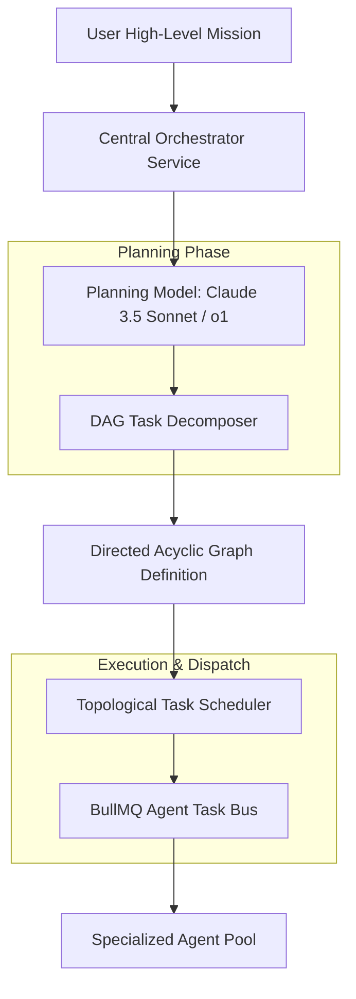
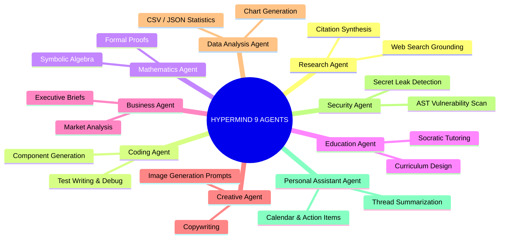
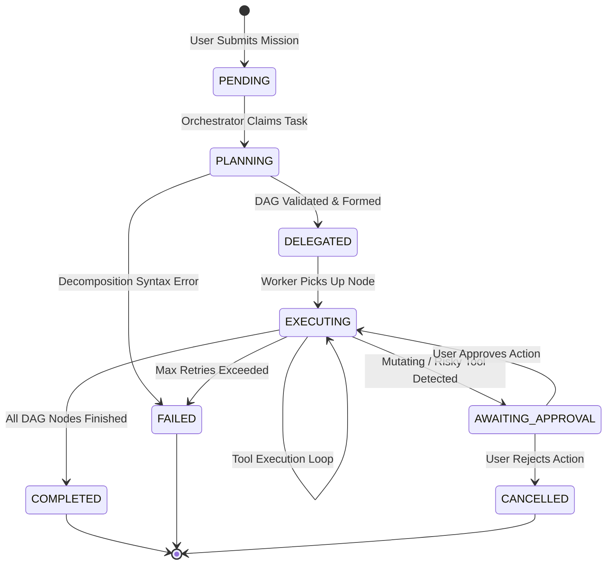
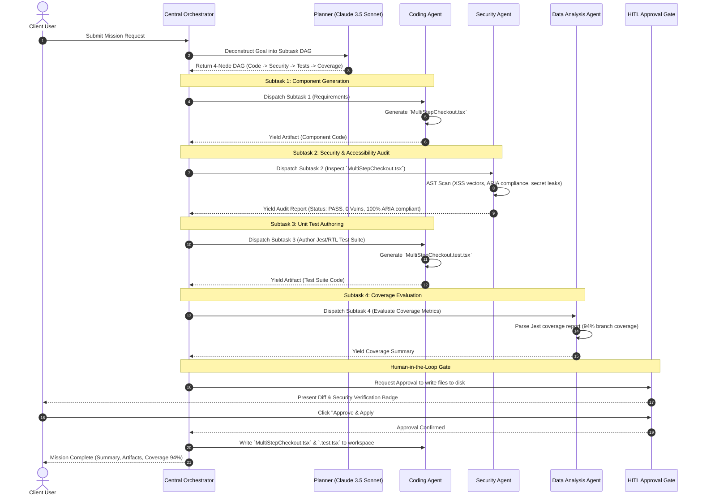
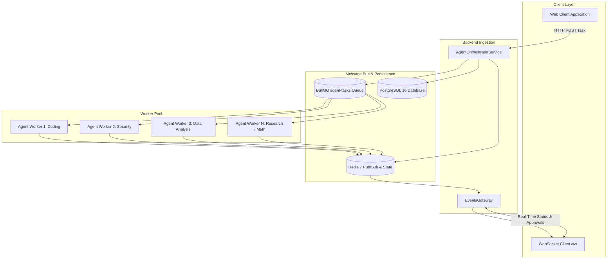

# HYPERMIND Agent Orchestration Architecture
**Document ID:** `HMD-ARCH-009`  
**Project:** HYPERMIND Universal AI Ecosystem Platform  
**Document Type:** Multi-Agent Architecture & Orchestration Specification  
**Date:** 2026-11-15  
**Version:** 1.0.0  
**Author:** Stream 3 Lead Architect (Backend & Intelligence)  
**Status:** Implementation Ready  

---

## Table of Contents
1. [Executive Summary & Multi-Agent Vision](#1-executive-summary--multi-agent-vision)
2. [Central Orchestrator Architecture](#2-central-orchestrator-architecture)
   - [Event-Driven Orchestrator Engine](#event-driven-orchestrator-engine)
   - [DAG Task Decomposition & Dependency Resolution](#dag-task-decomposition--dependency-resolution)
   - [Agent Capability Matching & Dispatch](#agent-capability-matching--dispatch)
   - [Execution Modes (Sequential, Parallel, Pipeline)](#execution-modes-sequential-parallel-pipeline)
3. [The 9 Specialized Autonomous Agents](#3-the-9-specialized-autonomous-agents)
   - [1. Research Agent](#1-research-agent)
   - [2. Coding Agent](#2-coding-agent)
   - [3. Mathematics Agent](#3-mathematics-agent)
   - [4. Education Agent](#4-education-agent)
   - [5. Business Agent](#5-business-agent)
   - [6. Creative Agent](#6-creative-agent)
   - [7. Data Analysis Agent](#7-data-analysis-agent)
   - [8. Security Agent](#8-security-agent)
   - [9. Personal Assistant Agent](#9-personal-assistant-agent)
4. [Agent Communication Protocol & Messaging Bus](#4-agent-communication-protocol--messaging-bus)
   - [Standard Inter-Agent Envelope Specification](#standard-inter-agent-envelope-specification)
   - [BullMQ Job Topology & Redis Pub/Sub Routing](#bullmq-job-topology--redis-pubsub-routing)
   - [Real-Time WebSocket Gateway Synchronization](#real-time-websocket-gateway-synchronization)
5. [Task Lifecycle & State Machine](#5-task-lifecycle--state-machine)
   - [Lifecycle States & Transitions](#lifecycle-states--transitions)
   - [Per-Agent Timeout & Execution Guardrails](#per-agent-timeout--execution-guardrails)
   - [Retry Policies, Backoff & Dead Letter Queue (DLQ)](#retry-policies-backoff--dead-letter-queue-dlq)
6. [Human-in-the-Loop (HITL) Governance & Safety Gates](#6-human-in-the-loop-hitl-governance--safety-gates)
   - [Policy Enforcement Engine & Risk Tiers](#policy-enforcement-engine--risk-tiers)
   - [Approval UI Protocol & Action Modification](#approval-ui-protocol--action-modification)
   - [Automated vs Manual Verification Gates](#automated-vs-manual-verification-gates)
7. [Extensible Tool System & Sandboxing](#7-extensible-tool-system--sandboxing)
   - [Tool Registry Schema & Permission Matrix](#tool-registry-schema--permission-matrix)
   - [Core Tool Catalog](#core-tool-catalog)
   - [Isolated Execution Sandbox](#isolated-execution-sandbox)
8. [End-to-End Multi-Agent Workflow: React Component Build & Test](#8-end-to-end-multi-agent-workflow-react-component-build--test)
9. [System Architecture Diagrams](#9-system-architecture-diagrams)
10. [Document Status & Verification Matrix](#10-document-status--verification-matrix)

---

## 1. Executive Summary & Multi-Agent Vision

HYPERMIND elevates AI interaction from passive conversational turn-taking to **goal-driven, collaborative multi-agent problem solving** [D]. When confronted with compound objectives that exceed the immediate scope of a single LLM prompt, the platform activates the **HYPERMIND Multi-Agent Orchestration Engine**.

The system combines:
1. **Hierarchical DAG Decomposition:** Deconstructs high-level user missions into topological dependency graphs.
2. **Specialized Cognitive Personas:** Deploys 9 purpose-built agents equipped with targeted system prompts, discrete tool grants, and tuned model configurations.
3. **Deterministic Human-in-the-Loop (HITL) Guardrails:** Protects critical environments by requiring human verification for mutating, financial, or dangerous operations [D].
4. **Resilient Asynchronous Bus:** Powered by BullMQ and Redis 7, enabling distributed scheduling, pausing, and resumption across long-running autonomous workflows [A].

---

## 2. Central Orchestrator Architecture

### Event-Driven Orchestrator Engine
The Central Orchestrator (`AgentOrchestratorService`) coordinates agent lifecycles via event-driven messaging. It does not perform low-level work directly; instead, it delegates tasks to specialized sub-agents, monitors progress, evaluates dependency satisfaction, and aggregates final deliverables.



### DAG Task Decomposition & Dependency Resolution
When a complex mission is submitted:
1. **Planning Pass:** The orchestrator invokes a high-reasoning model (Claude 3.5 Sonnet or OpenAI o1) with a structured DAG extraction prompt.
2. **Graph Construction:** The output parses into an internal Directed Acyclic Graph (DAG) consisting of discrete nodes ($N$) and edges ($E$):
   * **Node ($N_i$):** An atomic subtask assigned to a specific agent with distinct input requirements.
   * **Edge ($E_{ij}$):** A strict dependency requiring the output artifact of $N_i$ to be provided as context for $N_j$.
3. **Cycle Detection & Topological Sort:** The orchestrator validates the graph via Kahn's algorithm. If a cycle is detected, the graph is rejected and a refinement pass executes [D].

```typescript
export interface SubtaskNode {
  id: string;                         // e.g., 'subtask-01'
  title: string;                      // 'Extract database schema'
  targetAgent: AgentRole;             // AgentRole.CODING
  dependencies: string[];             // ['subtask-00']
  inputPayload: Record<string, any>;
  outputPayload?: Record<string, any>;
  status: TaskNodeStatus;
  retryCount: number;
}

export interface TaskDAG {
  taskId: string;
  userId: string;
  goal: string;
  nodes: Map<string, SubtaskNode>;
  executionOrder: string[][];         // Parallel execution tiers: [[1], [2, 3], [4]]
}
```

### Agent Capability Matching & Dispatch
Tasks are matched to agents based on the subtask's semantic domain. If a subtask requires multiple skillsets (e.g., "Analyze CSV and build a visualization dashboard"), the orchestrator decomposes it into an analytical step (assigned to `Data Analysis Agent`) followed by a coding step (assigned to `Coding Agent`).

### Execution Modes
1. **Sequential Mode:** Tasks with linear dependencies ($A \rightarrow B \rightarrow C$) execute sequentially. Each agent receives the predecessor's artifact.
2. **Parallel Mode:** Independent nodes residing in the same topological tier execute concurrently across distributed BullMQ workers.
3. **Pipeline Mode:** Streaming handoffs where downstream agents begin incremental processing as soon as upstream agents begin emitting structured token chunks.

---

## 3. The 9 Specialized Autonomous Agents

Each of the 9 agents is configured with strict operational boundaries, dedicated toolsets, and assigned model tiers:



### 1. Research Agent
* **Purpose:** Autonomous web exploration, factual investigation, and verified source synthesis.
* **Capabilities:** Deep web search, URL scraping, multi-source cross-referencing, APA/IEEE citation synthesis.
* **Assigned Models:** Primary: `gpt-4o`, Secondary: `gemini-2.0-flash`.
* **Granted Tools:** `web_search`, `web_fetch`, `file_read`.
* **Permissions:** Read-only web and document access.
* **Approval Requirements:** Autonomous (Low Risk).

### 2. Coding Agent
* **Purpose:** Production-grade software development, component generation, bug fixing, and test generation.
* **Capabilities:** Full-stack architecture, clean code generation (React, TypeScript, Node.js, Python), test authoring (Jest, PyTest), AST refactoring.
* **Assigned Models:** Primary: `claude-3-5-sonnet-20241022`, Secondary: `deepseek-coder`.
* **Granted Tools:** `file_read`, `file_write`, `code_execute`, `ast_inspect`.
* **Permissions:** Workspace filesystem write access (scoped to user project workspace).
* **Approval Requirements:** File overwrite requires human approval (Medium Risk).

### 3. Mathematics Agent
* **Purpose:** Rigorous symbolic math, algebraic deduction, statistical computations, and LaTeX formulation.
* **Capabilities:** Multi-step numerical calculation, proofs, matrix algebra, differential equations.
* **Assigned Models:** Primary: `o1-mini` or `deepseek-r1`.
* **Granted Tools:** `python_repl`, `wolfram_query`.
* **Permissions:** Sandboxed Python computation.
* **Approval Requirements:** Autonomous (Low Risk).

### 4. Education Agent
* **Purpose:** Personalized instruction, didactic breakdowns, and assessment creation.
* **Capabilities:** Socratic dialog, conceptual scaffolding, multi-tier quiz generation, adaptive learning plans.
* **Assigned Models:** Primary: `claude-3-5-haiku`, Secondary: `gpt-4o-mini`.
* **Granted Tools:** `file_read`, `quiz_builder`.
* **Permissions:** Read-only.
* **Approval Requirements:** Autonomous (Low Risk).

### 5. Business Agent
* **Purpose:** Strategic commercial intelligence, financial model interpretation, and executive communications.
* **Capabilities:** SWOT analysis, market sizing, business proposal drafting, pitch deck outline generation.
* **Assigned Models:** Primary: `claude-3-5-sonnet-20241022`, Secondary: `gpt-4o`.
* **Granted Tools:** `web_search`, `file_read`, `spreadsheet_parser`.
* **Permissions:** Read-only.
* **Approval Requirements:** Autonomous (Low Risk).

### 6. Creative Agent
* **Purpose:** Multimodal visual styling, copywriting, storytelling, and UI asset ideation.
* **Capabilities:** High-fidelity prompt engineering (DALL-E 3, Midjourney), marketing campaign copy, brand tone calibration.
* **Assigned Models:** Primary: `gpt-4o`, Secondary: `claude-3-5-sonnet-20241022`.
* **Granted Tools:** `image_generate`, `file_read`.
* **Permissions:** Storage write access for generated images.
* **Approval Requirements:** Autonomous (Low Risk).

### 7. Data Analysis Agent
* **Purpose:** Quantitative dataset parsing, statistical modeling, correlation discovery, and visualization code generation.
* **Capabilities:** CSV/JSON ingestion, pandas dataframe operations, automated chart generation (Recharts, Chart.js, Vega-Lite).
* **Assigned Models:** Primary: `gpt-4o`, Secondary: `claude-3-5-sonnet-20241022`.
* **Granted Tools:** `code_execute`, `file_read`, `chart_builder`.
* **Permissions:** Read-only dataset access, sandboxed execution.
* **Approval Requirements:** Autonomous (Low Risk).

### 8. Security Agent
* **Purpose:** Comprehensive source code auditing, vulnerability identification, and compliance verification.
* **Capabilities:** OWASP Top 10 auditing, static analysis for secret leaks (API keys, passwords), insecure dependency detection, permission minimization review.
* **Assigned Models:** Primary: `claude-3-5-sonnet-20241022`.
* **Granted Tools:** `file_read`, `dependency_audit`, `secret_scanner`.
* **Permissions:** Read-only repository access.
* **Approval Requirements:** Autonomous audit (Low Risk).

### 9. Personal Assistant Agent
* **Purpose:** Daily workflow coordination, priority tracking, conversational summarization, and action item extraction.
* **Capabilities:** Thread summarization, task list structuring, calendar scheduling proposals, reminder formatting.
* **Assigned Models:** Primary: `gpt-4o-mini`, Secondary: `claude-3-5-haiku`.
* **Granted Tools:** `calendar_query`, `memory_store`, `file_read`.
* **Permissions:** User memory read/write.
* **Approval Requirements:** Calendar events or external email dispatch require human approval (High Risk).

---

## 4. Agent Communication Protocol & Messaging Bus

### Standard Inter-Agent Envelope Specification
All inter-agent messages conform to a strictly typed JSON envelope:

```typescript
export interface AgentMessage<T = any> {
  id: string;                         // UUID v4
  taskId: string;                     // Root task identifier
  subtaskId: string;                  // Current DAG node ID
  senderAgentId: string;              // e.g., 'agent:security'
  recipientAgentId: string;           // e.g., 'agent:orchestrator' or '*'
  type: AgentMessageType;             // 'TASK_DELEGATION' | 'STATUS_UPDATE' | 'ARTIFACT_DELIVERY' | 'APPROVAL_REQUEST'
  payload: T;                         // Strongly-typed payload content
  status: TaskNodeStatus;             // 'PENDING' | 'EXECUTING' | 'SUCCESS' | 'FAILED'
  timestamp: string;                  // ISO 8601 UTC
  correlationId: string;              // Distributed tracing identifier
}
```

### BullMQ Job Topology & Redis Pub/Sub Routing
Communication leverages two distinct transport channels:
1. **BullMQ Queue (`agent-tasks`):** Used for reliable, durable task delegation. Subtasks are queued as BullMQ jobs. If an agent worker crashes mid-task, BullMQ re-queues the job to an active worker node [A].
2. **Redis Pub/Sub Channel (`hypermind:agent-bus:{taskId}`):** Used for ephemeral broadcast events, intermediate token streaming, and cross-agent status synchronization.

### Real-Time WebSocket Gateway Synchronization
Status updates from the Redis bus are intercepted by the `EventsGateway` and broadcast to the user's active client session:
```typescript
// Dispatched whenever a subtask status shifts
this.server.to(`task:${taskId}`).emit('agent:dag:update', {
  taskId,
  activeNodeId: message.subtaskId,
  agentRole: message.senderAgentId,
  status: message.status,
  summary: message.payload.summary,
});
```

---

## 5. Task Lifecycle & State Machine

### Lifecycle States & Transitions



### Per-Agent Timeout & Execution Guardrails
To prevent runaway LLM execution loops or billing spikes:
* **Default Subtask Timeout:** 5 minutes (300,000ms).
* **Maximum Mission Timeout:** 30 minutes (1,800,000ms).
* **Max Tool Invocations per Subtask:** 15 turns. If an agent loops beyond 15 tool calls without yielding an artifact, the task halts with `MAX_ITERATIONS_EXCEEDED`.

### Retry Policies, Backoff & Dead Letter Queue (DLQ)
* **Ephemeral Failures (Network, Rate Limit):** Retried automatically up to 3 times with exponential backoff (2s, 4s, 8s).
* **Dead Letter Queue (`agent-tasks-dlq`):** When all 3 retries fail, the subtask state is marked `FAILED`, the parent DAG halts gracefully, and the complete execution trace is persisted to PostgreSQL for developer analysis.

---

## 6. Human-in-the-Loop (HITL) Governance & Safety Gates

### Policy Enforcement Engine & Risk Tiers
Every tool invocation is intercepted by the `PolicyEngine` before execution:

| Risk Tier | Permitted Operations | Human Approval Required? | Default Behavior |
| :--- | :--- | :--- | :--- |
| **Tier 1: Read-Only** | `web_search`, `file_read`, `calculator`, `ast_inspect` | **No** | Auto-approved instantly [D] |
| **Tier 2: Non-Destructive Write** | `file_write` (new file creation), `image_generate` | **No** (Pro/Enterprise) | Auto-approved with audit log |
| **Tier 3: Mutating & Execution** | `file_write` (overwrite), `code_execute` (sandbox), API calls | **YES** | Execution paused; client prompted |
| **Tier 4: Critical & High Risk** | Database drop/migrate, shell commands, financial transactions | **MANDATORY** | Two-factor approval required |

### Approval UI Protocol & Action Modification
When an action enters `AWAITING_APPROVAL`:
1. The orchestrator suspends the BullMQ worker job.
2. An event is emitted to the client UI with the exact action details:
   ```json
   {
     "taskId": "task-8f92-a1",
     "actionId": "act-103",
     "agent": "Coding Agent",
     "riskLevel": "TIER_3_MUTATING",
     "action": "OVERWRITE_FILE",
     "target": "src/components/CheckoutButton.tsx",
     "diff": "--- a/src/components/CheckoutButton.tsx\n+++ b/src/components/CheckoutButton.tsx\n..."
   }
   ```
3. The user can select **Approve**, **Reject**, or **Modify Parameters** (e.g., change the target file path).

---

## 7. Extensible Tool System & Sandboxing

### Tool Registry Schema & Permission Matrix
Tools are defined as modular NestJS providers adhering to standard JSON Schema parameters:

```typescript
export interface ToolDefinition {
  name: string;
  description: string;
  parameters: Record<string, any>; // JSON Schema format
  permittedAgents: AgentRole[];
  riskTier: 'TIER_1' | 'TIER_2' | 'TIER_3' | 'TIER_4';
  timeoutMs: number;
}
```

### Core Tool Catalog

| Tool Name | Parameters | Allowed Agents | Function |
| :--- | :--- | :--- | :--- |
| `web_search` | `query: string, maxResults?: number` | Research, Business | Searches the web using Google Search API |
| `code_execute` | `language: string, code: string` | Coding, Math, Data Analysis | Executes code in an isolated container |
| `file_read` | `path: string, lineRange?: [number, number]` | All Agents | Reads file content from user workspace |
| `file_write` | `path: string, content: string, overwrite: boolean`| Coding | Writes or updates a file in user workspace |
| `api_call` | `url: string, method: string, headers: any, body: any`| Business, Personal Assistant| Executes external HTTP requests |
| `image_generate`| `prompt: string, size?: string` | Creative | Calls DALL-E 3 API to generate an image |

### Isolated Execution Sandbox
For tools executing raw code (`code_execute`, `python_repl`):
* **Execution Environment:** Isolated lightweight Linux microVMs or Docker containers via gVisor.
* **Resource Quotas:** 1 vCPU, 512MB RAM, 15-second CPU execution cap.
* **Network Egress:** Blocked by default (`--net=none`) to prevent unauthorized data exfiltration.

---

## 8. End-to-End Multi-Agent Workflow: React Component Build & Test

### Scenario Specification
**User Goal:** *"Build a high-performance, accessible React multi-step checkout component with Tailwind CSS, write comprehensive unit tests with Jest, and ensure it passes security checks."*



---

## 9. System Architecture Diagrams

### Complete Multi-Agent Communication & Job Bus Flow



---

## 10. Document Status & Verification Matrix

| Architecture Component | Status | Source / Verification Method | Target Milestone |
| :--- | :--- | :--- | :--- |
| **Central Orchestrator & DAG Engine** | Complete specification | Kahn's Algorithm & BullMQ DAG scheduling [D] | Day 4 |
| **9 Specialized Agent Profiles** | Complete specification | Tailored system prompts & capability constraints [D] | Day 4 |
| **Agent Communication Protocol** | Complete specification | Typed JSON envelope + Redis Pub/Sub [D] | Day 4 |
| **Task Lifecycle State Machine** | Complete specification | Finite State Machine with DLQ [A] | Day 4 |
| **Human-in-the-Loop (HITL) Gate** | Complete specification | WebSocket interactive approval protocol [D] | Day 5 |
| **Sandboxed Tool Execution** | Complete specification | Linux container & gVisor isolation [A] | Day 5 |
| **End-to-End React Workflow Spec**| Complete specification | Multi-agent sequence verification [D] | Day 5 |

**Status:** APPROVED FOR IMPLEMENTATION  
**Open Items:** None. System is fully specified for multi-agent development.
