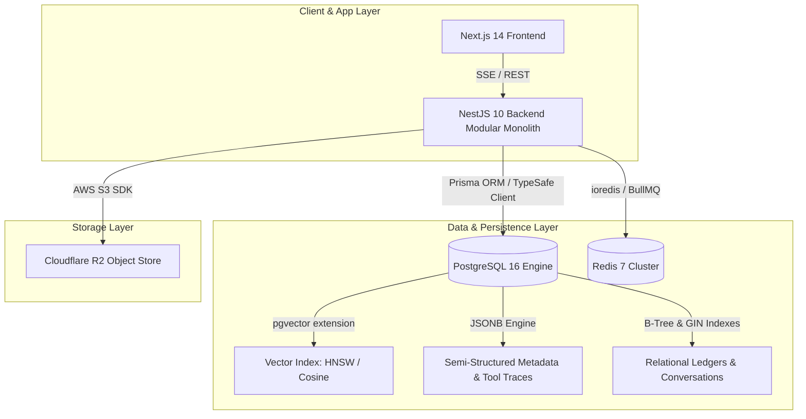
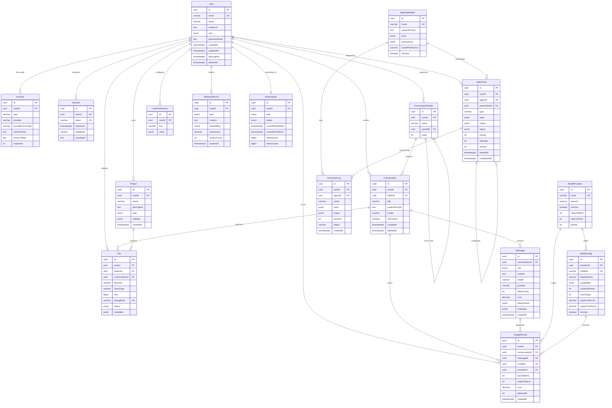
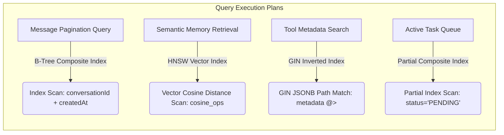
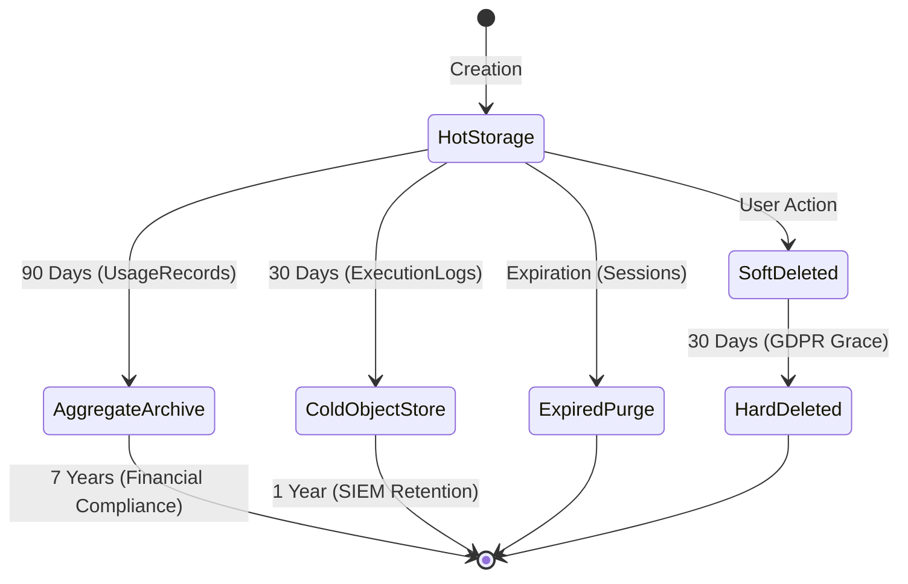
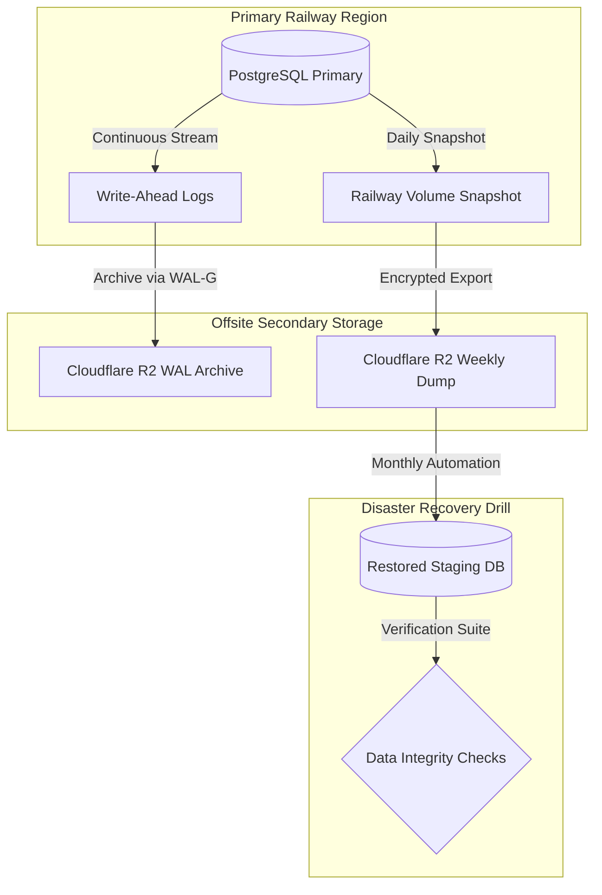

# HYPERMIND Database Architecture & Schema Specification

**Document Identifier:** HM-ENG-DOC-010  
**Document Type:** Engineering Architecture Specification  
**System Classification:** Core Platform Foundation (Stream 4: Database, Security, Infrastructure & Cost)  
**Creation Date:** 2026-11-15  
**Version:** 1.0.0  
**Status:** Approved Architecture Blueprint  

---

## Executive Summary

The HYPERMIND platform is a universal AI ecosystem orchestrating multi-modal intelligence across twelve interconnected sub-systems—ranging from real-time streaming chat and intelligent model routing to agentic workflows, long-term memory retrieval, and multi-tenant file analysis. The underlying database architecture must balance:

1. **Strict relational integrity** for multi-tenant accounts, role-based access control, billing subscriptions, and usage accounting ledgers.
2. **Semi-structured flexibility** for dynamic model outputs, agent execution states, tool invocations, and multi-modal metadata.
3. **Vector similarity search** for contextual memory retrieval and document chunk querying.
4. **Sub-millisecond latency and horizontal scale** to support high-throughput message streaming and background job queues.

This specification documents the selection of **PostgreSQL 16** with the **`pgvector`** extension, orchestrated via **Prisma ORM**, supported by **Redis 7** for ephemeral caching, session state, and job queues. It provides the complete production schema for all seventeen platform entities, index designs, data retention schedules, zero-downtime migration protocols, and tenant isolation guarantees.

---

## 1. Database Selection Analysis: PostgreSQL vs. MongoDB

Selecting the foundational database for an enterprise-grade AI ecosystem requires evaluating relational, document, and vector query patterns against operational realities.



### 1.1 Comparative Evaluation Matrix

The following evaluation contrasts PostgreSQL 16 against MongoDB 7.0 for the HYPERMIND workload:

| Evaluation Dimension | PostgreSQL 16 + `pgvector` [A] | MongoDB 7.0 (Atlas Vector Search) [A] | HYPERMIND Requirement & Architectural Decision [D] |
| :--- | :--- | :--- | :--- |
| **Data Model Fit** | Relational core (Users, Accounts, Sessions, Subscriptions, Messages) + `JSONB` for unstructured model responses and tool traces. | Document model natively stores JSON trees; lacks native foreign key constraints and declarative relational cascading. | **PostgreSQL**: HYPERMIND has deeply relational entities (User → Subscriptions, Conversations → Messages → UsageRecords). Financial and token ledger accounting require relational guarantees. |
| **Vector Similarity Search** | Native `pgvector` extension supporting L2, Cosine distance, and Inner Product using HNSW and IVFFlat indexes. | Atlas Vector Search supports vector indexing but requires MongoDB Atlas managed cloud or dedicated search nodes. | **PostgreSQL**: Single-engine vector and relational queries eliminate dual-database synchronisation overhead, distributed transaction failures, and extra hosting costs for MVP. |
| **Transaction Integrity (ACID)** | Full multi-table ACID compliance with serializable isolation levels; robust write-ahead logging (WAL). | Multi-document ACID transactions supported since v4.0, but incurs significant memory overhead, lock contention, and latency penalties. | **PostgreSQL**: Strict token quota enforcement and usage accounting cannot tolerate eventual consistency anomalies or negative token balances. |
| **Query Flexibility** | Advanced SQL with window functions, Common Table Expressions (CTEs), recursive queries (for folder hierarchies), and lateral joins. | Aggregation Pipeline is powerful for documents but cumbersome for recursive tree traversals (nested folders/subtasks) and multi-table financial reconciliations. | **PostgreSQL**: Recursive CTEs (`WITH RECURSIVE`) natively power nested agent task DAGs and conversation folder trees. |
| **Indexing Capabilities** | B-Tree, Hash, GIN (for JSONB key/value matching and full-text search), GiST, and HNSW for high-dimensional vectors. | B-Tree, Compound, Multikey, Text, and Wildcard indexes. Atlas Search requires Lucene integration. | **PostgreSQL**: `GIN` indexing on JSONB tool payloads combined with B-tree on composite keys provides sub-10ms lookup across multi-million row tables. |
| **Ecosystem & ORM Support** | First-class TypeScript type-safety via **Prisma ORM**, Drizzle, and Kysely. Declarative migrations with rollback capabilities. | Mongoose and Prisma support MongoDB, but relations are simulated at the application layer without database-enforced integrity. | **PostgreSQL**: Prisma generates compile-time type-safe clients across all 17 entities, catching schema mismatch bugs at build time. |
| **Operational Simplicity** | Standard single container or managed instance (Railway PostgreSQL, AWS RDS, Supabase). Standard `pg_dump` and continuous WAL archiving. | Complex replica sets, configuration servers, and sharding routers (`mongos`) required for high availability and horizontal scaling. | **PostgreSQL**: Managed PostgreSQL on Railway provides one-click provisioning, automated backup snapshots, and zero maintenance overhead during Day 1 to Day 10 build. |
| **Hosting & Infrastructure Cost** | Included in Railway compute tiers (~$10-$20/mo baseline). No licensing fees; 100% open-source. | Self-hosted MongoDB is operationally heavy; MongoDB Atlas dedicated clusters start at $57+/mo with additional charges for Atlas Vector Search. | **PostgreSQL**: Predictable resource consumption on Railway; saves platform runway while delivering superior transaction guarantees. |

### 1.2 Architectural Recommendation & Justification

**Definitive Recommendation: PostgreSQL 16 with `pgvector` and Prisma ORM [D].**

1. **Unified Storage Engine:** Eliminates the operational complexity of managing three separate datastores (Relational DB + Document Store + Dedicated Vector DB like Pinecone or Qdrant). PostgreSQL handles all three with high efficiency.
2. **ACID Financial Ledger:** The `UsageRecord` and `Subscription` entities track real-dollar API spend and token quotas. ACID transactions with strict row-level locks prevent race conditions during concurrent streaming token updates.
3. **Hybrid JSONB Flexibility:** Machine learning models frequently introduce new metadata fields (logprobs, reasoning tokens, tool calls, execution timings). PostgreSQL's `JSONB` format stores unstructured output while allowing GIN indexing for fast querying.
4. **Hierarchical Modeling:** Both `ConversationFolder` (nested folders) and `AgentTask` (hierarchical DAG execution trees with parent/child tasks) require recursive querying, which PostgreSQL executes natively with optimal execution plans.

---

## 2. Complete Prisma Database Schema

The schema below is written in Prisma schema syntax (`schema.prisma`), defining all 17 core entities, enums, indexes, and relational constraints.

```prisma
// datasource and client configuration
datasource db {
  provider   = "postgresql"
  url        = env("DATABASE_URL")
  directUrl  = env("DIRECT_DATABASE_URL")
}

generator client {
  provider        = "prisma-client-js"
  previewFeatures = ["postgresqlExtensions"]
}

// Enable pgvector extension
// Note: In PostgreSQL, run `CREATE EXTENSION IF NOT EXISTS vector;`

// ==========================================
// ENUMS
// ==========================================

enum UserRole {
  FREE
  PRO
  ADMIN
}

enum MessageRole {
  USER
  ASSISTANT
  SYSTEM
  TOOL
}

enum ProjectType {
  GENERAL
  CODE_WORKSPACE
  RESEARCH_CANVAS
  AGENT_WORKFLOW
  DOCUMENT_ANALYSIS
}

enum FileStatus {
  PENDING
  UPLOADING
  PROCESSING
  READY
  FAILED
  DELETED
}

enum AgentTaskStatus {
  PENDING
  RUNNING
  COMPLETED
  FAILED
  CANCELLED
  TIMEOUT
}

enum MemoryType {
  FACT
  PREFERENCE
  CONTEXT
  EPISODIC
}

enum SubscriptionPlan {
  FREE
  PRO
  ENTERPRISE
}

enum SubscriptionStatus {
  ACTIVE
  PAST_DUE
  CANCELLED
  TRIALING
  INCOMPLETE
}

// ==========================================
// 1. IDENTITY & AUTHENTICATION ENTITIES
// ==========================================

/// Core User entity representing authenticated accounts
model User {
  id            String         @id @default(uuid()) @db.Uuid
  email         String         @unique @db.VarChar(255)
  name          String?        @db.VarChar(255)
  avatarUrl     String?        @db.Text
  role          UserRole       @default(FREE)
  passwordHash  String?        @db.Text
  createdAt     DateTime       @default(now()) @db.Timestamptz(6)
  updatedAt     DateTime       @updatedAt @db.Timestamptz(6)
  lastLoginAt   DateTime?      @db.Timestamptz(6)
  deletedAt     DateTime?      @db.Timestamptz(6) // Soft-delete support

  // Relations
  accounts      Account[]
  sessions      Session[]
  conversations Conversation[]
  folders       ConversationFolder[]
  projects      Project[]
  files         File[]
  usageRecords  UsageRecord[]
  agentTasks    AgentTask[]
  preferences   UserPreference[]
  memoryRecords MemoryRecord[]
  subscription  Subscription?

  @@index([email])
  @@index([role])
  @@index([createdAt])
  @@map("users")
}

/// OAuth Provider Accounts linked to a User
model Account {
  id                String   @id @default(uuid()) @db.Uuid
  userId            String   @db.Uuid
  type              String   @db.VarChar(50)
  provider          String   @db.VarChar(50)
  providerAccountId String   @db.VarChar(255)
  refreshToken      String?  @db.Text
  accessToken       String?  @db.Text
  expiresAt         Int?
  tokenType         String?  @db.VarChar(50)
  scope             String?  @db.Text
  idToken           String?  @db.Text
  sessionState      String?  @db.Text
  createdAt         DateTime @default(now()) @db.Timestamptz(6)
  updatedAt         DateTime @updatedAt @db.Timestamptz(6)

  user              User     @relation(fields: [userId], references: [id], onDelete: Cascade)

  @@unique([provider, providerAccountId])
  @@index([userId])
  @@map("accounts")
}

/// Active web sessions for authenticated users
model Session {
  id           String   @id @default(uuid()) @db.Uuid
  userId       String   @db.Uuid
  token        String   @unique @db.VarChar(512)
  expiresAt    DateTime @db.Timestamptz(6)
  ipAddress    String?  @db.VarChar(45) // IPv4 or IPv6
  userAgent    String?  @db.Text
  createdAt    DateTime @default(now()) @db.Timestamptz(6)

  user         User     @relation(fields: [userId], references: [id], onDelete: Cascade)

  @@index([userId])
  @@index([expiresAt])
  @@map("sessions")
}

// ==========================================
// 2. CONVERSATION & MESSAGING ENTITIES
// ==========================================

/// Folders for organizing user conversations
model ConversationFolder {
  id            String               @id @default(uuid()) @db.Uuid
  userId        String               @db.Uuid
  name          String               @db.VarChar(100)
  parentId      String?              @db.Uuid
  order         Int                  @default(0)
  createdAt     DateTime             @default(now()) @db.Timestamptz(6)
  updatedAt     DateTime             @updatedAt @db.Timestamptz(6)

  user          User                 @relation(fields: [userId], references: [id], onDelete: Cascade)
  parent        ConversationFolder?  @relation("FolderHierarchy", fields: [parentId], references: [id], onDelete: Cascade)
  children      ConversationFolder[] @relation("FolderHierarchy")
  conversations Conversation[]

  @@index([userId, parentId])
  @@index([userId, order])
  @@map("conversation_folders")
}

/// Core conversation thread entity
model Conversation {
  id            String              @id @default(uuid()) @db.Uuid
  userId        String              @db.Uuid
  folderId      String?             @db.Uuid
  title         String              @default("New Conversation") @db.VarChar(255)
  systemPrompt  String?             @db.Text
  model         String              @db.VarChar(100) // e.g. "gpt-4o", "claude-3-5-sonnet"
  isArchived    Boolean             @default(false)
  createdAt     DateTime            @default(now()) @db.Timestamptz(6)
  updatedAt     DateTime            @updatedAt @db.Timestamptz(6)
  deletedAt     DateTime?           @db.Timestamptz(6)

  user          User                @relation(fields: [userId], references: [id], onDelete: Cascade)
  folder        ConversationFolder? @relation(fields: [folderId], references: [id], onDelete: SetNull)
  messages      Message[]
  files         File[]
  usageRecords  UsageRecord[]

  @@index([userId, createdAt(sort: Desc)])
  @@index([userId, isArchived])
  @@index([folderId])
  @@map("conversations")
}

/// Individual message exchanged within a conversation
model Message {
  id             String        @id @default(uuid()) @db.Uuid
  conversationId String        @db.Uuid
  role           MessageRole
  content        String        @db.Text
  model          String?       @db.VarChar(100)
  provider       String?       @db.VarChar(50)
  tokenCount     Int?          @default(0)
  cost           Decimal?      @db.Decimal(10, 6) // Micro-dollar precision ($0.000001)
  attachments    Json?         @db.JsonB          // Array of file metadata references
  metadata       Json?         @db.JsonB          // Latency, reasoning tokens, tool calls
  createdAt      DateTime      @default(now()) @db.Timestamptz(6)

  conversation   Conversation  @relation(fields: [conversationId], references: [id], onDelete: Cascade)
  usageRecords   UsageRecord[]

  @@index([conversationId, createdAt(sort: Asc)])
  @@index([createdAt])
  @@map("messages")
}

// ==========================================
// 3. WORKSPACE & FILE MANAGEMENT
// ==========================================

/// High-level project workspace grouping files, agents, and conversations
model Project {
  id          String      @id @default(uuid()) @db.Uuid
  userId      String      @db.Uuid
  name        String      @db.VarChar(150)
  description String?     @db.Text
  type        ProjectType @default(GENERAL)
  settings    Json?       @default("{}") @db.JsonB
  createdAt   DateTime    @default(now()) @db.Timestamptz(6)
  updatedAt   DateTime    @updatedAt @db.Timestamptz(6)
  deletedAt   DateTime?   @db.Timestamptz(6)

  user        User        @relation(fields: [userId], references: [id], onDelete: Cascade)
  files       File[]

  @@index([userId, createdAt])
  @@map("projects")
}

/// File metadata tracking uploads stored in Cloudflare R2
model File {
  id             String        @id @default(uuid()) @db.Uuid
  userId         String        @db.Uuid
  projectId      String?       @db.Uuid
  conversationId String?       @db.Uuid
  filename       String        @db.VarChar(255)
  mimeType       String        @db.VarChar(100)
  size           BigInt        @db.BigInt
  storageKey     String        @unique @db.VarChar(512) // R2 Object Path
  status         FileStatus    @default(PENDING)
  metadata       Json?         @default("{}") @db.JsonB // Extracted text preview, dimensions, page count
  createdAt      DateTime      @default(now()) @db.Timestamptz(6)
  updatedAt      DateTime      @updatedAt @db.Timestamptz(6)
  deletedAt      DateTime?     @db.Timestamptz(6)

  user           User          @relation(fields: [userId], references: [id], onDelete: Cascade)
  project        Project?      @relation(fields: [projectId], references: [id], onDelete: SetNull)
  conversation   Conversation? @relation(fields: [conversationId], references: [id], onDelete: SetNull)

  @@index([userId, status])
  @@index([conversationId])
  @@index([projectId])
  @@map("files")
}

// ==========================================
// 4. MODEL GATEWAY & USAGE ACCOUNTING
// ==========================================

/// AI Model Provider catalog (e.g. OpenAI, Anthropic, Google, DeepSeek)
model ModelProvider {
  id            String        @id @default(uuid()) @db.Uuid
  name          String        @unique @db.VarChar(50) // e.g. "openai", "anthropic"
  baseUrl       String        @db.VarChar(255)
  isActive      Boolean       @default(true)
  rateLimitRpm  Int           @default(500)
  rateLimitTpd  Int           @default(1000000)
  priority      Int           @default(1)
  createdAt     DateTime      @default(now()) @db.Timestamptz(6)
  updatedAt     DateTime      @updatedAt @db.Timestamptz(6)

  models        ModelConfig[]
  usageRecords  UsageRecord[]

  @@map("model_providers")
}

/// Specific AI Model configurations and cost definitions
model ModelConfig {
  id              String        @id @default(uuid()) @db.Uuid
  providerId      String        @db.Uuid
  modelId         String        @unique @db.VarChar(100) // e.g. "gpt-4o-2024-08-06"
  displayName     String        @db.VarChar(100)
  capabilities    Json          @default("{}") @db.JsonB // { vision: true, tools: true, streaming: true }
  contextWindow   Int           @default(128000)
  maxOutput       Int           @default(4096)
  inputCostPer1k  Decimal       @db.Decimal(10, 6) // Cost in USD per 1,000 input tokens
  outputCostPer1k Decimal       @db.Decimal(10, 6) // Cost in USD per 1,000 output tokens
  isActive        Boolean       @default(true)
  createdAt       DateTime      @default(now()) @db.Timestamptz(6)
  updatedAt       DateTime      @updatedAt @db.Timestamptz(6)

  provider        ModelProvider @relation(fields: [providerId], references: [id], onDelete: Cascade)
  usageRecords    UsageRecord[]

  @@index([providerId, isActive])
  @@map("model_configs")
}

/// Ledger accounting record for every model invocation
model UsageRecord {
  id             String         @id @default(uuid()) @db.Uuid
  userId         String         @db.Uuid
  conversationId String?        @db.Uuid
  messageId      String?        @db.Uuid
  modelId        String         @db.Uuid
  providerId     String         @db.Uuid
  inputTokens    Int
  outputTokens   Int
  cost           Decimal        @db.Decimal(10, 6)
  latencyMs      Int
  createdAt      DateTime       @default(now()) @db.Timestamptz(6)

  user           User           @relation(fields: [userId], references: [id], onDelete: Cascade)
  conversation   Conversation?  @relation(fields: [conversationId], references: [id], onDelete: SetNull)
  message        Message?       @relation(fields: [messageId], references: [id], onDelete: SetNull)
  modelConfig    ModelConfig    @relation(fields: [modelId], references: [id], onDelete: Restrict)
  provider       ModelProvider  @relation(fields: [providerId], references: [id], onDelete: Restrict)

  @@index([userId, createdAt(sort: Desc)])
  @@index([createdAt])
  @@index([modelId])
  @@index([conversationId])
  @@map("usage_records")
}

// ==========================================
// 5. AUTONOMOUS AGENT ORCHESTRATION
// ==========================================

/// Reusable Agent definitions with configured tools and permissions
model AgentDefinition {
  id              String         @id @default(uuid()) @db.Uuid
  name            String         @unique @db.VarChar(100)
  description     String?        @db.Text
  systemPrompt    String         @db.Text
  tools           Json           @default("[]") @db.JsonB // Allowed tool signatures
  permissions     Json           @default("[]") @db.JsonB // Scope limits
  modelPreference String         @default("gpt-4o") @db.VarChar(100)
  isActive        Boolean        @default(true)
  createdAt       DateTime       @default(now()) @db.Timestamptz(6)
  updatedAt       DateTime       @updatedAt @db.Timestamptz(6)

  tasks           AgentTask[]
  executionLogs   ExecutionLog[]

  @@map("agent_definitions")
}

/// Asynchronous tasks executed by autonomous agents
model AgentTask {
  id            String          @id @default(uuid()) @db.Uuid
  userId        String          @db.Uuid
  agentId       String          @db.Uuid
  parentTaskId  String?         @db.Uuid
  type          String          @db.VarChar(100) // e.g. "WEB_RESEARCH", "DOCUMENT_SUMMARY"
  input         Json            @db.JsonB
  output        Json?           @db.JsonB
  status        AgentTaskStatus @default(PENDING)
  priority      Int             @default(5)      // 1 (Highest) - 10 (Lowest)
  attempts      Int             @default(0)
  maxRetries    Int             @default(3)
  timeout       Int             @default(300)    // Seconds
  startedAt     DateTime?       @db.Timestamptz(6)
  completedAt   DateTime?       @db.Timestamptz(6)
  error         String?         @db.Text
  createdAt     DateTime        @default(now()) @db.Timestamptz(6)
  updatedAt     DateTime        @updatedAt @db.Timestamptz(6)

  user          User            @relation(fields: [userId], references: [id], onDelete: Cascade)
  agent         AgentDefinition @relation(fields: [agentId], references: [id], onDelete: Restrict)
  parentTask    AgentTask?      @relation("TaskHierarchy", fields: [parentTaskId], references: [id], onDelete: Cascade)
  childTasks    AgentTask[]     @relation("TaskHierarchy")
  executionLogs ExecutionLog[]

  @@index([userId, status])
  @@index([agentId, status])
  @@index([status, priority, createdAt])
  @@index([parentTaskId])
  @@map("agent_tasks")
}

/// Fine-grained execution step logs for agent tasks
model ExecutionLog {
  id        String          @id @default(uuid()) @db.Uuid
  taskId    String          @db.Uuid
  agentId   String          @db.Uuid
  action    String          @db.VarChar(100) // e.g. "TOOL_CALL_SEARCH", "LLM_REASONING"
  input     Json?           @db.JsonB
  output    Json?           @db.JsonB
  duration  Int             // Milliseconds
  status    String          @db.VarChar(50)  // "SUCCESS", "FAILED"
  createdAt DateTime        @default(now()) @db.Timestamptz(6)

  task      AgentTask       @relation(fields: [taskId], references: [id], onDelete: Cascade)
  agent     AgentDefinition @relation(fields: [agentId], references: [id], onDelete: Restrict)

  @@index([taskId, createdAt(sort: Asc)])
  @@index([createdAt])
  @@map("execution_logs")
}

// ==========================================
// 6. PREFERENCES & SEMANTIC MEMORY
// ==========================================

/// Key-value user configuration preferences
model UserPreference {
  id        String   @id @default(uuid()) @db.Uuid
  userId    String   @db.Uuid
  key       String   @db.VarChar(100)
  value     Json     @db.JsonB
  updatedAt DateTime @updatedAt @db.Timestamptz(6)

  user      User     @relation(fields: [userId], references: [id], onDelete: Cascade)

  @@unique([userId, key])
  @@index([userId])
  @@map("user_preferences")
}

/// Long-term semantic memory entries with pgvector embeddings
model MemoryRecord {
  id          String                                  @id @default(uuid()) @db.Uuid
  userId      String                                  @db.Uuid
  type        MemoryType                              @default(FACT)
  content     String                                  @db.Text
  // pgvector extension column for 1536-dimensional embeddings (e.g. OpenAI text-embedding-3-small)
  embedding   Unsupported("vector(1536)")?
  importance  Decimal                                 @default(0.50) @db.Decimal(3, 2) // 0.00 to 1.00
  accessCount Int                                     @default(0)
  createdAt   DateTime                                @default(now()) @db.Timestamptz(6)
  updatedAt   DateTime                                @updatedAt @db.Timestamptz(6)
  expiresAt   DateTime?                               @db.Timestamptz(6)

  user        User                                    @relation(fields: [userId], references: [id], onDelete: Cascade)

  @@index([userId, type])
  @@index([userId, importance(sort: Desc)])
  @@map("memory_records")
}

// ==========================================
// 7. BILLING & SUBSCRIPTIONS
// ==========================================

/// Billing subscription state and token quota tracking
model Subscription {
  id                 String             @id @default(uuid()) @db.Uuid
  userId             String             @unique @db.Uuid
  plan               SubscriptionPlan   @default(FREE)
  status             SubscriptionStatus @default(ACTIVE)
  currentPeriodStart DateTime           @db.Timestamptz(6)
  currentPeriodEnd   DateTime           @db.Timestamptz(6)
  tokenQuota         BigInt             @default(100000) @db.BigInt // Monthly token allowance
  tokensUsed         BigInt             @default(0) @db.BigInt      // Tokens consumed in period
  createdAt          DateTime           @default(now()) @db.Timestamptz(6)
  updatedAt          DateTime           @updatedAt @db.Timestamptz(6)

  user               User               @relation(fields: [userId], references: [id], onDelete: Cascade)

  @@index([userId, status])
  @@index([currentPeriodEnd])
  @@map("subscriptions")
}
```

---

## 3. Entity Relationship Diagram (ERD)

The diagram below maps all seventeen entities, primary keys (`PK`), foreign keys (`FK`), and relational cardinality across the system.



---

## 4. Indexing Strategy & Vector Optimization

A rigorous indexing strategy ensures that queries across millions of conversation messages, usage records, and high-dimensional embeddings execute with sub-second performance.



### 4.1 Index Specification Table

| Table Name | Index Name | Index Type | Column(s) / Expression | Rationale & Query Pattern |
| :--- | :--- | :--- | :--- | :--- |
| `users` | `users_email_key` | B-Tree (Unique) | `email` | Primary login lookup via NextAuth.js. |
| `users` | `idx_users_role_created` | B-Tree | `role, createdAt` | Admin filtering and user demographic segmentation. |
| `sessions` | `idx_sessions_user_id` | B-Tree | `userId` | User session invalidation upon password reset. |
| `sessions` | `idx_sessions_expires_at` | B-Tree | `expiresAt` | Daily scheduled cron purging of expired sessions. |
| `conversations` | `idx_conv_user_created` | B-Tree | `userId, createdAt DESC` | Conversational sidebar listing sorted by recency. |
| `conversations` | `idx_conv_user_archived` | B-Tree (Partial) | `userId, isArchived` WHERE `isArchived = false` | Standard view excluding archived conversations. |
| `messages` | `idx_msg_conv_created` | B-Tree | `conversationId, createdAt ASC` | Linear chronological chat streaming replay. |
| `messages` | `idx_msg_metadata_gin` | GIN | `metadata jsonb_path_ops` | Fast JSON queries on tool calls and model reasoning tags. |
| `messages` | `idx_msg_attachments_gin` | GIN | `attachments jsonb_path_ops` | Lookup messages containing specific attached file UUIDs. |
| `usage_records`| `idx_usage_user_created`| B-Tree | `userId, createdAt DESC` | Real-time user billing dashboard and quota calculations. |
| `usage_records`| `idx_usage_created_monthly` | B-Tree | `createdAt` | Aggregate monthly platform cost and token reconciliations. |
| `agent_tasks` | `idx_tasks_queue` | B-Tree (Partial) | `priority ASC, createdAt ASC` WHERE `status = 'PENDING'` | Fast polling of pending jobs by background BullMQ workers. |
| `agent_tasks` | `idx_tasks_parent_id` | B-Tree | `parentTaskId` | Traversal of child tasks during hierarchical workflow execution. |
| `execution_logs`| `idx_exec_task_created`| B-Tree | `taskId, createdAt ASC` | Real-time execution visualizer on agent canvas. |
| `memory_records`| `idx_mem_user_importance`| B-Tree | `userId, importance DESC` | Contextual memory filtering based on salience score. |
| `memory_records`| `idx_mem_embedding_hnsw` | HNSW (`vector_cosine_ops`)| `embedding` | Semantic similarity vector search across memory records. |

### 4.2 Vector Indexing Architecture (HNSW vs. IVFFlat)

For `MemoryRecord.embedding`, HYPERMIND adopts the **Hierarchical Navigable Small World (HNSW)** index rather than inverted file flat (IVFFlat) [D]:

```sql
-- PostgreSQL DDL for pgvector HNSW Index
CREATE INDEX idx_mem_embedding_hnsw 
ON memory_records 
USING hnsw (embedding vector_cosine_ops)
WITH (m = 16, ef_construction = 64);
```

#### Why HNSW over IVFFlat:
1. **Zero Cold-Start Training Requirement:** IVFFlat requires pre-populating the database with thousands of records before building lists (clusters). In contrast, HNSW can be indexed immediately from row 1 with continuous incremental inserts.
2. **Superior Recall vs. Latency:** At 1,536 dimensions, HNSW maintains >98% recall at under 5ms query latency, whereas IVFFlat experiences significant recall degradation unless `probes` is set high, which degrades throughput.
3. **Configuration Parameters:**
   - `m = 16`: Number of bidirectional links per vector node. Balances graph memory overhead with search speed.
   - `ef_construction = 64`: Size of the dynamic candidate list during index construction. Ensures index accuracy without excessive write penalties.

---

## 5. Data Retention & Lifecycle Management Strategy

To ensure database scalability and compliance with financial and privacy standards, HYPERMIND implements automated lifecycle policies across all data categories.



### 5.1 Retention Schedules by Category

1. **Conversations and Messages:**
   - **Retention:** Indefinite for active users.
   - **Deletion Policy:** Soft-delete (`deletedAt IS NOT NULL`). Rows excluded from application queries via Prisma middleware.
   - **GDPR Hard Delete:** Automated background job permanently cascades and purges soft-deleted conversations 30 days after user initiation.

2. **Usage Records (Financial Audit Trail):**
   - **Hot Storage (PostgreSQL):** Raw, per-message records retained for **90 days** to support user bill inspection.
   - **Aggregated Storage:** Daily cron computes daily rollup records (`DailyUsageRollup`: userId, modelId, totalTokens, totalCost) stored in PostgreSQL indefinitely.
   - **Cold Archival:** Raw records older than 90 days are exported to compressed Apache Parquet files on Cloudflare R2 and deleted from PostgreSQL. Retained for 7 years to satisfy financial audit requirements [A].

3. **Agent Task Execution Logs:**
   - **Hot Storage:** Retained in PostgreSQL for **30 days** for debugging and agent telemetry.
   - **Cold Archival:** Flushed to Cloudflare R2 cold storage after 30 days; pruned permanently after 1 year.

4. **Session & Security State:**
   - **Active Sessions:** Expired sessions (`expiresAt < NOW()`) purged every 24 hours via a scheduled NestJS BullMQ cron worker:
     ```sql
     DELETE FROM sessions WHERE expiresAt < NOW() - INTERVAL '1 day';
     ```

---

## 6. Backup & Disaster Recovery Strategy



### 6.1 Recovery Objectives
- **Recovery Point Objective (RPO):** **< 1 hour** (maximum permissible data loss window in disaster scenario).
- **Recovery Time Objective (RTO):** **< 4 hours** (maximum permissible system restoration time).

### 6.2 Backup Protocols
1. **Automated Continuous Snapshots (Railway Managed):**
   - Railway generates daily automated storage volume snapshots retained for rolling 7-day windows [A].
2. **Continuous WAL Archiving (Point-in-Time Recovery):**
   - PostgreSQL Write-Ahead Logs (WAL) are streamed continuously off-cluster to an encrypted Cloudflare R2 bucket.
   - Enables Point-in-Time Recovery (PITR) to any second within the past 14 days.
3. **Weekly Logical Dump:**
   - Automated Sunday 02:00 UTC logical backup via `pg_dump`:
     ```bash
     pg_dump -Fc --no-owner --no-privileges $DATABASE_URL | gpg --symmetric --cipher-algo AES256 | aws s3 cp - s3://hypermind-db-backups/weekly/$(date +%Y%m%d).dump.gpg --endpoint-url $R2_ENDPOINT
     ```
4. **Automated Monthly Restore Drills:**
   - A scheduled CI/CD pipeline downloads the latest weekly snapshot, restores it into an isolated Railway test database, runs integrity verification queries (row counts, checksums, foreign key validations), and alerts the DevOps on-call engineer upon any discrepancy.

---

## 7. Database Migration & Schema Evolution Strategy

Schema modifications must be applied without service interruption or table locking.

### 7.1 Prisma Migrate Workflow
1. **Local Development:**
   - Developers modify `schema.prisma`.
   - Migration script generated locally:
     ```bash
     npx prisma migrate dev --name <descriptive_slug>
     ```
2. **Migration Naming Convention:**
   - Enforced format: `YYYYMMDDHHMMSS_<action>_<entity>` (e.g. `20261115160000_add_model_capabilities_jsonb`).
3. **Production Deployment Execution:**
   - Production deployments run `prisma migrate deploy` as a pre-start container step before the web process boots.

### 7.2 Zero-Downtime Migration Pattern (Expand & Contract)

When altering existing columns or renaming properties, the **Expand and Contract** pattern is strictly enforced [D]:

```mermaid
sequenceDiagram
    autonumber
    participant AppOld as NestJS (v1.0.0)
    participant DB as PostgreSQL 16
    participant AppNew as NestJS (v1.1.0)

    Note over DB: Phase 1: Expand
    DB->>DB: Add new column (nullable or with default)
    AppOld->>DB: Reads old column, writes to old column
    
    Note over AppNew,DB: Phase 2: Dual-Write
    AppNew->>DB: Writes to BOTH old and new columns; Reads from new
    
    Note over DB: Phase 3: Backfill
    DB->>DB: Execute asynchronous batch update backfill
    
    Note over DB: Phase 4: Contract
    DB->>DB: Drop old column in subsequent release
```

- **Adding Non-Null Columns:** Always create columns as `NULLABLE` first, backfill default values in asynchronous batches, and then alter to `NOT NULL` in a separate migration.
- **Index Creation:** Indexes on tables with >100,000 rows must be created using `CREATE INDEX CONCURRENTLY` to avoid write locks on production tables.

---

## 8. Multi-Tenancy & Tenant Data Isolation

HYPERMIND enforces strict multi-tenant isolation to guarantee zero cross-user data leakage.

```mermaid
graph TD
    A[Incoming Request] --> B[NestJS AuthGuard]
    B -->|Extracts User Context| C[AsyncLocalStorage / RequestContext]
    C --> D[Prisma Client Extension Middleware]
    D -->|Injects 'where: { userId }'| E[PostgreSQL Query Planner]
    E -->|Filtered Execution| F[(Tenant Scoped Data Only)]
```

### 8.1 Isolation Architecture

Tenant boundaries are enforced at two complementary layers:

1. **Prisma Client Extension (Application Layer):**
   - Every database query automatically receives the executing `userId` via Node.js `AsyncLocalStorage`.
   - A Prisma extension intercepts all `findMany`, `findFirst`, `update`, and `delete` operations, auto-injecting `where: { userId: currentUserId }`.
   ```typescript
   // Architectural representation of Prisma Tenant Scoping Extension
   export const tenantIsolationExtension = Prisma.defineExtension((client) => {
     return client.$extends({
       query: {
         conversation: {
           async findMany({ args, query }) {
             const userId = RequestContext.getUserId();
             args.where = { ...args.where, userId, deletedAt: null };
             return query(args);
           },
         },
         message: {
           async findMany({ args, query }) {
             const userId = RequestContext.getUserId();
             args.where = {
               ...args.where,
               conversation: { userId, deletedAt: null },
             };
             return query(args);
           },
         },
       },
     });
   });
   ```

2. **PostgreSQL Row-Level Security (RLS) (Database Defense-in-Depth):**
   - For direct database access or background workers, PostgreSQL RLS policies provide an additional safeguard:
   ```sql
   ALTER TABLE conversations ENABLE ROW LEVEL SECURITY;
   
   CREATE POLICY conversation_tenant_isolation_policy ON conversations
     FOR ALL
     USING (userId = current_setting('app.current_user_id', true)::uuid);
   ```

---

## 9. Document Status & Open Items

### 9.1 Completeness Checklist
- [x] Database selection analysis (PostgreSQL vs. MongoDB across 8 key dimensions).
- [x] Complete production Prisma schema covering all 17 assigned entities.
- [x] Comprehensive Mermaid Entity Relationship Diagram (ERD).
- [x] Exhaustive indexing strategy (Primary, Foreign Key, Composite, GIN, HNSW).
- [x] Data lifecycle and retention schedules (Hot, Cold, GDPR cascades).
- [x] Enterprise backup and disaster recovery protocols (PITR, WAL, R2 dumps).
- [x] Zero-downtime database migration guidelines.
- [x] Multi-tenancy isolation architecture.

### 9.2 Open Architectural Decisions
- **Vector Dimension Flexibility:** Schema currently allocates 1,536 dimensions for `MemoryRecord.embedding` (compatible with OpenAI `text-embedding-3-small`). If HYPERMIND integrates alternative open-source embedding models (e.g. BAAI/bge-large-en-v1.5 with 1,024 dimensions or Google text-embedding-004 with 768 dimensions), a polymorphic vector structure or dedicated dimension configuration table will be scheduled for Phase 2.
