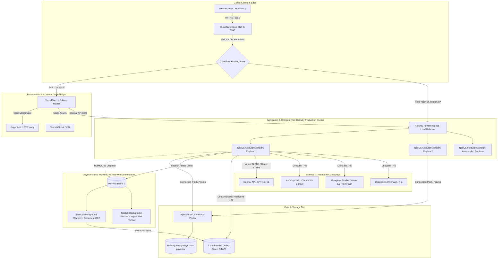
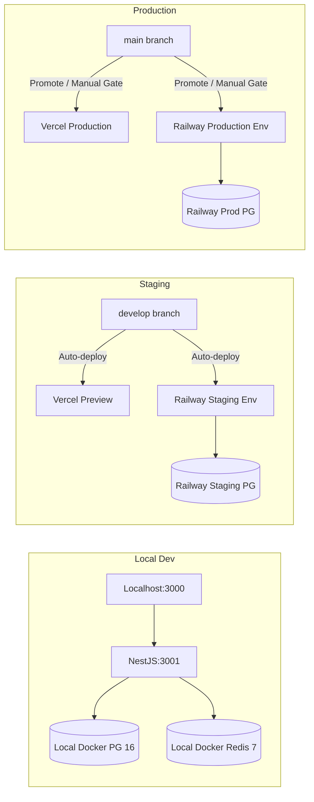
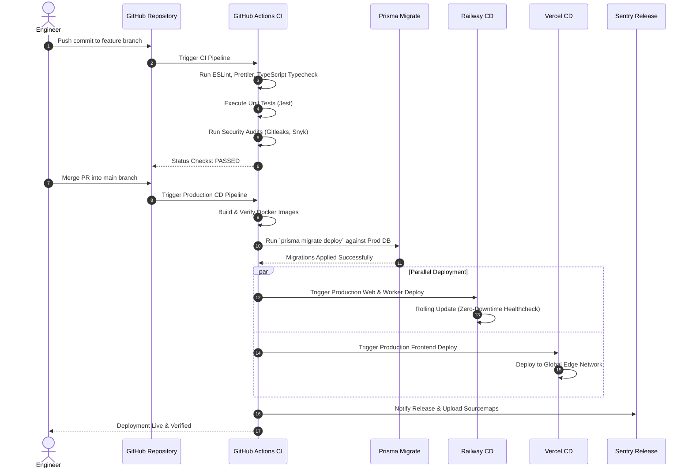
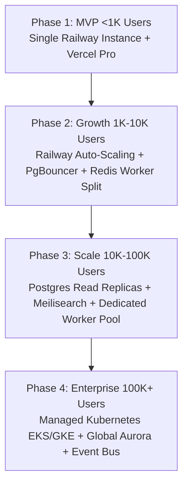
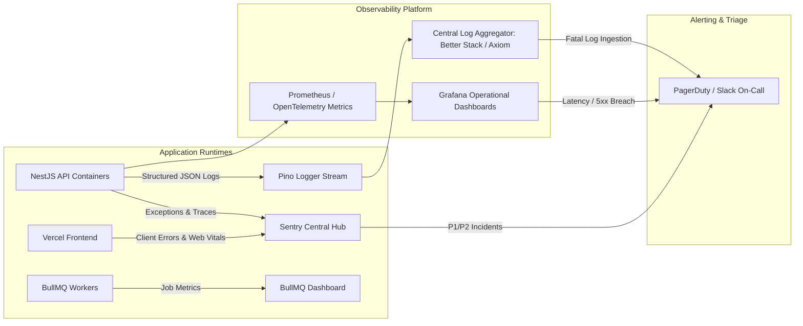
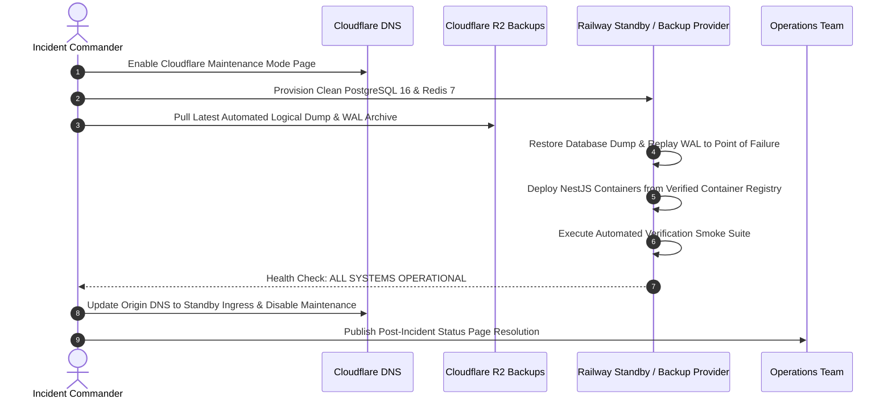

# HYPERMIND Infrastructure Strategy & Deployment Architecture

**Document Identifier:** HM-ENG-DOC-012  
**Document Type:** Engineering Infrastructure Specification  
**System Classification:** Deployment & Operations (Stream 4: Database, Security, Infrastructure & Cost)  
**Creation Date:** 2026-11-15  
**Version:** 1.0.0  
**Status:** Approved Architecture Blueprint  

---

## Executive Summary

The HYPERMIND ecosystem requires a scalable, resilient, and developer-friendly infrastructure foundation. Because the platform balances synchronous HTTP/SSE requests (streaming LLM chat), bidirectional WebSocket communication (collaborative agent canvases), heavy background job processing (document OCR, batch embeddings), and high-durability object storage, the deployment architecture is distributed across specialized best-in-class platforms:

- **Frontend & Edge Delivery:** **Vercel** for Next.js 14 App Router, dynamic serverless rendering, edge middleware, and global asset distribution.
- **Application & Data Services:** **Railway** for containerized NestJS modular monoliths, managed PostgreSQL 16 with `pgvector`, and managed Redis 7.
- **Object Storage:** **Cloudflare R2** for zero-egress, S3-compatible document and multimodal asset persistence.
- **Edge Routing & Protection:** **Cloudflare** for authoritative DNS, DDoS mitigation, Web Application Firewall (WAF), and SSL termination.

This document details the multi-environment topology, automated CI/CD pipeline, phased scaling roadmap from MVP to 100K+ concurrent users, observability stack, disaster recovery runbooks, and concrete Infrastructure-as-Code (IaC) configuration manifests.

---

## 1. Global Deployment Architecture



### 1.1 Component Responsibilities & Service Level Agreements (SLAs)

| Infrastructure Component | Hosting Platform | Core Responsibilities | Target Availability / SLA [A] |
| :--- | :--- | :--- | :--- |
| **Frontend Presentation** | **Vercel** | Next.js 14 App Router SSR/SSG, Edge middleware, static bundling, client session handling. | 99.99% Availability |
| **API Gateway & Core Logic** | **Railway (Containers)** | NestJS modular monolith, REST/SSE endpoints, Socket.io bidirectional channels, model orchestration. | 99.95% Availability |
| **Relational & Vector Data** | **Railway (Postgres)** | PostgreSQL 16 engine, `pgvector` HNSW index searches, ACID transaction ledgers. | 99.95% Availability |
| **Cache & Queue Broker** | **Railway (Redis)** | Redis 7 in-memory cache, BullMQ distributed job queues, rate limit counters. | 99.95% Availability |
| **Object & Document Store** | **Cloudflare R2** | Unstructured file storage (PDFs, images, logs), zero egress fees, S3 API compatibility. | 99.99% Durability (11 9s) |
| **Edge DNS & WAF** | **Cloudflare** | Anycast DNS, SSL termination, DDoS protection, Bot mitigation, HTTP/3 transport. | 100% DNS Uptime |

---

## 2. Environment Strategy & Configuration Management

HYPERMIND enforces strict environment isolation across Development, Staging, and Production.



### 2.1 Environment Breakdown

1. **Local Development (`local`):**
   - Frontend runs on `localhost:3000` via Next.js dev server.
   - Backend runs on `localhost:3001` via NestJS hot-reload.
   - Infrastructure managed via `docker-compose.yml`: PostgreSQL 16 with `pgvector` extension pre-installed, Redis 7, and LocalStack (mocking S3/R2).
2. **Staging (`staging`):**
   - Automatically tracks the `develop` Git branch.
   - Hosted on an isolated Railway Staging Project (`hypermind-staging.railway.internal`).
   - Uses sanitized, anonymized seed datasets. All external AI calls route through mock providers or low-cost models (Gemini Flash) with budget caps.
3. **Production (`production`):**
   - Tracks the `main` Git branch with manual promotion gates.
   - Deployed on dedicated Railway compute instances with auto-scaling enabled (1 to 6 replicas).
   - Live production credentials, isolated production databases, and continuous WAL archiving to R2.

### 2.2 Secrets & Variable Injection Protocol
- **Zero Secrets in Source Control:** Enforced via `gitleaks` pre-commit hooks.
- **Provider Synchronization:** Production variables managed in Railway and Vercel dashboards with environment scoping (`Production`, `Preview`, `Development`).
- **Required Production Environment Variables:**
  - `DATABASE_URL`: Direct connection string to PostgreSQL.
  - `REDIS_URL`: Authenticated connection string to Railway Redis.
  - `R2_ACCESS_KEY_ID`, `R2_SECRET_ACCESS_KEY`, `R2_BUCKET_NAME`, `R2_ENDPOINT`: Cloudflare R2 S3 API credentials.
  - `OPENAI_API_KEY`, `ANTHROPIC_API_KEY`, `GOOGLE_AI_API_KEY`, `DEEPSEEK_API_KEY`: External AI gateway credentials.
  - `NEXTAUTH_SECRET`, `JWT_SIGNING_KEY`: Identity cryptographic keys.

---

## 3. Continuous Integration & Continuous Deployment (CI/CD)

The automated deployment pipeline ensures that zero unverified code reaches production and all schema migrations execute safely without downtime.



### 3.1 Branching & Promotion Strategy
- **`main` Branch:** Represents production-ready code. Commits require passing CI checks and at least 1 peer approval.
- **`develop` Branch:** Integration branch for staging verification.
- **`feature/*` Branches:** Short-lived development branches merged via Pull Requests.

### 3.2 Automated Pipeline Stages (GitHub Actions)
1. **Lint & Static Analysis:** `npm run lint`, `npm run type-check`.
2. **Automated Testing:** `npm run test:unit`, `npm run test:e2e` (Playwright on staging).
3. **Container Build Verification:** Multi-stage Docker build executed with caching enabled.
4. **Database Migration Gate:** Pre-deployment migration runner executes `npx prisma migrate deploy`. If any migration errors occur, deployment is halted immediately before application containers are replaced.
5. **Zero-Downtime Rolling Rollout:** Railway provisions new containers, waits for HTTP 200 on `/api/health`, shifts traffic, and drains old containers.

---

## 4. Phased Scaling Strategy (MVP to 100K+ Users)

The platform architecture evolves predictably across four distinct scaling horizons to optimize infrastructure expenditure against user load.



### 4.1 Scaling Horizon Specifications

| Scaling Horizon | Target Active Users | Application Layer Architecture | Database & Caching Tier | Object & Asset Tier | Estimated Monthly Cost [E] |
| :--- | :--- | :--- | :--- | :--- | :--- |
| **Phase 1: MVP** | **< 1,000 Users** | Single Railway container (1 vCPU, 2 GB RAM). Vercel Pro. Monolithic web + worker. | Railway Managed Postgres (1 vCPU, 1 GB RAM, 10 GB disk). Railway Redis (0.5 vCPU, 512 MB RAM). | Cloudflare R2 Standard ($0.015/GB, zero egress). | **$65 - $110 / mo** |
| **Phase 2: Growth** | **1,000 - 10,000 Users** | Railway horizontal auto-scaling (2 to 4 replicas). Dedicated background worker container for BullMQ. | Postgres scaled to 2 vCPU, 4 GB RAM. **PgBouncer** connection pooling enabled. Redis scaled to 1 GB RAM. | Cloudflare R2 + Cloudflare Edge caching for static documents. | **$250 - $650 / mo** |
| **Phase 3: Scale** | **10,000 - 100,000 Users** | Railway or AWS App Runner container pool (6 to 20 replicas). Worker cluster split by queue (OCR, LLM, Embeddings). | Primary Postgres (4 vCPU, 16 GB RAM) + **Read Replica** for analytics. Dedicated vector search cache. | Cloudflare R2 multi-region bucket replication. | **$1,800 - $4,200 / mo** |
| **Phase 4: Enterprise** | **100,000+ Users** | Migration to **Managed Kubernetes (EKS / GKE)** with Karpenter auto-scaling. Microservices extraction. | **Amazon Aurora PostgreSQL Serverless v2** or Supabase Enterprise with multi-region read replicas. | Multi-cloud storage (R2 + AWS S3 cross-region backup). | **$12,000+ / mo** |

---

## 5. Monitoring, Observability & Incident Response

HYPERMIND adopts the Three Pillars of Observability: Metrics, Traces, and Structured Logs.



### 5.1 Monitoring Tooling Stack
- **Error Tracking & Performance Tracing:** **Sentry** (configured across Next.js frontend and NestJS backend). Distributed tracing captures full LLM request spans including time-to-first-token (TTFT).
- **Synthetic Uptime & API Health:** **Better Uptime** pinging `/api/health` and `/api/v1/models/status` every 30 seconds from 5 global regions.
- **Structured JSON Logging:** **Pino** logging engine with zero-overhead async logging to stdout, formatted with correlation IDs (`X-Request-ID`), user IDs, and elapsed milliseconds.
- **Real-Time Dashboards:** Grafana visualizing:
  - System throughput (requests per second).
  - P50, P95, and P99 latency per model provider.
  - Database connection pool utilization and active queries.
  - Redis memory usage and BullMQ queue wait times.

### 5.2 Incident Escalation & Alerting Matrix

| Severity Level | Trigger Condition | Notification Channel | Target Response Time (MTTA) | Target Resolution Time (MTTR) |
| :--- | :--- | :--- | :--- | :--- |
| **P1 - Critical** | Platform down; database connection failure; global 5xx error rate > 5%. | PagerDuty phone alert + #incident-war-room Slack. | **< 15 minutes** | **< 2 hours** |
| **P2 - Major** | Single model provider outage (e.g. OpenAI 500s); BullMQ queue latency > 5 minutes. | PagerDuty push alert + Slack high-priority. | **< 30 minutes** | **< 4 hours** |
| **P3 - Moderate** | Non-critical API degradation; elevated memory consumption (>80%) on background worker. | Slack #engineering-alerts channel. | **< 2 hours** | **< 1 business day** |
| **P4 - Low** | Minor UI rendering issue; third-party logging delay. | GitHub Issue backlog. | **< 24 hours** | Next sprint cycle |

---

## 6. Disaster Recovery & Business Continuity (DR/BC)

### 6.1 Core Recovery Metrics
- **Recovery Point Objective (RPO):** **< 1 Hour** (Data loss in catastrophic failure will not exceed 1 hour).
- **Recovery Time Objective (RTO):** **< 4 Hours** (Full operational recovery within 4 hours).

### 6.2 Disaster Recovery Runbook: Catastrophic Region Outage

In the event of a catastrophic hosting failure in Railway's primary cloud region:



---

## 7. Infrastructure as Code (IaC) & Configuration Manifests

### 7.1 Local Development: `docker-compose.yml`

This manifest provisions the complete local developer environment including PostgreSQL 16 with `pgvector`, Redis 7, and LocalStack.

```yaml
version: '3.8'

services:
  # PostgreSQL 16 with pgvector extension pre-installed
  postgres:
    image: pgvector/pgvector:pg16
    container_name: hypermind-local-postgres
    restart: always
    environment:
      POSTGRES_USER: hypermind_user
      POSTGRES_PASSWORD: hypermind_password
      POSTGRES_DB: hypermind_dev
    ports:
      - "5432:5432"
    volumes:
      - postgres_data:/var/lib/postgresql/data
      - ./scripts/init-db.sql:/docker-entrypoint-initdb.d/init.sql
    healthcheck:
      test: ["CMD-SHELL", "pg_isready -U hypermind_user -d hypermind_dev"]
      interval: 5s
      timeout: 5s
      retries: 5

  # Redis 7 for cache, rate limiting, and BullMQ queues
  redis:
    image: redis:7-alpine
    container_name: hypermind-local-redis
    restart: always
    command: ["redis-server", "--appendonly", "yes", "--requirepass", "hypermind_redis_pass"]
    ports:
      - "6379:6379"
    volumes:
      - redis_data:/data
    healthcheck:
      test: ["CMD", "redis-cli", "-a", "hypermind_redis_pass", "ping"]
      interval: 5s
      timeout: 5s
      retries: 5

volumes:
  postgres_data:
    driver: local
  redis_data:
    driver: local
```

### 7.2 Production Container Build: `Dockerfile`

A hardened, multi-stage production Dockerfile for the NestJS modular monolith.

```dockerfile
# Stage 1: Build & Dependencies
FROM node:20-alpine AS builder

WORKDIR /usr/src/app

# Install build dependencies
RUN apk add --no-cache libc6-compat python3 make g++

COPY package*.json ./
COPY prisma ./prisma/

RUN npm ci

COPY . .

# Generate Prisma Client & Build TypeScript
RUN npx prisma generate
RUN npm run build
RUN npm prune --production

# Stage 2: Production Runtime
FROM node:20-alpine AS runner

WORKDIR /usr/src/app

ENV NODE_ENV=production
ENV PORT=3001

# Create unprivileged application user
RUN addgroup --system --gid 1001 nodejs
RUN adduser --system --uid 1001 nestjs

COPY --from=builder /usr/src/app/package*.json ./
COPY --from=builder /usr/src/app/node_modules ./node_modules
COPY --from=builder /usr/src/app/dist ./dist
COPY --from=builder /usr/src/app/prisma ./prisma

USER nestjs

EXPOSE 3001

HEALTHCHECK --interval=15s --timeout=5s --start-period=10s --retries=3 \
  CMD wget --no-verbose --tries=1 --spider http://localhost:3001/api/health || exit 1

CMD ["node", "dist/main.js"]
```

### 7.3 Railway Deployment Configuration: `railway.toml`

Production Railway deployment manifest defining healthchecks, restart policies, and migration triggers.

```toml
[build]
builder = "DOCKERFILE"
dockerfilePath = "Dockerfile"

[deploy]
startCommand = "npx prisma migrate deploy && node dist/main.js"
healthcheckPath = "/api/health"
healthcheckTimeout = 120
restartPolicyType = "ON_FAILURE"
restartPolicyMaxRetries = 5

[[services]]
name = "hypermind-api"
numReplicas = 2

[[services.variables]]
NODE_ENV = "production"
PORT = "3001"
```

---

## 8. Document Status & Open Items

### 8.1 Completeness Checklist
- [x] End-to-end global deployment topology (Mermaid diagram).
- [x] Multi-tier platform delegation (Vercel, Railway, Cloudflare R2, Cloudflare Edge).
- [x] Environment isolation strategy across Local, Staging, and Production.
- [x] Automated CI/CD pipeline and zero-downtime database migration sequence.
- [x] Progressive 4-phase scaling roadmap (MVP <1K to 100K+ enterprise).
- [x] Comprehensive observability blueprint (Sentry, Better Uptime, Pino, Grafana).
- [x] Disaster recovery specifications (RPO < 1h, RTO < 4h, WAL archiving).
- [x] Concrete configuration manifests (`docker-compose.yml`, `Dockerfile`, `railway.toml`).

### 8.2 Open Architectural Items
- **Dedicated Kubernetes Transition Trigger:** Migration from Railway to managed Kubernetes (AWS EKS or GCP GKE) will be formally triggered when monthly active users exceed 25,000 or monthly Railway compute expenses exceed $1,500/month.
