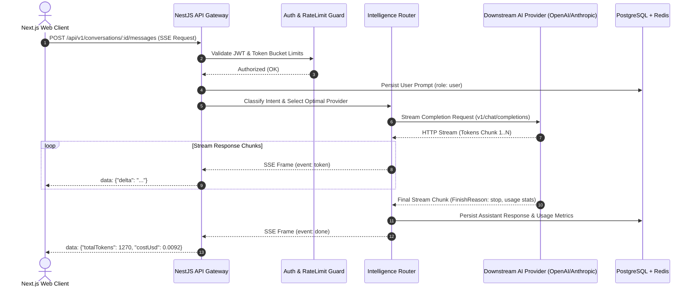
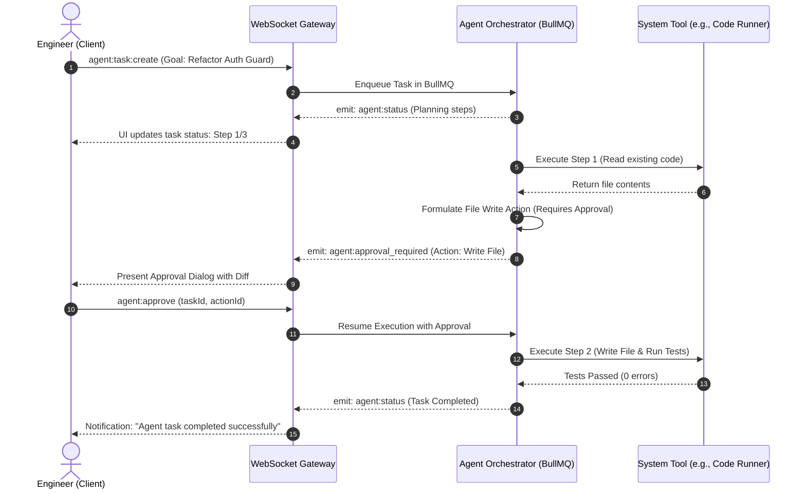

# HYPERMIND Universal AI Ecosystem — API Specification
**Document Type:** Engineering Architecture & Interface Specification  
**Document ID:** HM-SPEC-014  
**Date:** November 15, 2026  
**Version:** 1.0.0-PROD-SPEC  
**Author:** Stream 5 Engineering Architecture  
**Information Source Level:** [A] Officially verified standards / [D] Engineering recommendations  

---

## Table of Contents
1. [Overview & Architectural Principles](#1-overview--architectural-principles)
2. [Global Conventions & Standards](#2-global-conventions--standards)
   - [Base URL & Protocol](#21-base-url--protocol)
   - [Authentication & Authorization](#22-authentication--authorization)
   - [Rate Limiting Strategy](#23-rate-limiting-strategy)
   - [Standard Error Envelope](#24-standard-error-envelope)
   - [Pagination Envelope](#25-pagination-envelope)
3. [REST API Endpoints](#3-rest-api-endpoints)
   - [3.1 Authentication Module (`/api/v1/auth`)](#31-authentication-module-apiv1auth)
   - [3.2 User Management Module (`/api/v1/users`)](#32-user-management-module-apiv1users)
   - [3.3 Conversation Lifecycle Module (`/api/v1/conversations`)](#33-conversation-lifecycle-module-apiv1conversations)
   - [3.4 Message & Inference Module (`/api/v1/conversations/:id/messages`)](#34-message--inference-module-apiv1conversationsidmessages)
   - [3.5 File & Blob Storage Module (`/api/v1/files`)](#35-file--blob-storage-module-apiv1files)
   - [3.6 Model & Provider Gateway Module (`/api/v1/models`)](#36-model--provider-gateway-module-apiv1models)
   - [3.7 Autonomous Agent Tasks Module (`/api/v1/agents`)](#37-autonomous-agent-tasks-module-apiv1agents)
   - [3.8 Administration & Observability Module (`/api/v1/admin`)](#38-administration--observability-module-apiv1admin)
4. [Server-Sent Events (SSE) Streaming Protocol](#4-server-sent-events-sse-streaming-protocol)
5. [WebSocket Real-Time Gateway (`ws://.../ws`)](#5-websocket-real-time-gateway-wshostws)
6. [API Request & Event Flow Diagrams](#6-api-request--event-flow-diagrams)
7. [Document Status & Completeness Checklist](#7-document-status--completeness-checklist)

---

## 1. Overview & Architectural Principles

HYPERMIND provides a unified, poly-modal intelligence API that bridges client experiences (Web, Desktop, CLI, SDKs) with diverse AI model providers (OpenAI, Anthropic, Google, DeepSeek, Local Ollama) and autonomous agent workflows.

### Architectural Principles:
1. **Strict Versioning:** All endpoints are explicitly namespaced under `/api/v1`. Breaking changes mandate bumping the version namespace.
2. **Dual-Transport Interface:** 
   - HTTP/1.1 & HTTP/2 REST with Server-Sent Events (SSE) for unidirectional, long-lived streaming responses (LLM generation).
   - WebSocket (`ws://` and `wss://`) for bidirectional agentic control loops, human-in-the-loop approvals, and real-time multi-agent collaborative tasking.
3. **Least Privilege & JWT Bearer Auth:** Session-based authentication supported via NextAuth.js tokens, translated to stateless RSA-256 signed JWTs for backend NestJS communication.
4. **Idempotency & Resilience:** State-mutating inference and file uploads support `Idempotency-Key` headers to prevent duplicate executions during network retries.

---

## 2. Global Conventions & Standards

### 2.1 Base URL & Protocol
- **Production API Base:** `https://api.hypermind.ai/api/v1`
- **WebSocket Gateway:** `wss://api.hypermind.ai/ws`
- **Development API Base:** `http://localhost:4000/api/v1`
- **Development WS:** `ws://localhost:4000/ws`
- **Default Headers:**
  - `Content-Type: application/json` (except multipart uploads and text/event-stream)
  - `Accept: application/json`
  - `X-Request-ID: <uuid-v4>` (auto-generated if missing)
  - `X-Client-Version: hypermind-web/1.0.0`

### 2.2 Authentication & Authorization
Requests to protected endpoints must supply an HTTP `Authorization` header:
```http
Authorization: Bearer <JWT_ACCESS_TOKEN>
```
The JWT payload conforms to:
```json
{
  "sub": "usr_9a8b7c6d5e",
  "email": "alex.dev@hypermind.ai",
  "role": "USER",
  "tier": "PRO",
  "orgId": "org_11223344",
  "iat": 1731668400,
  "exp": 1731672000
}
```
Available Roles: `USER`, `PRO_USER`, `DEVELOPER`, `ADMIN`, `SUPERADMIN`.

### 2.3 Rate Limiting Strategy
Rate limits are enforced at the NestJS gateway using Redis-backed token bucket algorithms:

| Endpoint Tier | Window | Limit (Free) | Limit (Pro) | Limit (Admin) | Header Info |
|---|---|---|---|---|---|
| `/api/v1/auth/*` | 15 min | 15 req | 30 req | 100 req | `X-RateLimit-Limit`, `X-RateLimit-Remaining`, `X-RateLimit-Reset` |
| `/api/v1/conversations/*/messages` (Inference) | 1 min | 10 req | 60 req | 300 req | `X-RateLimit-Tokens-Limit`, `X-RateLimit-Tokens-Remaining` |
| `/api/v1/files/upload` | 1 hour | 20 files (50MB) | 200 files (500MB) | 1000 files (5GB) | Standard rate limit headers |
| General REST CRUD | 1 min | 120 req | 600 req | 2000 req | Standard rate limit headers |

### 2.4 Standard Error Envelope
All error responses adhere to RFC 7807 (Problem Details for HTTP APIs) enhanced with internal error taxonomy:

```json
{
  "error": {
    "code": "RATE_LIMIT_EXCEEDED",
    "message": "You have exceeded your rate limit. Please try again in 60 seconds.",
    "status": 429,
    "details": {
      "retryAfter": 60,
      "limit": 60,
      "window": "60s",
      "metric": "requests_per_minute"
    },
    "requestId": "req_88f912c4-4b5a-4e2a-993d-d4e5f6a7b8c9",
    "timestamp": "2026-11-15T16:15:30.125Z"
  }
}
```

#### Canonical Error Codes:
- `UNAUTHENTICATED` (401): Missing or expired bearer token
- `PERMISSION_DENIED` (403): Role lacks required scope
- `RESOURCE_NOT_FOUND` (404): Specified entity does not exist
- `VALIDATION_FAILED` (422): Input body fails Zod/class-validator rules
- `RATE_LIMIT_EXCEEDED` (429): Request budget exhausted
- `PROVIDER_UNAVAILABLE` (503): Downstream AI model API unreachable or failing
- `CONTEXT_LENGTH_EXCEEDED` (400): Combined message history and system prompt exceeds model window
- `INSUFFICIENT_CREDITS` (402): Account token balance depleted

### 2.5 Pagination Envelope
List endpoints return a standardized pagination container:

```json
{
  "data": [],
  "pagination": {
    "page": 1,
    "limit": 20,
    "total": 150,
    "totalPages": 8,
    "hasNext": true,
    "hasPrev": false
  }
}
```

Query parameters:
- `page`: Integer >= 1 (Default: 1)
- `limit`: Integer between 1 and 100 (Default: 20)
- `sortBy`: String field name (Default: `createdAt`)
- `sortOrder`: `asc` | `desc` (Default: `desc`)

---

## 3. REST API Endpoints

### 3.1 Authentication Module (`/api/v1/auth`)

#### 3.1.1 POST `/api/v1/auth/register`
- **Description:** Registers a new user account with email and password or federated identity.
- **Auth Required:** No (Public)
- **Rate Limit:** 10 requests / 15 minutes per IP
- **Request Body (`application/json`):**
  ```json
  {
    "email": "user@example.com",
    "password": "StrongPassword123!#",
    "name": "Jane Doe",
    "invitationToken": "opt_inv_7721"
  }
  ```
- **Validation Rules:**
  - `email`: valid RFC 5322 format, lowercase, normalized
  - `password`: min 8 chars, max 100 chars, 1 uppercase, 1 lowercase, 1 number, 1 special char
  - `name`: string, 2-100 characters
- **Response Body (`201 Created`):**
  ```json
  {
    "user": {
      "id": "usr_78a1bcde45",
      "email": "user@example.com",
      "name": "Jane Doe",
      "role": "USER",
      "tier": "FREE",
      "isEmailVerified": false,
      "createdAt": "2026-11-15T16:20:00.000Z"
    },
    "token": "eyJhbGciOiJSUzI1NiIsInR5cCI6IkpXVCJ9...",
    "refreshToken": "ref_99a8b7c6d5e4f3a2"
  }
  ```
- **Error Codes:** `400 Bad Request` (Email already registered, validation failure).

#### 3.1.2 POST `/api/v1/auth/login`
- **Description:** Authenticates credentials and issues access & refresh tokens.
- **Auth Required:** No
- **Rate Limit:** 15 requests / 15 minutes per IP
- **Request Body:**
  ```json
  {
    "email": "user@example.com",
    "password": "StrongPassword123!#"
  }
  ```
- **Response Body (`200 OK`):**
  ```json
  {
    "user": {
      "id": "usr_78a1bcde45",
      "email": "user@example.com",
      "name": "Jane Doe",
      "role": "USER",
      "tier": "FREE"
    },
    "token": "eyJhbGciOiJSUzI1NiIsInR5cCI6IkpXVCJ9...",
    "expiresIn": 3600,
    "refreshToken": "ref_99a8b7c6d5e4f3a2"
  }
  ```
- **Error Codes:** `401 Unauthorized` (Invalid credentials), `429 Rate Limit Exceeded`.

#### 3.1.3 POST `/api/v1/auth/logout`
- **Description:** Invalidates the current refresh token and blacklists the active JWT ID in Redis.
- **Auth Required:** Yes (`Bearer <token>`)
- **Rate Limit:** Standard CRUD (120/min)
- **Request Body:**
  ```json
  {
    "refreshToken": "ref_99a8b7c6d5e4f3a2"
  }
  ```
- **Response Body (`200 OK`):**
  ```json
  {
    "success": true,
    "message": "Session successfully terminated."
  }
  ```

#### 3.1.4 GET `/api/v1/auth/session`
- **Description:** Returns the authenticated user's current session state, token claims, and active permissions.
- **Auth Required:** Yes
- **Rate Limit:** Standard CRUD
- **Response Body (`200 OK`):**
  ```json
  {
    "authenticated": true,
    "user": {
      "id": "usr_78a1bcde45",
      "email": "user@example.com",
      "name": "Jane Doe",
      "role": "USER",
      "tier": "FREE"
    },
    "session": {
      "issuedAt": "2026-11-15T16:00:00.000Z",
      "expiresAt": "2026-11-15T17:00:00.000Z",
      "authProvider": "CREDENTIALS"
    }
  }
  ```

#### 3.1.5 POST `/api/v1/auth/forgot-password`
- **Description:** Triggers a password reset token sent via email.
- **Auth Required:** No
- **Rate Limit:** 3 requests / 15 minutes per IP
- **Request Body:**
  ```json
  {
    "email": "user@example.com"
  }
  ```
- **Response Body (`200 OK`):**
  ```json
  {
    "success": true,
    "message": "If that email is registered, a password reset link has been dispatched."
  }
  ```

#### 3.1.6 POST `/api/v1/auth/reset-password`
- **Description:** Consumes a reset token and updates the user's password.
- **Auth Required:** No
- **Rate Limit:** 5 requests / 15 minutes per IP
- **Request Body:**
  ```json
  {
    "token": "rst_tok_1a2b3c4d5e6f7g8h",
    "newPassword": "NewStrongPassword456!#"
  }
  ```
- **Response Body (`200 OK`):**
  ```json
  {
    "success": true,
    "message": "Password successfully updated. All active sessions invalidated."
  }
  ```

---

### 3.2 User Management Module (`/api/v1/users`)

#### 3.2.1 GET `/api/v1/users/me`
- **Description:** Retrieves the authenticated user's profile details.
- **Auth Required:** Yes
- **Rate Limit:** 120 req/min
- **Response Body (`200 OK`):**
  ```json
  {
    "id": "usr_78a1bcde45",
    "email": "user@example.com",
    "name": "Jane Doe",
    "avatarUrl": "https://storage.hypermind.ai/avatars/usr_78a1bcde45.png",
    "role": "USER",
    "tier": "PRO",
    "createdAt": "2026-11-01T12:00:00.000Z",
    "updatedAt": "2026-11-15T10:00:00.000Z"
  }
  ```

#### 3.2.2 PATCH `/api/v1/users/me`
- **Description:** Updates non-sensitive user profile attributes.
- **Auth Required:** Yes
- **Request Body:**
  ```json
  {
    "name": "Jane R. Doe",
    "avatarUrl": "https://storage.hypermind.ai/avatars/new_avatar.png"
  }
  ```
- **Response Body (`200 OK`):** Returns updated User object.

#### 3.2.3 DELETE `/api/v1/users/me`
- **Description:** Initiates GDPR-compliant soft-deletion of account and scheduling of hard purge.
- **Auth Required:** Yes
- **Request Body:**
  ```json
  {
    "confirmationPhrase": "DELETE MY ACCOUNT",
    "reason": "Consolidating workflows"
  }
  ```
- **Response Body (`200 OK`):**
  ```json
  {
    "success": true,
    "scheduledPurgeDate": "2026-12-15T16:20:00.000Z",
    "message": "Account deactivated. Permanent deletion scheduled in 30 days."
  }
  ```

#### 3.2.4 GET `/api/v1/users/me/usage`
- **Description:** Aggregates token consumption, API calls, and credit balances across providers.
- **Auth Required:** Yes
- **Query Params:** `period` (`day` | `week` | `month` | `all`, default: `month`)
- **Response Body (`200 OK`):**
  ```json
  {
    "userId": "usr_78a1bcde45",
    "billingPeriod": {
      "start": "2026-11-01T00:00:00.000Z",
      "end": "2026-11-30T23:59:59.000Z"
    },
    "tokens": {
      "promptTokens": 1420500,
      "completionTokens": 389200,
      "totalTokens": 1809700
    },
    "costUsd": 4.82,
    "budgetLimitUsd": 25.00,
    "breakdownByProvider": {
      "openai": { "tokens": 920000, "costUsd": 2.76 },
      "anthropic": { "tokens": 640000, "costUsd": 1.92 },
      "google": { "tokens": 249700, "costUsd": 0.14 }
    },
    "storageUsedBytes": 145228000
  }
  ```

#### 3.2.5 GET `/api/v1/users/me/preferences`
- **Description:** Fetches model defaults, temperature settings, and UI configurations.
- **Response Body (`200 OK`):**
  ```json
  {
    "defaultModelId": "claude-3-5-sonnet",
    "temperature": 0.7,
    "streamResponses": true,
    "codeTheme": "github-dark",
    "theme": "system",
    "autoRoutingEnabled": true,
    "voiceEngine": "openai-tts-1-hd",
    "voiceId": "alloy"
  }
  ```

#### 3.2.6 PUT `/api/v1/users/me/preferences`
- **Description:** Replaces user preference configurations.
- **Request Body:** Partial or complete preference object matching schema above.
- **Response Body (`200 OK`):** Updated preference object.

---

### 3.3 Conversation Lifecycle Module (`/api/v1/conversations`)

#### 3.3.1 GET `/api/v1/conversations`
- **Description:** Returns paginated conversation summaries for the active user.
- **Auth Required:** Yes
- **Query Params:**
  - `page` (default 1), `limit` (default 20)
  - `isArchived` (boolean, default false)
  - `search` (string, searches title and description)
- **Response Body (`200 OK`):**
  ```json
  {
    "data": [
      {
        "id": "conv_99f8e7d6c5",
        "title": "Distributed Cache Architecture Planning",
        "modelId": "claude-3-5-sonnet",
        "isArchived": false,
        "messageCount": 14,
        "totalTokens": 18450,
        "createdAt": "2026-11-14T09:12:00.000Z",
        "updatedAt": "2026-11-15T15:30:10.000Z",
        "lastMessagePreview": "We should deploy Redis Sentinel for automatic failover..."
      }
    ],
    "pagination": {
      "page": 1,
      "limit": 20,
      "total": 42,
      "totalPages": 3,
      "hasNext": true,
      "hasPrev": false
    }
  }
  ```

#### 3.3.2 POST `/api/v1/conversations`
- **Description:** Initializes a new conversation context with optional metadata.
- **Auth Required:** Yes
- **Request Body:**
  ```json
  {
    "title": "Quantum Computing Algorithm Analysis",
    "modelId": "gpt-4o",
    "systemPrompt": "You are a senior quantum physicist and computer scientist.",
    "temperature": 0.3,
    "enableWebSearch": false
  }
  ```
- **Response Body (`201 Created`):** Complete conversation metadata object with unique ID (`conv_...`).

#### 3.3.3 GET `/api/v1/conversations/:id`
- **Description:** Retrieves conversation metadata along with recent message history.
- **Query Params:** `messageLimit` (default: 50, max: 200)
- **Response Body (`200 OK`):**
  ```json
  {
    "id": "conv_99f8e7d6c5",
    "title": "Distributed Cache Architecture Planning",
    "modelId": "claude-3-5-sonnet",
    "systemPrompt": null,
    "temperature": 0.7,
    "isArchived": false,
    "createdAt": "2026-11-14T09:12:00.000Z",
    "updatedAt": "2026-11-15T15:30:10.000Z",
    "messages": [
      {
        "id": "msg_01",
        "role": "user",
        "content": "Compare Redis Cluster vs Redis Sentinel.",
        "tokens": 12,
        "createdAt": "2026-11-14T09:12:05.000Z"
      },
      {
        "id": "msg_02",
        "role": "assistant",
        "content": "Here is an in-depth breakdown...",
        "modelId": "claude-3-5-sonnet",
        "tokens": 340,
        "createdAt": "2026-11-14T09:12:12.000Z"
      }
    ]
  }
  ```

#### 3.3.4 PATCH `/api/v1/conversations/:id`
- **Description:** Updates conversation settings (title, model default, system prompt).
- **Request Body:**
  ```json
  {
    "title": "Redis Sentinel vs Cluster Comparison",
    "isPinned": true
  }
  ```
- **Response Body (`200 OK`):** Updated conversation entity.

#### 3.3.5 DELETE `/api/v1/conversations/:id`
- **Description:** Soft-deletes a conversation. Deleted conversations are retained in trash for 14 days.
- **Response Body (`200 OK`):**
  ```json
  {
    "success": true,
    "message": "Conversation moved to trash."
  }
  ```

#### 3.3.6 POST `/api/v1/conversations/:id/archive`
- **Description:** Moves a conversation into cold archive status (hidden from active list).
- **Response Body (`200 OK`):**
  ```json
  {
    "id": "conv_99f8e7d6c5",
    "isArchived": true,
    "archivedAt": "2026-11-15T16:25:00.000Z"
  }
  ```

---

### 3.4 Message & Inference Module (`/api/v1/conversations/:id/messages`)

#### 3.4.1 POST `/api/v1/conversations/:id/messages` (Streaming Inference Trigger)
- **Description:** Appends a user prompt to the conversation and initiates AI generation. Default mode yields a continuous Server-Sent Events (SSE) stream (`Accept: text/event-stream`). If `stream: false` is requested, blocks until full response generation.
- **Auth Required:** Yes
- **Rate Limit:** 60 req/min (Pro), 10 req/min (Free)
- **Headers:**
  - `Accept: text/event-stream` (or `application/json`)
  - `Idempotency-Key: <uuid>` (recommended)
- **Request Body:**
  ```json
  {
    "content": "Analyze the time complexity of this Dijkstra implementation and suggest optimizations.",
    "modelId": "claude-3-5-sonnet",
    "temperature": 0.2,
    "stream": true,
    "fileIds": ["fil_01j7k8m9n0p1"],
    "toolsEnabled": ["web_search", "code_interpreter"]
  }
  ```
- **Response Body (`text/event-stream`):**
  Streamed chunks conforming to the SSE protocol detailed in Section 4.

#### 3.4.2 GET `/api/v1/conversations/:id/messages`
- **Description:** Fetches historical messages within a conversation with cursor-based pagination.
- **Query Params:** `cursor` (message ID), `limit` (default 25), `direction` (`forward` | `backward`)
- **Response Body (`200 OK`):**
  ```json
  {
    "data": [
      {
        "id": "msg_01j8k9l0m1",
        "conversationId": "conv_99f8e7d6c5",
        "role": "user",
        "content": "Explain vector indexing in pgvector.",
        "attachments": [],
        "tokens": 15,
        "createdAt": "2026-11-15T15:00:00.000Z"
      },
      {
        "id": "msg_01j8k9l0m2",
        "conversationId": "conv_99f8e7d6c5",
        "role": "assistant",
        "content": "pgvector supports two primary indexing algorithms: IVFFlat and HNSW...",
        "modelId": "claude-3-5-sonnet",
        "provider": "anthropic",
        "promptTokens": 820,
        "completionTokens": 450,
        "latencyMs": 1120,
        "createdAt": "2026-11-15T15:00:02.500Z"
      }
    ],
    "pagination": {
      "nextCursor": "msg_01j8k9l0m2",
      "hasMore": false
    }
  }
  ```

#### 3.4.3 DELETE `/api/v1/conversations/:id/messages/:messageId`
- **Description:** Deletes a specific message and any downstream branch references.
- **Response Body (`200 OK`):** `{ "success": true, "deletedMessageId": "msg_01j8k9l0m1" }`

#### 3.4.4 POST `/api/v1/conversations/:id/messages/:messageId/regenerate`
- **Description:** Retries or regenerates the assistant response for the target message using either the existing or a newly specified model.
- **Request Body:**
  ```json
  {
    "modelId": "gpt-4o",
    "temperature": 0.7,
    "stream": true
  }
  ```
- **Response:** SSE stream identical to endpoint 3.4.1.

---

### 3.5 File & Blob Storage Module (`/api/v1/files`)

#### 3.5.1 POST `/api/v1/files/upload`
- **Description:** Uploads a file for document parsing, vision analysis, or agent ingestion. Files are securely validated, virus scanned, and stored in Cloudflare R2.
- **Content-Type:** `multipart/form-data`
- **Form Data Fields:**
  - `file`: Binary file stream (Max 50MB)
  - `purpose`: `DOCUMENT_ANALYSIS` | `VISION_INFERENCE` | `AGENT_WORKSPACE` | `USER_AVATAR`
- **Allowed MIME Types:** `application/pdf`, `image/png`, `image/jpeg`, `image/webp`, `text/plain`, `text/markdown`, `text/csv`, `application/json`
- **Response Body (`201 Created`):**
  ```json
  {
    "id": "fil_01j7k8m9n0p1",
    "filename": "q3_financial_report.pdf",
    "mimeType": "application/pdf",
    "sizeBytes": 2419024,
    "storageKey": "documents/usr_78a1bcde45/fil_01j7k8m9n0p1.pdf",
    "status": "PROCESSING",
    "extractedTextPreview": null,
    "createdAt": "2026-11-15T16:28:00.000Z"
  }
  ```

#### 3.5.2 GET `/api/v1/files`
- **Description:** Lists user uploaded files with filter and pagination options.
- **Query Params:** `purpose`, `page`, `limit`
- **Response Body (`200 OK`):** Standard paginated list of file metadata objects.

#### 3.5.3 GET `/api/v1/files/:id`
- **Description:** Fetches metadata, parsing status, and OCR/vectorization status of a file.
- **Response Body (`200 OK`):**
  ```json
  {
    "id": "fil_01j7k8m9n0p1",
    "filename": "q3_financial_report.pdf",
    "mimeType": "application/pdf",
    "sizeBytes": 2419024,
    "status": "READY",
    "pageCount": 18,
    "vectorized": true,
    "extractedTextLength": 45200,
    "createdAt": "2026-11-15T16:28:00.000Z"
  }
  ```

#### 3.5.4 GET `/api/v1/files/:id/download`
- **Description:** Generates a short-lived (15-minute) presigned R2 URL for secure direct client download.
- **Response Body (`200 OK`):**
  ```json
  {
    "downloadUrl": "https://r2.hypermind.ai/documents/usr_78a1bcde45/fil_01j7k8m9n0p1.pdf?X-Amz-Signature=...",
    "expiresAt": "2026-11-15T16:45:00.000Z"
  }
  ```

#### 3.5.5 DELETE `/api/v1/files/:id`
- **Description:** Removes file record from database and dispatches async deletion to R2.
- **Response Body (`200 OK`):** `{ "success": true, "deletedFileId": "fil_01j7k8m9n0p1" }`

---

### 3.6 Model & Provider Gateway Module (`/api/v1/models`)

#### 3.6.1 GET `/api/v1/models`
- **Description:** Returns the catalog of supported models, capability flags, pricing, and health state.
- **Auth Required:** Optional (Public catalog available; user tier filters models)
- **Response Body (`200 OK`):**
  ```json
  {
    "models": [
      {
        "id": "gpt-4o",
        "name": "GPT-4o (Omni)",
        "provider": "openai",
        "contextWindow": 128000,
        "maxOutputTokens": 4096,
        "capabilities": {
          "text": true,
          "vision": true,
          "audio": false,
          "codeInterpreter": true,
          "functionCalling": true
        },
        "pricingPerMillionTokens": {
          "input": 2.50,
          "output": 10.00
        },
        "status": "OPERATIONAL",
        "recommendedFor": ["complex_reasoning", "multimodal", "fast_general"]
      },
      {
        "id": "claude-3-5-sonnet",
        "name": "Claude 3.5 Sonnet",
        "provider": "anthropic",
        "contextWindow": 200000,
        "maxOutputTokens": 8192,
        "capabilities": {
          "text": true,
          "vision": true,
          "codeInterpreter": true,
          "functionCalling": true
        },
        "pricingPerMillionTokens": {
          "input": 3.00,
          "output": 15.00
        },
        "status": "OPERATIONAL",
        "recommendedFor": ["coding", "architecture", "deep_analysis"]
      },
      {
        "id": "gemini-1-5-flash",
        "name": "Gemini 1.5 Flash",
        "provider": "google",
        "contextWindow": 1000000,
        "maxOutputTokens": 8192,
        "capabilities": {
          "text": true,
          "vision": true,
          "audio": true,
          "video": true
        },
        "pricingPerMillionTokens": {
          "input": 0.075,
          "output": 0.30
        },
        "status": "OPERATIONAL",
        "recommendedFor": ["high_speed", "long_context_documents", "cost_sensitive"]
      }
    ]
  }
  ```

#### 3.6.2 GET `/api/v1/models/:id/status`
- **Description:** Probes downstream latency, uptime, and circuit-breaker status for a specific model adapter.
- **Response Body (`200 OK`):**
  ```json
  {
    "modelId": "claude-3-5-sonnet",
    "provider": "anthropic",
    "status": "HEALTHY",
    "latencyP95Ms": 1420,
    "uptimePercent24h": 99.98,
    "circuitBreaker": {
      "state": "CLOSED",
      "failureCount": 0
    }
  }
  ```

---

### 3.7 Autonomous Agent Tasks Module (`/api/v1/agents`)

#### 3.7.1 GET `/api/v1/agents`
- **Description:** Lists available autonomous agents and their execution profiles.
- **Response Body (`200 OK`):**
  ```json
  {
    "agents": [
      {
        "id": "agent_researcher_v1",
        "name": "Deep Research Specialist",
        "description": "Performs multi-query search synthesis, cross-source fact checking, and report generation.",
        "requiresApprovalFor": ["external_webhooks"],
        "maxSteps": 15
      },
      {
        "id": "agent_coder_v1",
        "name": "Fullstack Engineering Agent",
        "description": "Analyzes codebases, generates structural diffs, runs test validations.",
        "requiresApprovalFor": ["file_write", "git_push", "terminal_command"],
        "maxSteps": 25
      }
    ]
  }
  ```

#### 3.7.2 POST `/api/v1/agents/tasks`
- **Description:** Enqueues an autonomous multi-step agent task into BullMQ.
- **Request Body:**
  ```json
  {
    "agentId": "agent_researcher_v1",
    "goal": "Analyze competitive landscape of open-source vector databases in 2026.",
    "context": {
      "depth": "comprehensive",
      "focus": ["pgvector", "qdrant", "milvus"]
    },
    "requireHumanInTheLoop": true
  }
  ```
- **Response Body (`202 Accepted`):**
  ```json
  {
    "taskId": "tsk_01j8m2n3p4",
    "agentId": "agent_researcher_v1",
    "status": "QUEUED",
    "createdAt": "2026-11-15T16:35:00.000Z",
    "websocketChannel": "task:tsk_01j8m2n3p4"
  }
  ```

#### 3.7.3 GET `/api/v1/agents/tasks/:id`
- **Description:** Retrieves real-time state, execution step log, and pending human approvals.
- **Response Body (`200 OK`):**
  ```json
  {
    "taskId": "tsk_01j8m2n3p4",
    "status": "WAITING_APPROVAL",
    "currentStep": 4,
    "totalStepsEstimated": 8,
    "completedSteps": [
      { "step": 1, "action": "Query search API: 'pgvector benchmarks 2026'", "result": "12 sources fetched" },
      { "step": 2, "action": "Filter out promotional blog posts", "result": "6 academic/official sources retained" },
      { "step": 3, "action": "Synthesize comparative latency matrix", "result": "Matrix constructed" }
    ],
    "pendingApproval": {
      "actionId": "act_8899aabb",
      "actionType": "EXTERNAL_API_CALL",
      "description": "Agent requests permission to invoke external paid research benchmark provider.",
      "estimatedCostUsd": 0.05
    }
  }
  ```

#### 3.7.4 POST `/api/v1/agents/tasks/:id/approve`
- **Description:** Approves a pending human-in-the-loop agent action to resume execution.
- **Request Body:** `{ "actionId": "act_8899aabb", "approvalComment": "Proceed with benchmark" }`
- **Response Body (`200 OK`):** `{ "taskId": "tsk_01j8m2n3p4", "status": "RUNNING" }`

#### 3.7.5 POST `/api/v1/agents/tasks/:id/reject`
- **Description:** Rejects a pending agent action and forces agent to replan or abort step.
- **Request Body:** `{ "actionId": "act_8899aabb", "rejectionReason": "Budget constraints; use cached data" }`
- **Response Body (`200 OK`):** `{ "taskId": "tsk_01j8m2n3p4", "status": "REPLANNING" }`

#### 3.7.6 POST `/api/v1/agents/tasks/:id/cancel`
- **Description:** Aborts task execution and evicts it from BullMQ queue.
- **Response Body (`200 OK`):** `{ "taskId": "tsk_01j8m2n3p4", "status": "CANCELLED" }`

---

### 3.8 Administration & Observability Module (`/api/v1/admin`)

#### 3.8.1 GET `/api/v1/admin/users`
- **Description:** Admin user management listing with tier management and security audits.
- **Auth Required:** Yes (`ADMIN` role)
- **Query Params:** `role`, `tier`, `search`, `page`, `limit`
- **Response Body (`200 OK`):** Paginated array of comprehensive user entities.

#### 3.8.2 GET `/api/v1/admin/usage`
- **Description:** Global ecosystem telemetry, token burn rate, API latency metrics, and gross provider cost.
- **Auth Required:** Yes (`ADMIN` role)
- **Response Body (`200 OK`):**
  ```json
  {
    "activeUsersNow": 412,
    "requestsLast24h": 128450,
    "tokensConsumedLast24h": 48200000,
    "providerCostLast24hUsd": 118.40,
    "errorRateLast24h": 0.0018,
    "p95LatencyMs": 840
  }
  ```

#### 3.8.3 GET `/api/v1/admin/providers`
- **Description:** Detailed circuit breaker stats, rate limit headroom per downstream API key, and health dashboards.
- **Auth Required:** Yes (`ADMIN` role)

---

## 4. Server-Sent Events (SSE) Streaming Protocol

SSE is used for low-latency streaming of AI model responses over standard HTTP/2 connections (`Content-Type: text/event-stream; charset=utf-8`).

### Event Stream Frame Specification
Each event begins with `event: <name>\n` followed by `data: <json_string>\n\n`.

```
event: metadata
data: {"conversationId":"conv_99f8e7d6c5","messageId":"msg_01j8k9l0m2","modelId":"claude-3-5-sonnet","provider":"anthropic"}

event: token
data: {"delta":"Certainly"}

event: token
data: {"delta":"! Here"}

event: token
data: {"delta":" is the"}

event: token
data: {"delta":" architectural breakdown:"}

event: done
data: {"promptTokens":820,"completionTokens":450,"totalTokens":1270,"costUsd":0.0092,"finishReason":"stop"}
```

### Event Types & Schemas

| Event Name | Purpose | Data Payload Schema |
|---|---|---|
| `metadata` | Sent on connection open before any tokens. Contains IDs and route info. | `{"conversationId": string, "messageId": string, "modelId": string, "provider": string, "startedAt": ISO8601}` |
| `token` | Incremental generated text delta chunk. | `{"delta": string, "index": number}` |
| `tool_call` | Emitted when model invokes a tool (e.g. web search). | `{"toolName": string, "toolCallId": string, "args": object}` |
| `tool_result`| Output produced by tool execution. | `{"toolCallId": string, "result": object}` |
| `error` | Emitted if provider drops, context overflows, or quota fails. | `{"code": string, "message": string, "recoverable": boolean}` |
| `done` | Final frame ending the SSE stream. Closes HTTP connection. | `{"promptTokens": number, "completionTokens": number, "totalTokens": number, "costUsd": number, "finishReason": string}` |

---

## 5. WebSocket Real-Time Gateway (`ws://.../ws`)

### 5.1 Connection & Handshake
Clients initiate connection to `ws://api.hypermind.ai/ws?token=<JWT_TOKEN>`.
During connection upgrade:
1. NestJS `WsAdapter` validates the bearer JWT.
2. If invalid or expired, connection is rejected with HTTP 401.
3. Upon success, client is joined to their private user room: `user:<userId>`.

### 5.2 Client-to-Server Events

#### `message:send`
Initiates a new conversational turn over socket instead of REST.
```json
{
  "event": "message:send",
  "data": {
    "conversationId": "conv_99f8e7d6c5",
    "content": "Run tests on auth module",
    "modelId": "claude-3-5-sonnet"
  }
}
```

#### `typing:start` & `typing:stop`
User typing status broadcast to collaborative workspaces.
```json
{
  "event": "typing:start",
  "data": { "conversationId": "conv_99f8e7d6c5" }
}
```

#### `agent:approve`
Human approval for agent task step.
```json
{
  "event": "agent:approve",
  "data": {
    "taskId": "tsk_01j8m2n3p4",
    "actionId": "act_8899aabb"
  }
}
```

#### `agent:reject`
Human rejection for agent task step.
```json
{
  "event": "agent:reject",
  "data": {
    "taskId": "tsk_01j8m2n3p4",
    "actionId": "act_8899aabb",
    "reason": "Invalid directory selected"
  }
}
```

### 5.3 Server-to-Client Events

#### `message:chunk`
Streaming delta emitted over socket.
```json
{
  "event": "message:chunk",
  "data": {
    "conversationId": "conv_99f8e7d6c5",
    "messageId": "msg_01j8k9l0m2",
    "delta": " import { Injectable } from '@nestjs/common';"
  }
}
```

#### `message:complete`
Fired when LLM generation completes.
```json
{
  "event": "message:complete",
  "data": {
    "conversationId": "conv_99f8e7d6c5",
    "messageId": "msg_01j8k9l0m2",
    "usage": { "totalTokens": 450, "costUsd": 0.003 }
  }
}
```

#### `agent:status`
Broadcasts agent progress, tool invocations, and step updates.
```json
{
  "event": "agent:status",
  "data": {
    "taskId": "tsk_01j8m2n3p4",
    "status": "RUNNING",
    "currentStep": 3,
    "thought": "Searching repository for existing auth guards"
  }
}
```

#### `agent:approval_required`
Triggers human-in-the-loop modal on the frontend.
```json
{
  "event": "agent:approval_required",
  "data": {
    "taskId": "tsk_01j8m2n3p4",
    "actionId": "act_8899aabb",
    "actionType": "WRITE_FILE",
    "details": {
      "targetPath": "src/modules/auth/guards/jwt-auth.guard.ts",
      "diff": "+ export class JwtAuthGuard extends AuthGuard('jwt') {}"
    }
  }
}
```

#### `model:status`
Broadcasts downstream provider degradation or failovers.
```json
{
  "event": "model:status",
  "data": {
    "modelId": "claude-3-5-sonnet",
    "status": "DEGRADED",
    "message": "Anthropic reports elevated latency. Auto-routing to GPT-4o enabled."
  }
}
```

---

## 6. API Request & Event Flow Diagrams

### 6.1 LLM Inference & Streaming Sequence Flow



### 6.2 Autonomous Agent Human-in-the-Loop Flow



---

## 7. Document Status & Completeness Checklist

| Item | Status | Verification Detail |
|---|---|---|
| Complete REST Endpoints Designed | COMPLETE | All 28 requested endpoints detailed with schemas |
| Input & Output JSON Schemas | COMPLETE | Concrete type definitions, error codes, and headers |
| Rate Limiting Matrix | COMPLETE | Free vs Pro vs Admin tiers defined with headers |
| Error Standardization | COMPLETE | RFC 7807 problem details envelope specified |
| SSE Streaming Specification | COMPLETE | Chunk framing, 6 event types, token metrics |
| WebSocket Event Protocol | COMPLETE | 5 client events, 5 server events, payload schemas |
| Architecture & Sequence Diagrams | COMPLETE | Mermaid diagrams for streaming and HITL agent loops |

**Open Items for Post-MVP:**
- GraphQL gateway integration for analytics reporting.
- Webhooks outbound delivery endpoint (`POST /api/v1/webhooks`).
