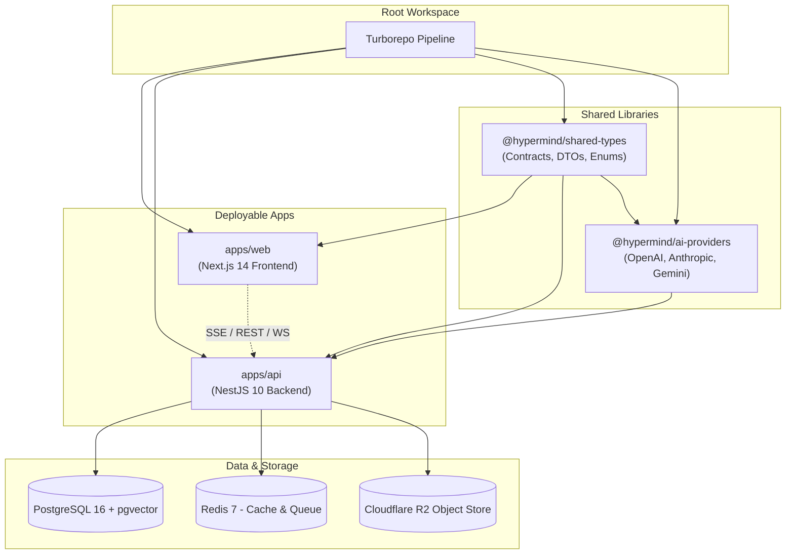

# HYPERMIND Universal AI Ecosystem — Project Folder Structure
**Document Type:** Engineering Architecture & Monorepo Organization  
**Document ID:** HM-SPEC-015  
**Date:** November 15, 2026  
**Version:** 1.0.0-PROD-SPEC  
**Author:** Stream 5 Engineering Architecture  
**Information Source Level:** [A] Officially verified standards / [D] Engineering recommendations  

---

## Table of Contents
1. [Monorepo Architecture & Philosophy](#1-monorepo-architecture--philosophy)
2. [Complete Directory Tree](#2-complete-directory-tree)
3. [Applications (`apps/`) Deep-Dive](#3-applications-apps-deep-dive)
   - [3.1 Web Application (`apps/web`) — Next.js 14+](#31-web-application-appsweb--nextjs-14)
   - [3.2 API Backend (`apps/api`) — NestJS 10+](#32-api-backend-appsapi--nestjs-10)
4. [Shared Packages (`packages/`) Deep-Dive](#4-shared-packages-packages-deep-dive)
   - [4.1 Shared Types (`packages/shared-types`)](#41-shared-types-packagesshared-types)
   - [4.2 AI Providers (`packages/ai-providers`)](#42-ai-providers-packagesai-providers)
5. [Database, Infrastructure & DevOps](#5-database-infrastructure--devops)
   - [5.1 Prisma Schema & Migrations (`prisma/`)](#51-prisma-schema--migrations-prisma)
   - [5.2 Docker & Local Orchestration (`docker/`)](#52-docker--local-orchestration-docker)
   - [5.3 CI/CD Workflows (`.github/workflows/`)](#53-cicd-workflows-githubworkflows)
   - [5.4 Developer Tooling & Scripts (`scripts/`)](#54-developer-tooling--scripts-scripts)
6. [Global Naming & Code Conventions](#6-global-naming--code-conventions)
7. [Monorepo Dependency & Pipeline Graph](#7-monorepo-dependency--pipeline-graph)
8. [Document Status & Completeness Checklist](#8-document-status--completeness-checklist)

---

## 1. Monorepo Architecture & Philosophy

HYPERMIND is organized as an enterprise-grade Turborepo monorepo utilizing `pnpm` workspaces. This architecture achieves:
- **Type Safety End-to-End:** Frontend and Backend consume identical TypeScript data contracts from `@hypermind/shared-types`, completely eliminating contract drift.
- **Provider Isolation:** Multi-provider LLM integrations (OpenAI, Anthropic, Google, DeepSeek) are modularized within `@hypermind/ai-providers` for reusable adapter patterns and testability.
- **Independent Deployability:** The Next.js frontend (`apps/web`) deploys natively to Vercel edge/serverless, while the NestJS backend (`apps/api`) deploys to Railway container services, sharing caching via Turborepo remote cache.
- **Modular Monolith Paradigm:** The backend utilizes NestJS feature modules with clean domain boundaries, permitting future microservices extraction without code rewrites.

---

## 2. Complete Directory Tree

```
hypermind/
├── .github/
│   ├── workflows/
│   │   ├── ci.yml                     # Lint, type-check, test on pull requests
│   │   ├── deploy-api-railway.yml     # Container build & Railway deployment
│   │   └── deploy-web-vercel.yml      # Preview and production Vercel deployment
│   └── pull_request_template.md       # PR checklist and verification rules
├── apps/
│   ├── web/                           # Next.js 14+ Frontend (App Router)
│   │   ├── app/                       # Route segment tree
│   │   │   ├── (marketing)/           # Route group: Landing, pricing, showcase
│   │   │   │   ├── page.tsx           # High-converting landing page
│   │   │   │   ├── pricing/page.tsx   # Tier breakdown & credit calculator
│   │   │   │   └── layout.tsx         # Marketing navigation header & footer
│   │   │   ├── (auth)/                # Route group: Authentication
│   │   │   │   ├── login/page.tsx     # Credentials & OAuth login
│   │   │   │   ├── register/page.tsx  # Account registration
│   │   │   │   ├── reset-password/    # Password reset views
│   │   │   │   └── layout.tsx         # Centered card layout with ambient gradient
│   │   │   ├── (workspace)/           # Route group: Protected productivity app
│   │   │   │   ├── chat/              # Core multi-turn streaming chat
│   │   │   │   │   ├── page.tsx       # Default conversational interface
│   │   │   │   │   └── [id]/page.tsx  # Dynamic conversation view
│   │   │   │   ├── research/          # Autonomous deep research workspace
│   │   │   │   │   └── page.tsx       # Multi-query synthesis & citation view
│   │   │   │   ├── code/              # Code generation & artifact editor
│   │   │   │   │   └── page.tsx       # Syntax editor with side-by-side diff
│   │   │   │   ├── documents/         # Multimodal document intelligence
│   │   │   │   │   └── page.tsx       # PDF/Image OCR, vector search, Q&A
│   │   │   │   ├── agents/            # Autonomous agent control room
│   │   │   │   │   ├── page.tsx       # Active tasks, logs, HITL approvals
│   │   │   │   │   └── [taskId]/      # Granular agent execution trace
│   │   │   │   ├── settings/          # User & organization preferences
│   │   │   │   │   ├── page.tsx       # Profile, keys, model routing, billing
│   │   │   │   │   └── usage/page.tsx # Real-time token consumption analytics
│   │   │   │   └── layout.tsx         # Collapsible sidebar, model selector, command menu
│   │   │   ├── api/                   # Next.js BFF (Backend For Frontend) proxy
│   │   │   │   ├── auth/[...nextauth]/# NextAuth.js authentication handler
│   │   │   │   └── proxy/[...path]/   # Secure proxy forwarder to NestJS backend
│   │   │   ├── layout.tsx             # Root HTML, font preloading, provider wrapper
│   │   │   ├── page.tsx               # Root redirection logic (auth-aware)
│   │   │   └── globals.css            # Tailwind directives & CSS custom properties
│   │   ├── components/
│   │   │   ├── ui/                    # Base primitives (shadcn/ui + Radix)
│   │   │   │   ├── button.tsx
│   │   │   │   ├── dialog.tsx
│   │   │   │   ├── dropdown-menu.tsx
│   │   │   │   ├── input.tsx
│   │   │   │   ├── scroll-area.tsx
│   │   │   │   ├── sheet.tsx
│   │   │   │   ├── skeleton.tsx
│   │   │   │   ├── tooltip.tsx
│   │   │   │   └── ...
│   │   │   ├── chat/                  # Conversational intelligence components
│   │   │   │   ├── chat-input.tsx     # Auto-resizing textarea with file drag-and-drop
│   │   │   │   ├── message-list.tsx   # Virtualized streaming message feed
│   │   │   │   ├── message-item.tsx   # Render individual message with actions
│   │   │   │   ├── markdown-renderer.tsx # Stream-safe Markdown with KaTeX math
│   │   │   │   ├── code-block.tsx     # Shiki/Prism syntax highlighting with copy
│   │   │   │   ├── model-badge.tsx    # Provider logo and latency badge
│   │   │   │   └── token-counter.tsx  # Live prompt token estimator
│   │   │   ├── workspace/             # Global application chrome
│   │   │   │   ├── sidebar.tsx        # Conversation history with search & pin
│   │   │   │   ├── workspace-header.tsx # Breadcrumbs, quick model switcher, avatar
│   │   │   │   ├── command-menu.tsx   # Cmd+K omnibar for quick actions
│   │   │   │   └── mobile-nav.tsx     # Responsive slide-over drawer
│   │   │   ├── agents/                # Agentic workflow visualization
│   │   │   │   ├── task-card.tsx      # Agent task progress overview card
│   │   │   │   ├── approval-modal.tsx # Human-in-the-loop action inspection & diff
│   │   │   │   ├── step-timeline.tsx  # Collapsible tree of agent reasoning steps
│   │   │   │   └── tool-execution-log.tsx # Terminal-like view of agent tool calls
│   │   │   ├── shared/                # Cross-cutting reusable components
│   │   │   │   ├── file-uploader.tsx  # Chunked multipart upload dropzone
│   │   │   │   ├── voice-player.tsx   # TTS playback controls with waveform
│   │   │   │   ├── empty-state.tsx    # Illustrative placeholders
│   │   │   │   └── error-boundary.tsx # Graceful React error catcher
│   │   │   └── providers/             # Global React Context providers
│   │   │       ├── auth-provider.tsx  # Session token distribution
│   │   │       ├── theme-provider.tsx # Next-themes (dark, light, system)
│   │   │       ├── socket-provider.tsx# WebSocket lifecycle manager
│   │   │       └── query-provider.tsx # TanStack React Query v5 cache
│   │   ├── lib/
│   │   │   ├── api-client.ts          # Typed Axios/Fetch client wrapper
│   │   │   ├── sse-client.ts          # EventSource and stream reader utilities
│   │   │   ├── hooks/                 # Custom React hooks
│   │   │   │   ├── use-chat-stream.ts # SSE consumption and delta reconstruction
│   │   │   │   ├── use-socket.ts      # WebSocket event listener subscription
│   │   │   │   ├── use-debounce.ts    # Input rate limiting
│   │   │   │   └── use-voice.ts       # Audio recording & playback state
│   │   │   ├── stores/                # Zustand client state stores
│   │   │   │   ├── chat-store.ts      # Active conversation & streaming buffers
│   │   │   │   ├── agent-store.ts     # Pending approvals & task queues
│   │   │   │   └── ui-store.ts        # Sidebar collapse, active tab, modals
│   │   │   └── utils.ts               # Class merger (clsx + twMerge), formatters
│   │   ├── styles/
│   │   │   ├── globals.css            # Tailwind base, utilities, font variables
│   │   │   └── typography.css         # Prose overrides for AI generation
│   │   ├── public/
│   │   │   ├── icons/                 # Provider logos (OpenAI, Anthropic, Google)
│   │   │   ├── images/                # Platform diagrams, marketing banners
│   │   │   └── favicon.ico
│   │   ├── next.config.mjs            # Next.js production build configuration
│   │   ├── tailwind.config.ts         # Design tokens, color palette, animations
│   │   ├── tsconfig.json              # Strict TS config extending base
│   │   └── package.json               # Frontend dependencies & scripts
│   │
│   └── api/                           # NestJS 10+ Modular Monolith Backend
│       ├── src/
│       │   ├── modules/
│       │   │   ├── auth/              # Authentication & Session Security
│       │   │   │   ├── controllers/   # auth.controller.ts
│       │   │   │   ├── services/      # auth.service.ts, token.service.ts
│       │   │   │   ├── strategies/    # jwt.strategy.ts, local.strategy.ts
│       │   │   │   ├── guards/        # jwt-auth.guard.ts, roles.guard.ts
│       │   │   │   ├── dto/           # login.dto.ts, register.dto.ts
│       │   │   │   └── auth.module.ts
│       │   │   ├── user/              # User Profile & Preferences
│       │   │   │   ├── controllers/   # user.controller.ts
│       │   │   │   ├── services/      # user.service.ts, preferences.service.ts
│       │   │   │   ├── dto/           # update-profile.dto.ts
│       │   │   │   └── user.module.ts
│       │   │   ├── conversation/      # Conversation Management
│       │   │   │   ├── controllers/   # conversation.controller.ts
│       │   │   │   ├── services/      # conversation.service.ts
│       │   │   │   ├── dto/           # create-conversation.dto.ts
│       │   │   │   └── conversation.module.ts
│       │   │   ├── message/           # Message Persistence & SSE Streaming
│       │   │   │   ├── controllers/   # message.controller.ts
│       │   │   │   ├── services/      # message.service.ts, stream.service.ts
│       │   │   │   ├── dto/           # send-message.dto.ts
│       │   │   │   └── message.module.ts
│       │   │   ├── ai/                # AI Intelligence Router & Model Adapters
│       │   │   │   ├── controllers/   # model.controller.ts
│       │   │   │   ├── services/      # router.service.ts, intent.service.ts
│       │   │   │   ├── adapters/      # openai.adapter.ts, anthropic.adapter.ts, google.adapter.ts
│       │   │   │   ├── interfaces/    # model-adapter.interface.ts
│       │   │   │   └── ai.module.ts
│       │   │   ├── agent/             # Autonomous Multi-Step Agent Framework
│       │   │   │   ├── controllers/   # agent.controller.ts
│       │   │   │   ├── services/      # orchestrator.service.ts, task.service.ts
│       │   │   │   ├── processors/    # agent-queue.processor.ts (BullMQ)
│       │   │   │   ├── tools/         # web-search.tool.ts, code-exec.tool.ts
│       │   │   │   ├── gateways/      # agent.gateway.ts (Socket.io)
│       │   │   │   └── agent.module.ts
│       │   │   ├── file/              # File Processing & Cloudflare R2 Uploads
│       │   │   │   ├── controllers/   # file.controller.ts
│       │   │   │   ├── services/      # r2-storage.service.ts, pdf-extractor.service.ts
│       │   │   │   ├── dto/           # upload-file.dto.ts
│       │   │   │   └── file.module.ts
│       │   │   ├── usage/             # Token Counting, Metering & Cost Tracking
│       │   │   │   ├── services/      # usage.service.ts, billing.service.ts
│       │   │   │   └── usage.module.ts
│       │   │   ├── memory/            # Semantic Memory & pgvector Embeddings
│       │   │   │   ├── services/      # memory.service.ts, embedding.service.ts
│       │   │   │   └── memory.module.ts
│       │   │   └── admin/             # System Telemetry & Provider Diagnostics
│       │   │       ├── controllers/   # admin.controller.ts
│       │   │       ├── services/      # metrics.service.ts
│       │   │       └── admin.module.ts
│       │   ├── common/                # Cross-Cutting Concerns
│       │   │   ├── decorators/        # current-user.decorator.ts, roles.decorator.ts
│       │   │   ├── filters/           # http-exception.filter.ts, all-exceptions.filter.ts
│       │   │   ├── guards/            # rate-limit.guard.ts, api-key.guard.ts
│       │   │   ├── interceptors/      # logging.interceptor.ts, transform.interceptor.ts
│       │   │   └── pipes/             # zod-validation.pipe.ts
│       │   ├── config/                # Environment & Configuration Service
│       │   │   ├── app.config.ts      # Port, cors, host variables
│       │   │   ├── ai.config.ts       # API keys, timeout, model defaults
│       │   │   └── storage.config.ts  # Cloudflare R2 credentials & bucket names
│       │   ├── database/              # Database Layer
│       │   │   ├── prisma.service.ts  # Prisma client lifecycle and connection pool
│       │   │   └── redis.service.ts   # Redis connection for caching & rate limiting
│       │   ├── app.module.ts          # Root module assembling all submodules
│       │   └── main.ts                # Application bootstrap, Swagger, Winston logger
│       ├── test/                      # API End-to-End & Integration Tests
│       │   ├── auth.e2e-spec.ts
│       │   ├── message.e2e-spec.ts
│       │   └── jest-e2e.json
│       ├── Dockerfile                 # Multi-stage production container build
│       ├── nest-cli.json
│       ├── tsconfig.json
│       └── package.json
│
├── packages/
│   ├── shared-types/                  # Shared TypeScript Contracts & Schemas
│   │   ├── src/
│   │   │   ├── models/                # Model, Provider, Token definitions
│   │   │   │   ├── model.types.ts
│   │   │   │   └── provider.types.ts
│   │   │   ├── chat/                  # Conversation, Message, Stream event types
│   │   │   │   ├── conversation.types.ts
│   │   │   │   ├── message.types.ts
│   │   │   │   └── sse-events.types.ts
│   │   │   ├── agents/                # Agent, Step, Tool, Approval types
│   │   │   │   ├── agent.types.ts
│   │   │   │   └── task.types.ts
│   │   │   ├── api/                   # REST request/response envelope schemas
│   │   │   │   ├── api-response.types.ts
│   │   │   │   └── error-codes.ts
│   │   │   └── index.ts               # Single barrel export
│   │   ├── tsconfig.json
│   │   └── package.json
│   │
│   └── ai-providers/                  # Unified Provider Adapters & Encoders
│       ├── src/
│       │   ├── adapters/
│       │   │   ├── openai.adapter.ts  # Direct SDK / Vercel AI SDK OpenAI driver
│       │   │   ├── anthropic.adapter.ts # Claude 3.5 Sonnet / Haiku driver
│       │   │   └── google.adapter.ts  # Gemini 1.5 Flash / Pro driver
│       │   ├── tokenizer/             # Tiktoken & BPE token estimators
│       │   │   └── token-counter.ts
│       │   ├── interfaces/            # Common driver signatures
│       │   │   └── provider-adapter.interface.ts
│       │   └── index.ts
│       ├── tsconfig.json
│       └── package.json
│
├── prisma/
│   ├── schema.prisma                  # PostgreSQL schema with pgvector extension
│   ├── migrations/                    # Versioned SQL migration files
│   └── seed.ts                        # Seed initial models, admin user, mock chats
│
├── docker/
│   ├── docker-compose.yml             # Local production simulation
│   ├── docker-compose.dev.yml         # Local dev (PostgreSQL 16 + Redis 7)
│   └── postgres/
│       └── init-extensions.sql        # Script: CREATE EXTENSION IF NOT EXISTS vector;
│
├── docs/                              # Project Architecture & Implementation Specs
│   ├── 01_HYPERMIND_EXECUTIVE_SUMMARY.md
│   ├── ...
│   ├── 14_HYPERMIND_API_SPECIFICATION.md
│   ├── 15_HYPERMIND_PROJECT_FOLDER_STRUCTURE.md
│   ├── 17_HYPERMIND_TESTING_STRATEGY.md
│   ├── 18_HYPERMIND_TEN_DAY_DEVELOPMENT_ROADMAP.md
│   ├── 19_HYPERMIND_RISK_REGISTER.md
│   └── 20_HYPERMIND_DAY_1_DECISION_LOG.md
│
├── scripts/
│   ├── dev-setup.sh                   # Environment check & automated setup
│   ├── clean.sh                       # Purge node_modules, dist, .turbo
│   └── seed-vectors.ts                # Generate initial pgvector sample embeddings
│
├── .env.example                       # Documented environment variable template
├── .gitignore
├── .npmrc                             # hoisted dependency resolutions
├── package.json                       # Monorepo root package.json (pnpm workspaces)
├── pnpm-workspace.yaml                # Package inclusion configuration
├── turbo.json                         # Turborepo task pipeline & cache config
└── README.md                          # Quickstart developer onboarding guide
```

---

## 3. Applications (`apps/`) Deep-Dive

### 3.1 Web Application (`apps/web`) — Next.js 14+

#### Purpose & Responsibility
`apps/web` provides the entire user experience. Built with Next.js 14 App Router, it leverages Server Components for data hydration, Client Components for low-latency interactive streaming, and Tailwind CSS + shadcn/ui for an enterprise aesthetic.

#### Key Directories & Files:
- **`app/(marketing)/`**: Pre-login public routes optimized for zero layout shift, rapid SEO indexing, and conversion.
  - `page.tsx`: Hero section, model comparison interactive demo, social proof, pricing tiers.
  - `layout.tsx`: Global navigation header with authentication status indicator.
- **`app/(auth)/`**: Focused authentication pages free of distracting chrome.
  - `login/page.tsx`, `register/page.tsx`: Forms utilizing `react-hook-form` + `zod` validation.
- **`app/(workspace)/`**: Authenticated workspace layout with fixed navigation rail, dynamic model switcher, and omnibar search.
  - `chat/page.tsx` & `chat/[id]/page.tsx`: Real-time streaming chat. Manages token streams via `useChatStream` hook and auto-scrolls through dynamic code blocks.
  - `research/page.tsx`: Live research canvas showing parallel search queries, source evaluation, and auto-synthesized briefing documents.
  - `code/page.tsx`: Monaco-based or CodeMirror-based code exploration workspace with instant LLM refactor buttons.
  - `documents/page.tsx`: Drag-and-drop document vault with visual OCR bounding boxes and vector semantic search.
  - `agents/page.tsx`: Agentic orchestration cockpit displaying BullMQ active jobs, step-by-step reasoning trees, and human approval prompts.
- **`components/ui/`**: 25+ accessible UI primitives built on Radix UI, styled via Tailwind CSS, and copy-pasted/customized through shadcn/ui standards.
- **`lib/stores/`**: Lightweight client state management via Zustand (`chat-store.ts`, `agent-store.ts`, `ui-store.ts`), preventing unnecessary React tree re-renders during high-frequency token streams.

#### Why This Structure Was Chosen:
Next.js Route Groups `(marketing)`, `(auth)`, and `(workspace)` allow distinct root layout hierarchies, route protection boundaries, and isolated CSS styles without polluting the public URL structure.

---

### 3.2 API Backend (`apps/api`) — NestJS 10+

#### Purpose & Responsibility
`apps/api` serves as the core intelligence orchestrator, authentication authority, and data gateway. It encapsulates business logic into strictly decoupled modules following the NestJS modular monolith pattern.

#### Key Modules & Files:
- **`modules/auth/`**:
  - `auth.controller.ts`: Issues JWT access tokens and Redis-backed refresh tokens.
  - `jwt.strategy.ts`: Validates bearer tokens on protected endpoints using Passport.
- **`modules/ai/`**:
  - `router.service.ts`: The heart of HYPERMIND. Evaluates input complexity, latency budget, and token count to route requests to the optimal provider (e.g. GPT-4o, Claude 3.5 Sonnet, Gemini Flash).
  - `intent.service.ts`: Performs fast classification (coding, creative writing, research, mathematical analysis) using lightweight model passes or regex fast-paths.
  - `adapters/`: Concrete implementations of `ModelAdapter` abstracting vendor-specific API structures into a uniform stream.
- **`modules/agent/`**:
  - `orchestrator.service.ts`: Deconstructs complex user goals into iterative DAGs (Directed Acyclic Graphs).
  - `agent-queue.processor.ts`: Consumes BullMQ Redis jobs, executing steps asynchronously with exponential backoff retry.
  - `agent.gateway.ts`: Socket.io gateway handling bi-directional Human-In-The-Loop approvals.
- **`modules/file/`**:
  - `r2-storage.service.ts`: Manages presigned S3/R2 upload URLs and byte streaming to Cloudflare R2.
  - `pdf-extractor.service.ts`: Uses `pdf-parse` to extract clean text streams, chunk them into semantically cohesive spans, and dispatch them to the embedding pipeline.
- **`modules/memory/`**:
  - `memory.service.ts`: Interacts with PostgreSQL `pgvector` to store and retrieve dense vector embeddings for conversation recall and document retrieval.
- **`common/`**:
  - `guards/rate-limit.guard.ts`: Distributed sliding-window rate limiter powered by Redis.
  - `filters/http-exception.filter.ts`: Traps all runtime exceptions and converts them into the standard RFC 7807 problem envelope.

#### Why This Structure Was Chosen:
NestJS enforces dependency injection, modular encapsulation, and strong TypeScript architecture out of the box. This prevents spaghetti code and guarantees that services can be split into standalone microservices if individual load spikes demand it.

---

## 4. Shared Packages (`packages/`) Deep-Dive

### 4.1 Shared Types (`packages/shared-types`)
- **Purpose:** Single source of truth for domain models, DTOs, and event envelopes across the entire platform.
- **Key Files:**
  - `chat/conversation.types.ts`: Conversation entity, model preferences, metadata.
  - `chat/message.types.ts`: Message schema, token counts, model provider metrics.
  - `chat/sse-events.types.ts`: TypeScript discriminated union representing all SSE stream payloads (`TokenEvent`, `MetadataEvent`, `DoneEvent`, `ErrorEvent`).
  - `agents/task.types.ts`: Agent task states (`PENDING`, `RUNNING`, `WAITING_APPROVAL`, `COMPLETED`, `FAILED`).
- **Rationale:** Prevents frontend-backend schema mismatch bugs during builds. If the backend changes a field name, TypeScript build immediately flags errors across the frontend.

### 4.2 AI Providers (`packages/ai-providers`)
- **Purpose:** Vendor-agnostic wrapper around diverse AI APIs.
- **Key Files:**
  - `interfaces/provider-adapter.interface.ts`: Standard interface defining `streamChat()`, `generateCompletion()`, and `countTokens()`.
  - `adapters/openai.adapter.ts`: OpenAI official SDK wrapper.
  - `adapters/anthropic.adapter.ts`: Anthropic official SDK wrapper with Claude-specific stream handling.
  - `adapters/google.adapter.ts`: Google Generative AI SDK wrapper for Gemini models.
  - `tokenizer/token-counter.ts`: Unified BPE and Tiktoken token calculation utilities.
- **Rationale:** Decouples AI vendor quirks from the NestJS business logic. Adding a new provider (e.g., Mistral, Groq, Ollama) requires only implementing a single adapter file.

---

## 5. Database, Infrastructure & DevOps

### 5.1 Prisma Schema & Migrations (`prisma/`)
- **`prisma/schema.prisma`**: Defines database relations:
  - `User`, `Account`, `Session` (Auth)
  - `Conversation`, `Message`, `Attachment` (Chat)
  - `File`, `DocumentChunk` with `vector(1536)` (pgvector)
  - `AgentTask`, `AgentStep`, `ActionApproval` (Agents)
  - `UsageLog`, `ProviderMetric` (Billing & Telemetry)
- **`prisma/seed.ts`**: Populates test users, verified system prompts, and pre-computed embedding fixtures.

### 5.2 Docker & Local Orchestration (`docker/`)
- **`docker-compose.dev.yml`**: Spins up:
  - `postgres`: PostgreSQL 16 image with `pgvector` pre-installed on port 5432.
  - `redis`: Redis 7 Alpine with persistent append-only file on port 6379.
- **`docker/postgres/init-extensions.sql`**: Automatically executes `CREATE EXTENSION IF NOT EXISTS vector;` during first initialization.

### 5.3 CI/CD Workflows (`.github/workflows/`)
- **`ci.yml`**: Runs on all PRs to `main`:
  1. `pnpm install --frozen-lockfile`
  2. `pnpm turbo run lint`
  3. `pnpm turbo run type-check`
  4. `pnpm turbo run test` (Jest unit tests)
  5. `pnpm turbo run test:e2e` (Playwright & Supertest)
- **`deploy-api-railway.yml`**: Builds backend container, runs Prisma migrations, and updates Railway staging/production environment.
- **`deploy-web-vercel.yml`**: Deploys frontend to Vercel preview environments for PRs and production for `main`.

---

## 6. Global Naming & Code Conventions

| Artifact Type | Convention | Example |
|---|---|---|
| **Files (Frontend)** | `kebab-case.tsx` / `kebab-case.ts` | `message-list.tsx`, `use-chat-stream.ts` |
| **Files (Backend)** | `kebab-case.<role>.ts` | `auth.controller.ts`, `jwt-auth.guard.ts` |
| **Directories** | `kebab-case` | `components/chat/`, `modules/conversation/` |
| **React Components** | `PascalCase` | `MessageList`, `ApprovalModal` |
| **NestJS Classes** | `PascalCase` with role suffix | `AuthService`, `LoggingInterceptor` |
| **TypeScript Interfaces** | `PascalCase` (No `I` prefix) | `ConversationSummary`, `StreamTokenPayload` |
| **Database Tables** | `snake_case` (Plural) | `users`, `conversations`, `document_chunks` |
| **Environment Variables** | `SCREAMING_SNAKE_CASE` | `DATABASE_URL`, `ANTHROPIC_API_KEY` |

---

## 7. Monorepo Dependency & Pipeline Graph



---

## 8. Document Status & Completeness Checklist

| Verification Item | Status | Notes |
|---|---|---|
| Monorepo Configuration Specified | COMPLETE | Turborepo + pnpm workspaces defined |
| Next.js App Router Structure | COMPLETE | All 12 systems and route groups mapped |
| NestJS Module Breakdown | COMPLETE | All 10 backend core modules detailed |
| Shared Packages Design | COMPLETE | `shared-types` and `ai-providers` articulated |
| DevOps & Infrastructure Mapped | COMPLETE | Docker, Prisma, GitHub Actions, and R2 detailed |
| Naming Standards Documented | COMPLETE | Strict naming guidelines established |

**Open Items for Post-MVP:**
- Mobile application directory (`apps/mobile`) using React Native / Expo.
- Desktop application directory (`apps/desktop`) using Tauri.
