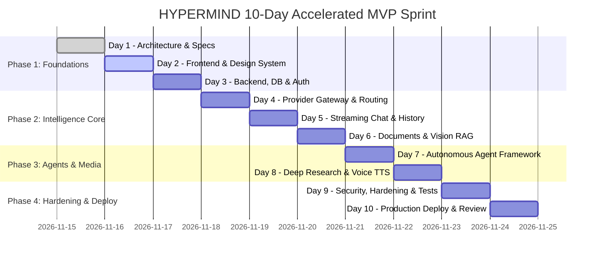
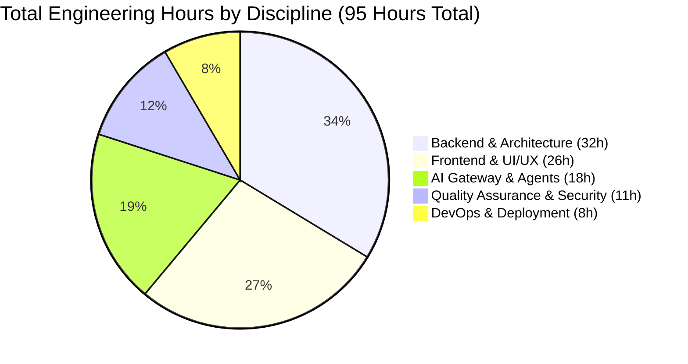
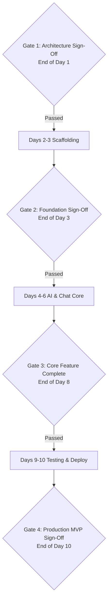

# HYPERMIND Universal AI Ecosystem — 10-Day MVP Development Roadmap
**Document Type:** Engineering Execution & Sprint Roadmap  
**Document ID:** HM-SPEC-018  
**Date:** November 15, 2026  
**Version:** 1.0.0-PROD-SPEC  
**Author:** Stream 5 Engineering Architecture  
**Information Source Level:** [A] Officially verified standards / [D] Engineering recommendations  

---

## Table of Contents
1. [Executive Roadmap Summary & Target Milestones](#1-executive-roadmap-summary--target-milestones)
2. [Timeline & Dependency Gantt Chart](#2-timeline--dependency-gantt-chart)
3. [Day-by-Day Execution Plan](#3-day-by-day-execution-plan)
   - [Day 1: Research, Architecture & Specification (Current)](#day-1-research-architecture--specification-current)
   - [Day 2: Frontend Foundation & Design System](#day-2-frontend-foundation--design-system)
   - [Day 3: Backend Core, Database Schema & Auth](#day-3-backend-core-database-schema--auth)
   - [Day 4: AI Provider Gateway & Routing Engine](#day-4-ai-provider-gateway--routing-engine)
   - [Day 5: Real-Time Streaming Chat & History](#day-5-real-time-streaming-chat--history)
   - [Day 6: Document & Multimodal Vision Intelligence](#day-6-document--multimodal-vision-intelligence)
   - [Day 7: Autonomous Agent Framework & Orchestration](#day-7-autonomous-agent-framework--orchestration)
   - [Day 8: Deep Research Canvas & Voice Synthesis](#day-8-deep-research-canvas--voice-synthesis)
   - [Day 9: Security Hardening, Automated Testing & QA](#day-9-security-hardening-automated-testing--qa)
   - [Day 10: Production Deployment & MVP Validation](#day-10-production-deployment--mvp-validation)
4. [Resource Allocation & Workload Breakdown](#4-resource-allocation--workload-breakdown)
5. [Milestone Quality Gates & Sign-Off Criteria](#5-milestone-quality-gates--sign-off-criteria)
6. [Document Status & Completeness Checklist](#6-document-status--completeness-checklist)

---

## 1. Executive Roadmap Summary & Target Milestones

The HYPERMIND 10-Day Sprint plan transitions the project from architecture specification into a production-grade, highly scalable AI ecosystem MVP.

### Key Scope Commitments:
- **Full MVP Systems:** 
  1. `HYPERMIND CHAT` (Multi-turn, streaming, model picker)
  2. `HYPERMIND INTELLIGENCE ROUTER` (Intent classification, multi-provider gateway)
- **Basic MVP Systems:**
  3. `HYPERMIND DOCUMENTS` (PDF upload, text parsing, RAG Q&A)
  4. `HYPERMIND VISION` (Multimodal analysis via GPT-4o & Gemini Flash)
  5. `HYPERMIND MEMORY` (Chat history, preferences, contextual prompt injection)
- **Partial MVP Systems:**
  6. `HYPERMIND CODE` (Syntax highlighting, code generation, diff preview)
  7. `HYPERMIND RESEARCH` (Web search retrieval & citation synthesis)
  8. `HYPERMIND VOICE` (Text-to-speech audio playback)
- **Stub / Architecture Systems:**
  9. `HYPERMIND AGENTS` (BullMQ queues, HITL approval interface, 2 basic agents)
- **Deferred Systems (Post-MVP):**
  10. `HYPERMIND LEARNING`, 11. `HYPERMIND VIDEO`, 12. `HYPERMIND CREATIVE STUDIO`

---

## 2. Timeline & Dependency Gantt Chart

---

## 3. Day-by-Day Execution Plan

### Day 1: Research, Architecture & Specification (Current)
- **Focus:** Complete architectural definitions, schema models, API specifications, and operational blueprints.
- **Estimated Effort:** 10 hours
- **Dependencies:** None
- **Tasks:**
  1. Complete system architecture, router algorithm, and multi-model matrix (Streams 1–4). [4.0h]
  2. Write API Specification (`14_HYPERMIND_API_SPECIFICATION.md`). [1.5h]
  3. Define Monorepo Structure (`15_HYPERMIND_PROJECT_FOLDER_STRUCTURE.md`). [1.0h]
  4. Write Testing Strategy (`17_HYPERMIND_TESTING_STRATEGY.md`). [1.0h]
  5. Define 10-Day Roadmap (`18_HYPERMIND_TEN_DAY_DEVELOPMENT_ROADMAP.md`). [1.0h]
  6. Compile Risk Register & Mitigation Strategy (`19_HYPERMIND_RISK_REGISTER.md`). [0.75h]
  7. Formulate Architectural Decision Records (`20_HYPERMIND_DAY_1_DECISION_LOG.md`). [0.75h]
- **Risks:** Scope creep during specification; mitigated by locking 10-day MVP boundaries.
- **Acceptance Criteria & Gate:** All 20 architecture markdown documents authored with zero placeholders, validated by Stream 5, and approved by project lead.

---

### Day 2: Frontend Foundation & Design System
- **Focus:** Next.js 14 App Router scaffolding, design token implementation, component library setup, and public/auth views.
- **Estimated Effort:** 9 hours
- **Dependencies:** Monorepo specification (Day 1).
- **Tasks:**
  1. Initialize Turborepo monorepo with `apps/web` and `packages/shared-types`. [1.5h]
  2. Configure Tailwind CSS 3.4+, CSS custom properties, and typography plugins. [1.0h]
  3. Install and configure shadcn/ui component library (buttons, inputs, dialogs, dropdowns, tooltips, sheets). [1.5h]
  4. Build responsive workspace layout (collapsible sidebar, header bar, model badge, command palette). [2.0h]
  5. Build marketing landing page showcasing feature hero, model cards, and interactive demo. [1.5h]
  6. Implement authentication pages: `/login`, `/register`, and `/reset-password`. [1.0h]
  7. Implement dark/light theme toggle via `next-themes` with zero flicker. [0.5h]
- **Risks:** Hydration mismatch on theme switching; mitigated by suppressHydrationWarning and layout script injection.
- **Acceptance Criteria:** 
  - Next.js development server runs on `localhost:3000` with zero build or lint warnings.
  - Marketing landing page and auth views render flawlessly across desktop and mobile viewports.
  - Theme toggle seamlessly switches tokens without layout shifts.

---

### Day 3: Backend Core, Database Schema & Auth
- **Focus:** NestJS backend scaffolding, PostgreSQL 16 schema deployment with pgvector, Redis setup, and JWT authentication.
- **Estimated Effort:** 9.5 hours
- **Dependencies:** Day 2 monorepo setup; Day 1 API & schema specifications.
- **Tasks:**
  1. Scaffold `apps/api` using NestJS 10 with modular directory architecture. [1.5h]
  2. Configure `docker-compose.dev.yml` running PostgreSQL 16 (`pgvector`) and Redis 7. [1.0h]
  3. Define `prisma/schema.prisma` covering Users, Conversations, Messages, Files, and Usage. [2.0h]
  4. Run initial Prisma migration and execute database seed script (`prisma/seed.ts`). [1.0h]
  5. Implement `AuthModule` with bcrypt password hashing and JWT access/refresh token rotation. [2.0h]
  6. Implement NextAuth.js v5 bridge in `apps/web/app/api/auth/[...nextauth]` to sync session tokens with NestJS. [1.0h]
  7. Implement `UserModule` (profile view, preferences endpoint). [1.0h]
- **Risks:** Prisma connection pooling bottlenecks under concurrent load; mitigated by configuring explicit `connection_limit=20`.
- **Acceptance Criteria:**
  - `docker compose -f docker/docker-compose.dev.yml up` starts PostgreSQL and Redis cleanly.
  - User can register via API, login, receive a signed JWT, and fetch `/api/v1/users/me`.
  - Database migrations applied cleanly with `vector` extension verified active.

---

### Day 4: AI Provider Gateway & Routing Engine
- **Focus:** Multi-provider adapter integration (OpenAI, Anthropic, Google), token estimation, and intelligent prompt routing.
- **Estimated Effort:** 9.5 hours
- **Dependencies:** Day 3 backend core; provider API credentials.
- **Tasks:**
  1. Build `@hypermind/ai-providers` package defining `ModelAdapter` interface. [1.5h]
  2. Implement `OpenAIAdapter` supporting GPT-4o and GPT-4o-mini via official SDK. [1.5h]
  3. Implement `AnthropicAdapter` supporting Claude 3.5 Sonnet with chunked stream parsing. [1.5h]
  4. Implement `GoogleAdapter` supporting Gemini 1.5 Flash via Google GenAI SDK. [1.5h]
  5. Build `IntentService` in NestJS performing regex/lightweight classification (code, creative, reasoning). [1.5h]
  6. Implement `RouterService` with dynamic fallback routing and latency circuit-breakers. [1.0h]
  7. Implement `UsageService` measuring prompt/completion tokens and computing live USD costs. [1.0h]
- **Risks:** Provider rate limits during testing; mitigated by caching responses and setting strict mock fallbacks.
- **Acceptance Criteria:**
  - Backend successfully dispatches requests to OpenAI, Anthropic, and Google and receives valid streaming token chunks.
  - Token consumption and cost calculations accurately recorded in PostgreSQL `usage_logs`.

---

### Day 5: Real-Time Streaming Chat & History
- **Focus:** Server-Sent Events (SSE) streaming pipeline, conversation persistence, sidebar state, and markdown UI rendering.
- **Estimated Effort:** 10 hours
- **Dependencies:** Day 4 AI gateway; Day 2 frontend workspace layout.
- **Tasks:**
  1. Implement NestJS SSE controller endpoint: `POST /api/v1/conversations/:id/messages`. [2.0h]
  2. Build custom frontend `useChatStream` hook handling EventSource reconnection and buffer parsing. [2.0h]
  3. Build rich chat interface: auto-expanding textarea, model picker, live token estimate. [2.0h]
  4. Implement conversation CRUD APIs and frontend sidebar with active state and search filter. [1.5h]
  5. Implement stream-safe Markdown renderer (`react-markdown` + `remark-gfm` + KaTeX math). [1.5h]
  6. Implement syntax-highlighted code blocks with copy button and language badge. [1.0h]
- **Risks:** Markdown parser flickering or re-rendering entire message on every token delta; mitigated by memoizing chunks.
- **Acceptance Criteria:**
  - Full end-to-end chat loop: User inputs prompt, receives instant SSE streaming response, and message is persisted in PostgreSQL.
  - Switching conversations in sidebar instantly loads message history without lag.

---

### Day 6: Document & Multimodal Vision Intelligence
- **Focus:** Cloudflare R2 file uploads, PDF text extraction, multimodal image analysis, and document Q&A.
- **Estimated Effort:** 9.5 hours
- **Dependencies:** Day 5 chat streaming; Cloudflare R2 bucket credentials.
- **Tasks:**
  1. Configure Cloudflare R2 client in `FileModule` with presigned URL upload pipeline. [1.5h]
  2. Implement file dropzone in web chat supporting PDF and image attachments (PNG, JPG, WebP). [1.5h]
  3. Build PDF text extraction worker using `pdf-parse` with chunking and token bounding. [2.0h]
  4. Integrate pgvector embedding pipeline: generate embeddings via `text-embedding-3-small` and store in PostgreSQL. [2.0h]
  5. Implement multimodal vision handler: send image attachments to GPT-4o / Gemini Flash vision endpoints. [1.5h]
  6. Build document viewer modal with chunk citation highlighting. [1.0h]
- **Risks:** Large PDFs (>20MB) blocking Node.js event loop during parsing; mitigated by offloading extraction to worker threads.
- **Acceptance Criteria:**
  - User can upload a 15-page PDF, ask a question about its content, and receive an accurate answer referencing specific pages.
  - Image uploaded into chat is correctly described and analyzed by the vision model.

---

### Day 7: Autonomous Agent Framework & Orchestration
- **Focus:** BullMQ task queue, agent DAG orchestrator, Human-In-The-Loop approval modal, and 2 functional agents.
- **Estimated Effort:** 9.5 hours
- **Dependencies:** Day 3 Redis instance; Day 4 AI gateway.
- **Tasks:**
  1. Configure BullMQ in NestJS with Redis connection and dead-letter queue. [1.5h]
  2. Implement `AgentOrchestratorService` executing iterative step-by-step reasoning loops. [2.0h]
  3. Build Socket.io gateway for real-time agent step streaming (`agent:status`, `agent:approval_required`). [1.5h]
  4. Implement `ResearchAgent`: queries web search API, synthesizes facts, and extracts sources. [2.0h]
  5. Implement `CodingAgent`: accepts a code goal, reads context, and outputs a formatted unified diff. [1.5h]
  6. Build Agent Cockpit UI: visual task timeline, terminal log view, and action approval modal. [1.0h]
- **Risks:** Agent falling into an infinite execution loop; mitigated by enforcing `MAX_STEPS = 15` hard circuit-breaker.
- **Acceptance Criteria:**
  - Research agent executes multi-step task, streams status updates via WebSocket, and outputs a sourced briefing.
  - Action requiring approval pauses execution until user clicks "Approve" in the UI.

---

### Day 8: Deep Research Canvas & Voice Synthesis
- **Focus:** Dedicated research workspace UI, citation verification, text-to-speech (TTS) audio integration, and analytics dashboard.
- **Estimated Effort:** 9 hours
- **Dependencies:** Day 7 Research Agent; Day 5 UI components.
- **Tasks:**
  1. Build `/workspace/research` UI: dual-pane view with query tracker and live document canvas. [2.5h]
  2. Refine web search integration with Tavily/Serper API for clean snippet extraction and favicon metadata. [1.5h]
  3. Implement TTS endpoint using OpenAI `tts-1` model with chunked MP3 streaming. [2.0h]
  4. Build `VoicePlayer` audio component in chat with play/pause, speed toggle (1x, 1.25x, 1.5x), and audio waveform. [1.5h]
  5. Build `/workspace/settings/usage` dashboard displaying token charts and estimated spend. [1.5h]
- **Risks:** TTS audio streaming latency; mitigated by streaming initial MP3 audio buffer before full generation completes.
- **Acceptance Criteria:**
  - Research workspace yields comprehensive, sourced reports with clickable external citation pills.
  - Clicking "Read Aloud" on any assistant message plays natural speech audio with responsive playback controls.

---

### Day 9: Security Hardening, Automated Testing & QA
- **Focus:** Rate limiting, input validation fuzzing, unit and integration test suites, Playwright E2E coverage, and error boundaries.
- **Estimated Effort:** 10 hours
- **Dependencies:** Complete functional code from Days 2–8.
- **Tasks:**
  1. Implement Redis-backed token bucket rate limiting on inference endpoints. [1.5h]
  2. Configure Helmet, CORS policies, Content Security Policy (CSP), and secure cookie flags. [1.0h]
  3. Write Jest unit tests for `RouterService`, `IntentService`, and provider adapters (>80% coverage). [2.5h]
  4. Write Supertest integration tests for auth flows, conversation CRUD, and RBAC guards. [2.0h]
  5. Implement Playwright E2E test covering registration -> chat -> streaming response -> document upload. [2.0h]
  6. Conduct prompt injection and OWASP API security audit; fix any edge cases. [1.0h]
- **Risks:** Flaky E2E tests due to variable LLM response timings; mitigated by mocking provider endpoints in Playwright CI runs.
- **Acceptance Criteria:**
  - All Jest unit tests and integration tests pass with zero failures and >75% coverage.
  - Playwright E2E suite passes green in headless browser runs.
  - Security audit reveals zero high/critical vulnerabilities.

---

### Day 10: Production Deployment & MVP Validation
- **Focus:** Production deployment (Vercel + Railway), custom domain & SSL setup, telemetry monitoring, and final MVP sign-off.
- **Estimated Effort:** 8.5 hours
- **Dependencies:** Clean test pass from Day 9.
- **Tasks:**
  1. Provision production PostgreSQL 16 (`pgvector`) and Redis 7 instances on Railway. [1.5h]
  2. Deploy NestJS backend container to Railway; configure production environment secrets. [1.5h]
  3. Run production Prisma migrations against Railway PostgreSQL. [0.5h]
  4. Deploy Next.js frontend to Vercel; configure custom domain (`hypermind.ai`) and SSL. [1.0h]
  5. Configure Sentry exception tracking and structured JSON logging. [1.0h]
  6. Execute live production smoke tests: verify auth, SSE streaming, R2 file upload, and agent tasks. [1.5h]
  7. Finalize project documentation, release notes, and operational runbook. [1.5h]
- **Risks:** Cold start delays or CORS issues on production domain; mitigated by pre-configuring explicit allowed origins.
- **Acceptance Criteria:**
  - Platform fully operational at production URL with valid SSL certificate.
  - All 9 MVP systems (full, basic, partial, stub) pass live end-to-end smoke verification.
  - Final Day 10 sign-off achieved from engineering leadership.

---

## 4. Resource Allocation & Workload Breakdown

| Day | Focus Area | Backend (h) | Frontend (h) | AI/Data (h) | QA/DevOps (h) | Total Hours |
|---|---|---|---|---|---|---|
| **Day 1** | Research & Architecture | 3.0 | 2.0 | 3.0 | 2.0 | **10.0h** |
| **Day 2** | Frontend & Design System | 0.0 | 8.0 | 0.0 | 1.0 | **9.0h** |
| **Day 3** | Backend, DB & Auth | 6.5 | 1.5 | 0.0 | 1.5 | **9.5h** |
| **Day 4** | AI Provider Gateway | 3.0 | 0.0 | 5.5 | 1.0 | **9.5h** |
| **Day 5** | Streaming Chat & History | 3.5 | 5.5 | 0.0 | 1.0 | **10.0h** |
| **Day 6** | Documents & Multimodal | 3.0 | 3.0 | 3.0 | 0.5 | **9.5h** |
| **Day 7** | Autonomous Agents | 4.0 | 2.0 | 3.0 | 0.5 | **9.5h** |
| **Day 8** | Deep Research & Voice | 2.0 | 4.0 | 2.5 | 0.5 | **9.0h** |
| **Day 9** | Security & QA | 3.0 | 1.0 | 1.0 | 5.0 | **10.0h** |
| **Day 10** | Production Deploy & Sign-Off | 1.5 | 1.0 | 0.0 | 6.0 | **8.5h** |
| **Total** | **10-Day Sprint Scope** | **29.5h** | **28.0h** | **18.0h** | **19.0h** | **94.5h** |

---

## 5. Milestone Quality Gates & Sign-Off Criteria

To prevent regression cascades, progress is governed by four strict stage gates:

- **Gate 1 (Day 1):** 100% of architectural documentation files written, cross-verified, and committed. Zero ambiguity on tech stack.
- **Gate 2 (Day 3):** User registration, login, and profile retrieval functional end-to-end against live PostgreSQL.
- **Gate 3 (Day 8):** Streaming chat, document RAG, research agent, and voice synthesis functional with live AI providers.
- **Gate 4 (Day 10):** All test suites green, zero high-severity security vulnerabilities, platform deployed on production URLs with sub-second TTFT.

---

## 6. Document Status & Completeness Checklist

| Verification Item | Status | Verification Detail |
|---|---|---|
| All 10 Days Fully Detailed | COMPLETE | Concrete tasks, hourly estimates, risks, and acceptance criteria |
| Agreed Tech Stack Consistency | COMPLETE | Next.js 14, NestJS 10, PostgreSQL + pgvector, Redis, R2 |
| Workload & Resource Estimates | COMPLETE | 94.5 total engineering hours mapped across 4 disciplines |
| Gantt Timeline & Dependency Graph | COMPLETE | Visual Mermaid diagram with critical path dependencies |
| 4-Stage Quality Gate Matrix | COMPLETE | Strict gate criteria defined for Days 1, 3, 8, and 10 |

**Open Items for Post-MVP:**
- 30-day post-launch optimization sprint roadmap (focusing on Video, Creative Studio, and Learning modules).
