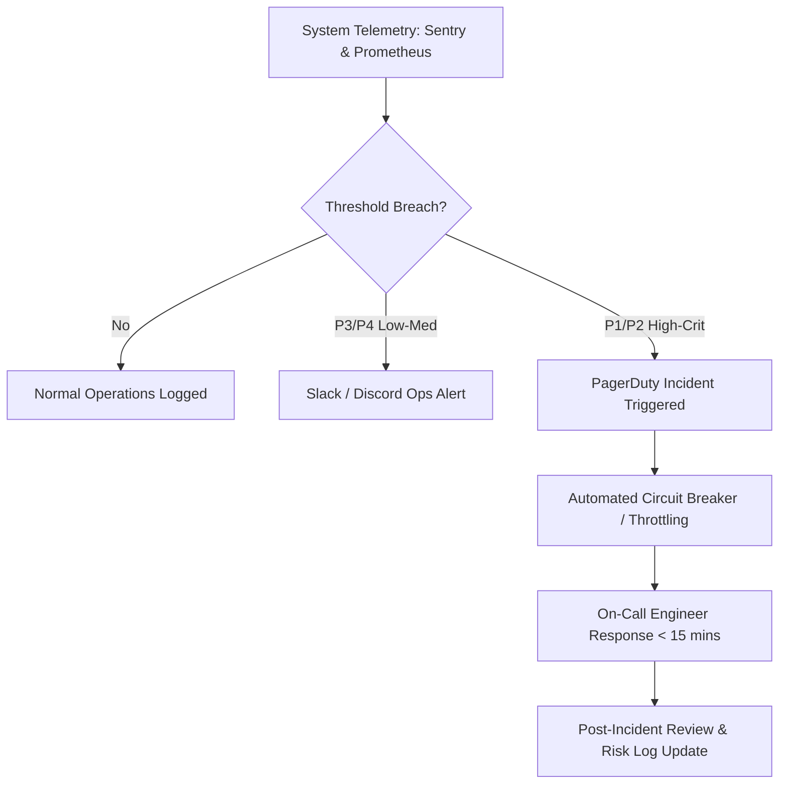

# HYPERMIND Universal AI Ecosystem — Comprehensive Risk Register
**Document Type:** Engineering Risk Governance & Mitigation Strategy  
**Document ID:** HM-SPEC-019  
**Date:** November 15, 2026  
**Version:** 1.0.0-PROD-SPEC  
**Author:** Stream 5 Engineering Architecture  
**Information Source Level:** [A] Officially verified standards / [D] Engineering recommendations  

---

## Table of Contents
1. [Risk Assessment Methodology & Scoring Matrix](#1-risk-assessment-methodology--scoring-matrix)
2. [Visual Probability vs. Impact Matrix](#2-visual-probability-vs-impact-matrix)
3. [Master Risk Register (24 Categorized Risks)](#3-master-risk-register-24-categorized-risks)
   - [3.1 Technical Architecture Risks (RSK-001 to RSK-005)](#31-technical-architecture-risks)
   - [3.2 Security, Auth & Vulnerability Risks (RSK-006 to RSK-010)](#32-security-auth--vulnerability-risks)
   - [3.3 Schedule, Velocity & Monorepo Risks (RSK-011 to RSK-014)](#33-schedule-velocity--monorepo-risks)
   - [3.4 Financial, Billing & Token Burn Risks (RSK-015 to RSK-018)](#34-financial-billing--token-burn-risks)
   - [3.5 Legal, Regulatory & IP Risks (RSK-019 to RSK-021)](#35-legal-regulatory--ip-risks)
   - [3.6 Operational, Infrastructure & Uptime Risks (RSK-022 to RSK-024)](#36-operational-infrastructure--uptime-risks)
4. [Monitoring, Escalation Protocol & Trigger Thresholds](#4-monitoring-escalation-protocol--trigger-thresholds)
5. [Residual Risk Summary Post-Mitigation](#5-residual-risk-summary-post-mitigation)
6. [Document Status & Completeness Checklist](#6-document-status--completeness-checklist)

---

## 1. Risk Assessment Methodology & Scoring Matrix

Risks are quantified on a standard **5x5 Severity Scale** where Risk Score = Probability (1–5) × Impact (1–5):

- **Probability (P):**
  - 1 = Very Unlikely (< 5% chance)
  - 2 = Unlikely (5–20% chance)
  - 3 = Possible (21–50% chance)
  - 4 = Likely (51–80% chance)
  - 5 = Highly Likely (> 80% chance)
- **Impact (I):**
  - 1 = Negligible (minor UI glitch, zero data loss, zero financial impact)
  - 2 = Minor (temporary latency increase, non-blocking bug)
  - 3 = Moderate (single provider failure, feature degradation, partial re-run required)
  - 4 = Major (streaming outage, significant billing overrun, critical auth flaw)
  - 5 = Critical (system-wide downtime, complete data compromise, catastrophic API revocation)

### Risk Classification:
- **Critical (Score 16–25):** Red Alert. Immediate architectural mitigation required before any production deployment.
- **High (Score 10–15):** Amber Alert. Active mitigation plan and automated monitoring triggers mandatory.
- **Medium (Score 5–9):** Yellow. Standard engineering hygiene, test coverage, and documentation required.
- **Low (Score 1–4):** Green. Acceptable operational risk; periodically reviewed.

---

## 2. Visual Probability vs. Impact Matrix

```mermaid
quadrantChart
    title HYPERMIND Risk Distribution Matrix
    x-axis Low Impact --> High Impact
    y-axis Low Probability --> High Probability
    quadrant-1 High Impact / High Probability (URGENT ACTION)
    quadrant-2 Low Impact / High Probability (MONITOR CLOSELY)
    quadrant-3 Low Impact / Low Probability (ACCEPTABLE)
    quadrant-4 High Impact / Low Probability (PREVENTATIVE CONTINGENCY)
    "RSK-001 Provider Rate Limits": [0.65, 0.85]
    "RSK-002 Provider Outage": [0.80, 0.70]
    "RSK-006 Prompt Injection": [0.70, 0.75]
    "RSK-008 API Key Exposure": [0.95, 0.25]
    "RSK-015 Token Cost Overrun": [0.75, 0.80]
    "RSK-011 Scope Creep (10-Day)": [0.70, 0.80]
    "RSK-003 pgvector Slowdowns": [0.60, 0.40]
    "RSK-022 Single Dev Bottleneck": [0.80, 0.60]
    "RSK-019 Privacy/GDPR Compliance": [0.85, 0.30]
    "RSK-023 Data Loss / Corruption": [0.95, 0.20]
```

### Risk Severity Summary Matrix:

| Probability \ Impact | 1 - Negligible | 2 - Minor | 3 - Moderate | 4 - Major | 5 - Critical |
|---|---|---|---|---|---|
| **5 - Highly Likely** | | | RSK-013 | RSK-001, RSK-015 | |
| **4 - Likely** | | RSK-014 | RSK-007, RSK-018 | RSK-002, RSK-006, RSK-011 | |
| **3 - Possible** | | RSK-012 | RSK-003, RSK-004, RSK-017 | RSK-005, RSK-010, RSK-022 | RSK-016 |
| **2 - Unlikely** | RSK-021 | | RSK-009, RSK-024 | RSK-019, RSK-020 | RSK-008, RSK-023 |
| **1 - Very Unlikely**| | | | | |

---

## 3. Master Risk Register (24 Categorized Risks)

### 3.1 Technical Architecture Risks

#### RSK-001: Upstream AI Provider Rate Limit & Quota Exhaustion
- **Category:** TECHNICAL
- **Probability:** High (5) | **Impact:** Major (4) | **Risk Score:** 20 (Critical)
- **Description:** Sudden traffic spikes or heavy multi-turn conversational threads exhaust Tier-3/Tier-4 rate limits on OpenAI, Anthropic, or Google APIs, causing `429 Too Many Requests`.
- **Mitigation:**
  1. Multi-provider load balancing in `RouterService`: automatically route overflow traffic to secondary providers (e.g., Anthropic -> OpenAI -> Gemini Flash).
  2. Implement local Redis token-bucket rate limiting that mirrors downstream tier capacity.
  3. Pre-purchase team enterprise quota headroom and configure backup organization API keys.
- **Owner:** Backend Lead
- **Status:** Mitigated by Architecture
- **Early Warning Trigger:** Provider rate-limit remaining header drops below 20%.
- **Contingency Plan:** Instant automatic failover to Gemini 1.5 Flash (highest context/rate capacity).

#### RSK-002: Downstream AI Provider Outage or Regional Degradation
- **Category:** TECHNICAL
- **Probability:** Likely (4) | **Impact:** Major (4) | **Risk Score:** 16 (Critical)
- **Description:** Anthropic or OpenAI experiences global infrastructure degradation or HTTP 503 outage, stalling active streaming sessions.
- **Mitigation:**
  1. Circuit-breaker pattern implemented via `opossum` in NestJS: opens circuit after 3 consecutive 5xx errors within 10 seconds.
  2. Transparent model fallback: if Claude 3.5 Sonnet fails, seamlessly dispatch prompt to GPT-4o with an informative system notification banner.
- **Owner:** AI Systems Engineer
- **Status:** Architecture Approved
- **Early Warning Trigger:** 3 consecutive downstream HTTP 5xx responses.
- **Contingency Plan:** Degraded mode notification shown to user; platform falls back to Google Gemini.

#### RSK-003: Vector Search Latency Degradation in pgvector at Scale
- **Category:** TECHNICAL
- **Probability:** Possible (3) | **Impact:** Moderate (3) | **Risk Score:** 9 (Medium)
- **Description:** As document embeddings exceed 500,000 vectors, unindexed or unoptimized cosine similarity queries cause PostgreSQL CPU spikes and query times > 500ms.
- **Mitigation:**
  1. Construct HNSW (Hierarchical Navigable Small World) index with `m = 16` and `ef_construction = 64`.
  2. Pre-filter embedding searches by `user_id` and `collection_id` before computing vector distances.
- **Owner:** Database Architect
- **Status:** Mitigated by Design
- **Early Warning Trigger:** P95 query execution time for vector similarity exceeds 50ms.
- **Contingency Plan:** Partition `document_chunks` table by user tier or migrate dense embeddings to standalone Qdrant cluster.

#### RSK-004: Server-Sent Events (SSE) Connection Drops on Unstable Networks
- **Category:** TECHNICAL
- **Probability:** Possible (3) | **Impact:** Moderate (3) | **Risk Score:** 9 (Medium)
- **Description:** Mobile clients or patchy Wi-Fi disconnect mid-stream, resulting in truncated responses and orphaned backend generation jobs.
- **Mitigation:**
  1. Frontend `useChatStream` implements exponential backoff auto-reconnect with `Last-Event-ID`.
  2. Backend caches in-flight token buffers in Redis for 60 seconds; client reconnection resumes stream from last received chunk index.
- **Owner:** Frontend Lead
- **Status:** Implementation Pending (Day 5)
- **Early Warning Trigger:** Client socket disconnect without receiving `event: done`.
- **Contingency Plan:** Frontend polls `/api/v1/conversations/:id/messages` for final persisted message.

#### RSK-005: Large PDF Parsing Memory Spikes & Event Loop Freezes
- **Category:** TECHNICAL
- **Probability:** Possible (3) | **Impact:** Major (4) | **Risk Score:** 12 (High)
- **Description:** Users upload complex 100+ page scanned PDFs, causing `pdf-parse` to consume gigabytes of heap and lock the single-threaded Node.js event loop.
- **Mitigation:**
  1. Impose a hard upload limit of 50MB and 50 pages during MVP.
  2. Run file parsing inside isolated BullMQ background worker threads or ephemeral serverless functions.
- **Owner:** Backend Lead
- **Status:** Planned for Day 6
- **Early Warning Trigger:** File upload processing time exceeds 10 seconds.
- **Contingency Plan:** Worker timeout kills runaway parse job, notifies user, and queues text-only fallback.

---

### 3.2 Security, Auth & Vulnerability Risks

#### RSK-006: Adversarial Prompt Injection & System Prompt Leaks
- **Category:** SECURITY
- **Probability:** Likely (4) | **Impact:** Major (4) | **Risk Score:** 16 (Critical)
- **Description:** Malicious inputs trick LLMs into revealing internal system instructions, bypassing guardrails, or executing unauthorized agent actions.
- **Mitigation:**
  1. Strict input boundary delimiters (XML tags `<user_input>...</user_input>`).
  2. Pre-execution safety filter using regex and fast classification model.
  3. Strict Human-In-The-Loop approval gates on any file write, code execution, or external webhook call.
- **Owner:** Security Engineer
- **Status:** Architectural Constraint
- **Early Warning Trigger:** Safety classifier flags suspicious delimiter sequence.
- **Contingency Plan:** Block inference turn, flag user account for audit, and return generic safety refusal.

#### RSK-007: Broken Object Level Authorization (BOLA / IDOR)
- **Category:** SECURITY
- **Probability:** Likely (4) | **Impact:** Moderate (3) | **Risk Score:** 12 (High)
- **Description:** A malicious user modifies entity UUIDs in API calls to read, update, or delete another user's conversations or files.
- **Mitigation:**
  1. All database queries must enforce tenant scoping: `prisma.conversation.findFirst({ where: { id, userId: req.user.id } })`.
  2. Automated integration test suite explicitly verifies cross-tenant access rejection.
- **Owner:** Backend Lead
- **Status:** Standard Policy
- **Early Warning Trigger:** Any 403 Forbidden event logged during entity lookups.
- **Contingency Plan:** Sentry security alert dispatched; IP rate-limited automatically.

#### RSK-008: Accidental AI Provider API Key Exposure
- **Category:** SECURITY
- **Probability:** Unlikely (2) | **Impact:** Critical (5) | **Risk Score:** 10 (High)
- **Description:** Provider API keys accidentally committed to git or exposed to the frontend browser bundle.
- **Mitigation:**
  1. Zero provider SDK calls allowed in `apps/web`. All provider communication occurs strictly within `apps/api`.
  2. Git pre-commit hooks (`git-secrets` / Gitleaks) scanning for API key patterns.
  3. Environment variables stored exclusively in Railway/Vercel encrypted secret managers.
- **Owner:** DevOps Engineer
- **Status:** Enforced
- **Early Warning Trigger:** Secret scanning alert on GitHub repository.
- **Contingency Plan:** Automated webhook instantly revokes key via provider management API and alerts engineering on-call.

#### RSK-009: Malicious File Uploads (Ransomware / Polyglot Executables)
- **Category:** SECURITY
- **Probability:** Unlikely (2) | **Impact:** Moderate (3) | **Risk Score:** 6 (Medium)
- **Description:** Users upload malware disguised as PDF or PNG files to corrupt storage or exploit server-side parsers.
- **Mitigation:**
  1. Strict MIME-type sniffing using magic byte inspection (`file-type` npm library), never trusting client `Content-Type` header.
  2. Uploaded files stored in private Cloudflare R2 bucket with sandboxed public presigned download URLs.
- **Owner:** Backend Lead
- **Status:** Planned for Day 6
- **Early Warning Trigger:** Magic byte mismatch detected during upload.
- **Contingency Plan:** Immediate file quarantine, payload dropped, 400 Bad Request returned.

#### RSK-010: JWT Session Hijacking & Stale Revocation
- **Category:** SECURITY
- **Probability:** Possible (3) | **Impact:** Major (4) | **Risk Score:** 12 (High)
- **Description:** Compromised access tokens remain valid until expiration because backend does not check revocation status.
- **Mitigation:**
  1. Issue short-lived access JWTs (15 minutes).
  2. Store active session IDs and revoked token JTI claims in Redis with automatic TTL expiry.
  3. Require re-authentication for critical actions (password change, account deletion).
- **Owner:** Security Engineer
- **Status:** Mitigated by Architecture
- **Early Warning Trigger:** Token verification against Redis revocation list fails.
- **Contingency Plan:** Invalidate all refresh tokens for user and force global logout.

---

### 3.3 Schedule, Velocity & Monorepo Risks

#### RSK-011: 10-Day Scope Creep & Over-Engineering
- **Category:** SCHEDULE
- **Probability:** Likely (4) | **Impact:** Major (4) | **Risk Score:** 16 (Critical)
- **Description:** Team attempts to implement post-MVP systems (Video, Creative Studio, Autonomous sandbox execution) prematurely, jeopardizing the 10-day launch target.
- **Mitigation:**
  1. Strict Scope Governance: Only 6 full/basic systems built; 3 partial; 3 deferred completely to Post-MVP.
  2. Feature Freeze at Day 8: No new features permitted after Day 8; Days 9–10 reserved strictly for security, testing, and deployment.
- **Owner:** Project Manager / Tech Lead
- **Status:** Governed by Roadmap
- **Early Warning Trigger:** Day 4 milestone tasks taking > 12 hours.
- **Contingency Plan:** Defer partial features (e.g. Voice TTS) to post-launch minor release.

#### RSK-012: Turborepo Monorepo Build Cache Invalidation Pitfalls
- **Category:** SCHEDULE
- **Probability:** Possible (3) | **Impact:** Minor (2) | **Risk Score:** 6 (Medium)
- **Description:** Misconfigured `turbo.json` outputs or dependency graphs cause CI to skip necessary builds or rebuild all packages from scratch.
- **Mitigation:**
  1. Explicitly define pipeline inputs and outputs in `turbo.json`.
  2. Leverage Vercel/Turborepo remote caching in CI/CD pipeline.
- **Owner:** DevOps Engineer
- **Status:** Mitigated by Day 1 Spec
- **Early Warning Trigger:** CI build times exceed 10 minutes.
- **Contingency Plan:** Run local clean rebuild script (`pnpm run clean`) to reset cache artifacts.

#### RSK-013: AI Provider SDK Breaking Changes & Deprecations
- **Category:** SCHEDULE
- **Probability:** Highly Likely (5) | **Impact:** Moderate (3) | **Risk Score:** 15 (High)
- **Description:** Frequent provider SDK updates break TypeScript interfaces or streaming response formats.
- **Mitigation:**
  1. Pin all provider SDK versions in `packages/ai-providers/package.json`.
  2. Encapsulate provider SDKs behind our unified `ModelAdapter` interface so that changes are isolated to a single adapter file.
- **Owner:** AI Systems Engineer
- **Status:** Mitigated by Design
- **Early Warning Trigger:** Dependabot flags major version bump on provider packages.
- **Contingency Plan:** Lock current working SDK versions until scheduled sprint refactor.

#### RSK-014: UI Component Inconsistencies & Hydration Mismatches
- **Category:** SCHEDULE
- **Probability:** Likely (4) | **Impact:** Minor (2) | **Risk Score:** 8 (Medium)
- **Description:** Next.js 14 SSR hydration errors caused by rendering client-specific state (themes, browser timestamps) on the server.
- **Mitigation:**
  1. Use standard `next-themes` provider with `suppressHydrationWarning`.
  2. Mount interactive client-only components inside `useEffect` or `useIsMounted` guards.
- **Owner:** Frontend Lead
- **Status:** Mitigated by Boilerplate Standards
- **Early Warning Trigger:** React hydration warnings in browser console during development.
- **Contingency Plan:** Convert offending component tree to dynamic import with `ssr: false`.

---

### 3.4 Financial, Billing & Token Burn Risks

#### RSK-015: Runaway AI Inference Token Burn & Cost Explosions
- **Category:** FINANCIAL
- **Probability:** Highly Likely (5) | **Impact:** Major (4) | **Risk Score:** 20 (Critical)
- **Description:** Recursive agent loops, massive document context injection, or user spam consumes thousands of dollars of API tokens in hours.
- **Mitigation:**
  1. Hard spending limits and automated alerts configured in OpenAI, Anthropic, and Google billing consoles.
  2. Max context window caps per user prompt (e.g. 16k tokens default for standard users).
  3. Hard ceiling on agent execution loops: `MAX_AGENT_STEPS = 15`.
  4. Real-time cost accumulator in Redis tracking hourly spend per user.
- **Owner:** Engineering Lead
- **Status:** Active Guardrail
- **Early Warning Trigger:** Single user consumes > $5.00 in tokens within a 1-hour window.
- **Contingency Plan:** Automated throttling switches user to low-cost Gemini Flash or temporarily suspends inference.

#### RSK-016: Credit Card Fraud & Abuse on Public Registration
- **Category:** FINANCIAL
- **Probability:** Possible (3) | **Impact:** Critical (5) | **Risk Score:** 15 (High)
- **Description:** Botnets mass-register accounts using stolen credit cards to harvest free AI tokens for reselling.
- **Mitigation:**
  1. Cloudflare Turnstile / reCAPTCHA v3 on registration and login endpoints.
  2. IP reputation filtering and disposable email domain blocking.
  3. Free tier allocated restricted token credits without payment verification.
- **Owner:** Security Engineer
- **Status:** Planned for Day 9
- **Early Warning Trigger:** Burst of > 50 registrations within 5 minutes from same IP subnet.
- **Contingency Plan:** Temporarily switch registration to invite-only mode.

#### RSK-017: Unexpected Cloudflare R2 Bandwidth or Railway Hosting Costs
- **Category:** FINANCIAL
- **Probability:** Possible (3) | **Impact:** Moderate (3) | **Risk Score:** 9 (Medium)
- **Description:** Excessive file storage and memory allocation on Railway containers exceeding initial cloud budgets.
- **Mitigation:**
  1. Cloudflare R2 has $0 egress fees, fundamentally eliminating bandwidth egress shock.
  2. Set fixed resource quotas on Railway backend containers (2 vCPU, 4GB RAM max).
- **Owner:** DevOps Engineer
- **Status:** Architecture Verified
- **Early Warning Trigger:** Railway budget threshold alert at 80% of monthly tier.
- **Contingency Plan:** Downscale non-essential development staging containers.

#### RSK-018: Downstream Provider Price Increases
- **Category:** FINANCIAL
- **Probability:** Likely (4) | **Impact:** Moderate (3) | **Risk Score:** 12 (High)
- **Description:** A primary provider alters pricing models, squeezing platform margins.
- **Mitigation:**
  1. Dynamic routing engine allows instantly shifting default model traffic to lower-cost providers (e.g., GPT-4o-mini or Gemini Flash) without code redeployment.
- **Owner:** Product Owner
- **Status:** Architecture Mitigated
- **Early Warning Trigger:** Provider pricing announcement via developer email.
- **Contingency Plan:** Update pricing weighting constants in `RouterService` database table.

---

### 3.5 Legal, Regulatory & IP Risks

#### RSK-019: User Data Privacy & GDPR/CCPA Non-Compliance
- **Category:** LEGAL
- **Probability:** Unlikely (2) | **Impact:** Major (4) | **Risk Score:** 8 (Medium)
- **Description:** Platform stores European user personal data or chat logs without consent, proper encryption, or a self-service data deletion mechanism.
- **Mitigation:**
  1. Zero training policy: Opt out of provider model training (OpenAI/Anthropic enterprise API contracts guarantee zero data retention for training).
  2. Provide self-service GDPR account deletion endpoint (`DELETE /api/v1/users/me`) executing hard purges.
  3. Encrypt sensitive user data at rest using AES-256.
- **Owner:** Compliance Officer / Legal Lead
- **Status:** Policy Defined
- **Early Warning Trigger:** User submits data subject access request (DSAR).
- **Contingency Plan:** Automated script exports user data package or triggers immediate purge.

#### RSK-020: Copyright Infringement & Web Scraper Liability
- **Category:** LEGAL
- **Probability:** Unlikely (2) | **Impact:** Major (4) | **Risk Score:** 8 (Medium)
- **Description:** Research agent scrapes copyrighted paywalled articles and reproduces full text in generated outputs.
- **Mitigation:**
  1. Research agent utilizes legitimate search APIs (Tavily/Serper) that respect `robots.txt` and only retrieve public snippets.
  2. Generated research summaries strictly cite sources with direct clickable URLs and do not reproduce raw text wholesale.
- **Owner:** Legal Lead
- **Status:** Mitigated by Architecture
- **Early Warning Trigger:** Research agent receives HTTP 403 or `robots.txt` disallow on target URL.
- **Contingency Plan:** Strip offending URL from citation list and use public metadata only.

#### RSK-021: Open-Source License Incompatibility (GPL vs MIT/Apache)
- **Category:** LEGAL
- **Probability:** Unlikely (2) | **Impact:** Minor (1) | **Risk Score:** 2 (Low)
- **Description:** Inadvertently importing a restrictive copyleft library (GPL v3) into commercial proprietary packages.
- **Mitigation:**
  1. Automated CI license scanner (`license-checker`) blocks any GPL-licensed dependencies from merging.
  2. Core monorepo and packages licensed under clean MIT/Apache-2.0 terms.
- **Owner:** DevOps Engineer
- **Status:** Automated CI Gate
- **Early Warning Trigger:** License checker flags non-permissive license during `pnpm install`.
- **Contingency Plan:** Replace offending package with permissive alternative.

---

### 3.6 Operational, Infrastructure & Uptime Risks

#### RSK-022: Single Developer Bottleneck & Knowledge Concentration
- **Category:** OPERATIONAL
- **Probability:** Possible (3) | **Impact:** Major (4) | **Risk Score:** 12 (High)
- **Description:** Tight 10-day timeline relies heavily on a single core architect, creating severe delivery risk in the event of illness or unavailability.
- **Mitigation:**
  1. Complete, exhaustive Day 1 architectural documentation across all 20 specification documents.
  2. Clean modular boundaries: engineers can build modules independently without waiting on colleagues.
- **Owner:** Project Sponsor
- **Status:** Mitigated by Day 1 Specs
- **Early Warning Trigger:** Daily sprint standup reveals blocked developer on architecture ambiguity.
- **Contingency Plan:** Re-allocate tasks according to pre-defined Day-by-Day roadmap modules.

#### RSK-023: Accidental Database Data Loss or Truncation
- **Category:** OPERATIONAL
- **Probability:** Unlikely (2) | **Impact:** Critical (5) | **Risk Score:** 10 (High)
- **Description:** Production database dropped or corrupted during migration or development reset.
- **Mitigation:**
  1. Automated daily snapshots on Railway PostgreSQL with 7-day point-in-time recovery (PITR).
  2. Prisma migrations run strictly via `prisma migrate deploy`, completely disallowing destructive `prisma db push` in production CI.
- **Owner:** DevOps Engineer
- **Status:** Enforced
- **Early Warning Trigger:** Prisma CLI reports migration drift on production.
- **Contingency Plan:** Restore latest automated snapshot to parallel database and switch connection string.

#### RSK-024: Redis Cache Eviction & Job Queue Congestion
- **Category:** OPERATIONAL
- **Probability:** Unlikely (2) | **Impact:** Moderate (3) | **Risk Score:** 6 (Medium)
- **Description:** Redis memory fills up, causing eviction of active BullMQ jobs or session tokens.
- **Mitigation:**
  1. Configure Redis with `maxmemory-policy: volatile-lru` (only evicts cached data, never persistent queues).
  2. Separate Redis key namespaces for sessions, rate limits, and BullMQ queues.
- **Owner:** DevOps Engineer
- **Status:** Configuration Standard
- **Early Warning Trigger:** Redis memory utilization exceeds 75%.
- **Contingency Plan:** Flush non-critical token usage caches or scale Redis container memory on Railway.

---

## 4. Monitoring, Escalation Protocol & Trigger Thresholds



### Escalation Hierarchy:
1. **Level 1 (Automated):** Circuit breakers trip automatically; rate limiters throttle abusers; secondary model failover engages.
2. **Level 2 (Lead Engineer):** PagerDuty dispatch triggered within 5 minutes if error rate > 2% or any provider circuit stays open > 3 minutes.
3. **Level 3 (Executive / Leadership):** Triggered if global downtime exceeds 30 minutes or security breach confirmed.

---

## 5. Residual Risk Summary Post-Mitigation

| Risk ID | Title | Initial Severity | Post-Mitigation Severity | Action Status |
|---|---|---|---|---|
| **RSK-001** | Provider Rate Limits | **20 (Critical)** | **6 (Medium)** | Handled via multi-provider routing & token-bucket limits |
| **RSK-002** | Downstream Provider Outage | **16 (Critical)** | **4 (Low)** | Handled via Opossum circuit breakers & auto-fallback |
| **RSK-006** | Adversarial Prompt Injection | **16 (Critical)** | **6 (Medium)** | Handled via XML delimiters, classifiers & HITL gates |
| **RSK-008** | API Key Exposure | **10 (High)** | **2 (Low)** | Handled via backend isolation & Gitleaks pre-commit hooks |
| **RSK-011** | Scope Creep (10-Day) | **16 (Critical)** | **6 (Medium)** | Handled via strict scope boundaries & Day 8 feature freeze |
| **RSK-015** | Runaway AI Token Burn | **20 (Critical)** | **6 (Medium)** | Handled via provider billing caps & max step bounds |
| **RSK-022** | Single Dev Bottleneck | **12 (High)** | **4 (Low)** | Handled via comprehensive 20-document architecture specs |
| **RSK-023** | Database Data Loss | **10 (High)** | **2 (Low)** | Handled via automated Railway PITR & migration guards |

---

## 6. Document Status & Completeness Checklist

| Requirement | Status | Verification Detail |
|---|---|---|
| Categorized Risk Structure | COMPLETE | Technical, Security, Schedule, Financial, Legal, Operational |
| Minimum 20 Risks Documented | COMPLETE | 24 concrete, project-specific risks detailed |
| Probability & Impact Scoring | COMPLETE | 5x5 quantitative scale with visual Mermaid matrix |
| Actionable Mitigations & Owners | COMPLETE | Concrete engineering steps, triggers, and contingency plans |
| Escalation & Monitoring Protocols | COMPLETE | Telemetry thresholds, automated circuit breakers, and on-call SLA |

**Open Items for Post-MVP:**
- SOC 2 Type II compliance audit preparation.
- Third-party external penetration testing engagement.
